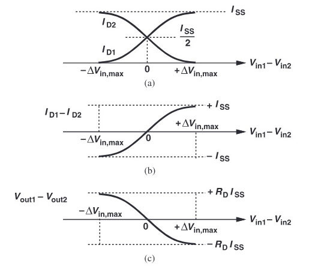

# 장말문제 10.49 — 산화막 두께 2배, V_TH 반감, I_SS와 W/L 반감이 Fig 10.33 특성에 주는 영향

## 원문
Explain what happens to the characteristics shown in Fig. 10.33 if (a) the gate oxide thickness of the transistor is doubled, (b) the threshold voltage is halved, (c) $I_{SS}$ and $W/L$ are halved.

## 조건
- Fig 10.33의 특성: MOS 차동쌍의 (a) 드레인 전류, (b) 드레인 전류 차, (c) 차동 출력 전압을 입력 $V_{in1} - V_{in2}$의 함수로 그린 그래프
- 세 경우: (a) 트랜지스터의 게이트 산화막 두께가 2배가 됨, (b) 문턱 전압이 절반이 됨, (c) $I_{SS}$와 $W/L$이 절반이 됨

## 구할 것
- (a), (b), (c) 각 경우에 Fig 10.33의 특성이 어떻게 되는지 설명

## 상속·참조
- 본문 Fig 10.33 (교재 533쪽, PDF 19): 특성 그래프 (회로 그림 아님). 세 그래프 모두 가로축 $V_{in1} - V_{in2}$ (오른쪽 화살표, 가운데 0), 눈금 $-\Delta V_{in,max}$, $+\Delta V_{in,max}$
  - (a) 드레인 전류: $I_{D1}$은 $-\Delta V_{in,max}$에서 0으로 시작해 올라가 $+\Delta V_{in,max}$에서 점선 $I_{SS}$ 레벨에 닿음, $I_{D2}$는 $-\Delta V_{in,max}$의 $I_{SS}$에서 $+\Delta V_{in,max}$의 0으로 내려감. 두 곡선은 0에서 점선 $I_{SS}/2$ 레벨로 교차 (0에 세로 점선)
  - (b) $I_{D1} - I_{D2}$: $-\Delta V_{in,max}$에서 점선 $-I_{SS}$ 레벨로 시작해 0을 지나 $+\Delta V_{in,max}$에서 점선 $+I_{SS}$ 레벨에 닿음. $\pm\Delta V_{in,max}$에 세로 점선
  - (c) $V_{out1} - V_{out2}$: $-\Delta V_{in,max}$에서 점선 $+R_D I_{SS}$ 레벨로 시작해 0을 지나 $+\Delta V_{in,max}$에서 점선 $-R_D I_{SS}$ 레벨로 내려감. $\pm\Delta V_{in,max}$에 세로 점선
- Fig 10.33의 회로는 본문 Fig 10.31 (교재 530쪽, PDF 18, 이 파일의 그림 목록에는 넣지 않음, 크롭은 fig10-31.png). 연결: `R_D: VDD – Vout1`, `R_D: VDD – Vout2`, `M1: D = Vout1, G = Vin1, S = 공통 소스 노드`, `M2: D = Vout2, G = Vin2, S = 공통 소스 노드`, `I_SS: 공통 소스 노드 → 접지`
- 한 트랜지스터가 꺼지는 경계 (교재 532–533쪽, $\lambda = 0$, 제곱 법칙 $I_D = \frac{1}{2}\mu_n C_{ox}\frac{W}{L}(V_{GS} - V_{TH})^2$):
  $$|V_{in1} - V_{in2}|_{max} = \sqrt{\frac{2I_{SS}}{\mu_n C_{ox}\dfrac{W}{L}}} \qquad (10.150)$$
  $$|V_{in1} - V_{in2}|_{max} = \sqrt{2}(V_{GS} - V_{TH})_{equil} \qquad (10.151)$$
  본문(교재 533쪽)은 $\Delta V_{in} = V_{in1} - V_{in2}$로 두고, 그림의 $\pm\Delta V_{in,max}$를 이 경계 값으로 씀 ($\Delta V_{in} > \Delta V_{in,max}$이면 완전히 비선형)
- 식 (10.147) (교재 532쪽): $I_{D1} - I_{D2} = \frac{1}{2}\mu_n C_{ox}\frac{W}{L}(V_{in1} - V_{in2})\sqrt{\dfrac{4I_{SS}}{\mu_n C_{ox}W/L} - (V_{in1} - V_{in2})^2}$, 출력 $V_{out1} - V_{out2} = -R_D(I_{D1} - I_{D2})$ (10.131)–(10.132)
- $C_{ox} = \varepsilon_{ox}/t_{ox}$ (산화막 두께에 반비례) (원문에 없음)

## 회로 — 없음 (특성 그래프 문제, 그림 10.33은 회로가 아닌 그래프로 상속·참조에 적음)

## 풀이
### 특성을 정하는 두 값
- $K = \mu_n C_{ox} W/L$로 두면 전류 곡선은 세로로 $I_{SS}$(출력은 $R_D I_{SS}$)까지, 가로로 $\Delta V_{in,max} = \sqrt{2I_{SS}/K}$까지 뻗는다
- 원점 기울기는 $G_m = \sqrt{K I_{SS}}$ (출력 쪽은 $R_D$배). $V_{TH}$는 식 (10.147)에 없다
### (a) 산화막 두께 2배
- $C_{ox} = \varepsilon_{ox}/t_{ox}$가 절반이라 $K$가 절반: $\Delta V_{in,max}$는 $\sqrt{2} = 1.41$배, $G_m$은 $1/\sqrt{2} = 0.707$배
- 한계 $I_{SS}$, $I_{SS}/2$, $\pm I_{SS}$, $\pm R_D I_{SS}$는 그대로
### (b) 문턱 전압 절반
- 차동 특성은 $V_{in1} - V_{in2}$에만 의존하고 $V_{TH}$가 들어가지 않으므로 세 그래프 모두 그대로다
- 달라지는 것은 직류 레벨뿐: 같은 입력 공통 모드에서 $V_{GS}$가 $V_{TH}/2$만큼 작아져 공통 소스 노드 전압이 그만큼 올라간다
### (c) $I_{SS}$와 $W/L$ 절반
- $I_{SS}/K$가 그대로라 $\Delta V_{in,max}$와 평형 과구동은 그대로
- 세로 한계는 절반($I_{SS}/2$, $\pm R_D I_{SS}/2$, $R_D$ 불변으로 봄), $G_m$은 $\sqrt{1/4} = 0.5$배
### 답
- (a) 곡선이 가로로 $\sqrt{2}$배 늘어난다: $\Delta V_{in,max}$가 $1.41$배, 원점 기울기가 $0.707$배, 전류·출력 한계는 그대로
- (b) 그래프는 변하지 않는다. 공통 소스 노드 등 직류 레벨만 $V_{TH}/2$만큼 옮겨진다
- (c) 곡선이 세로로 절반이 된다: 전류·출력 한계와 원점 기울기가 절반, $\Delta V_{in,max}$는 그대로
