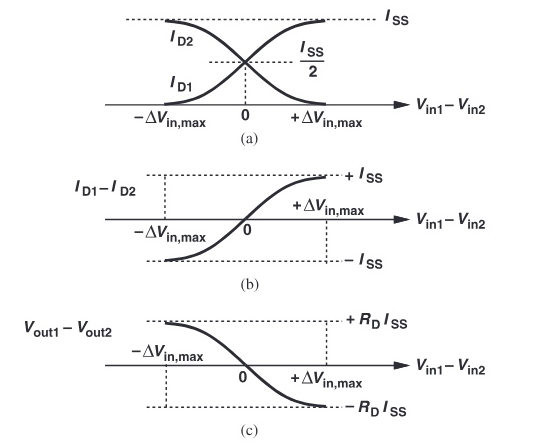

# 장말문제 10.50 — 온도가 오를 때(이동도 감소) Fig 10.33 특성의 변화

## 원문
Assuming that the mobility of carriers falls at high temperatures, explain what happens to the characteristics of Fig. 10.33 as the temperature rises.

## 조건
- Fig 10.33의 특성: MOS 차동쌍의 (a) 드레인 전류, (b) 드레인 전류 차, (c) 차동 출력 전압을 입력 $V_{in1} - V_{in2}$의 함수로 그린 그래프
- 캐리어 이동도는 높은 온도에서 떨어진다고 가정

## 구할 것
- 온도가 오를 때 Fig 10.33의 특성이 어떻게 되는지 설명

## 상속·참조
- 본문 Fig 10.33 (교재 533쪽, PDF 19): 특성 그래프 (회로 그림 아님). 세 그래프 모두 가로축 $V_{in1} - V_{in2}$ (오른쪽 화살표, 가운데 0), 눈금 $-\Delta V_{in,max}$, $+\Delta V_{in,max}$
  - (a) 드레인 전류: $I_{D1}$은 $-\Delta V_{in,max}$에서 0으로 시작해 올라가 $+\Delta V_{in,max}$에서 점선 $I_{SS}$ 레벨에 닿음, $I_{D2}$는 $-\Delta V_{in,max}$의 $I_{SS}$에서 $+\Delta V_{in,max}$의 0으로 내려감. 두 곡선은 0에서 점선 $I_{SS}/2$ 레벨로 교차 (0에 세로 점선)
  - (b) $I_{D1} - I_{D2}$: $-\Delta V_{in,max}$에서 점선 $-I_{SS}$ 레벨로 시작해 0을 지나 $+\Delta V_{in,max}$에서 점선 $+I_{SS}$ 레벨에 닿음. $\pm\Delta V_{in,max}$에 세로 점선
  - (c) $V_{out1} - V_{out2}$: $-\Delta V_{in,max}$에서 점선 $+R_D I_{SS}$ 레벨로 시작해 0을 지나 $+\Delta V_{in,max}$에서 점선 $-R_D I_{SS}$ 레벨로 내려감. $\pm\Delta V_{in,max}$에 세로 점선
- Fig 10.33의 회로는 본문 Fig 10.31 (교재 530쪽, PDF 18, 이 파일의 그림 목록에는 넣지 않음, 크롭은 fig10-31.png). 연결: `R_D: VDD – Vout1`, `R_D: VDD – Vout2`, `M1: D = Vout1, G = Vin1, S = 공통 소스 노드`, `M2: D = Vout2, G = Vin2, S = 공통 소스 노드`, `I_SS: 공통 소스 노드 → 접지`
- 한 트랜지스터가 꺼지는 경계 (교재 532–533쪽, $\lambda = 0$, 제곱 법칙 $I_D = \frac{1}{2}\mu_n C_{ox}\frac{W}{L}(V_{GS} - V_{TH})^2$):
  $$|V_{in1} - V_{in2}|_{max} = \sqrt{\frac{2I_{SS}}{\mu_n C_{ox}\dfrac{W}{L}}} \qquad (10.150)$$
  $$|V_{in1} - V_{in2}|_{max} = \sqrt{2}(V_{GS} - V_{TH})_{equil} \qquad (10.151)$$
  본문(교재 533쪽)은 $\Delta V_{in} = V_{in1} - V_{in2}$로 두고, 그림의 $\pm\Delta V_{in,max}$를 이 경계 값으로 씀 ($\Delta V_{in} > \Delta V_{in,max}$이면 완전히 비선형)
- 식 (10.147) (교재 532쪽): $I_{D1} - I_{D2} = \frac{1}{2}\mu_n C_{ox}\frac{W}{L}(V_{in1} - V_{in2})\sqrt{\dfrac{4I_{SS}}{\mu_n C_{ox}W/L} - (V_{in1} - V_{in2})^2}$, 출력 $V_{out1} - V_{out2} = -R_D(I_{D1} - I_{D2})$ (10.131)–(10.132)

## 회로 — 없음 (특성 그래프 문제, 그림 10.33은 회로가 아닌 그래프로 상속·참조에 적음)
