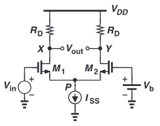

# 장말문제 10.51 — 단일 입력 전압원으로 구동한 MOS 차동쌍(Fig 10.77)의 v_X, v_Y와 차동 이득

## 조건
- 회로: Fig 10.77 — 단일 종단 전압원 하나만 가진 학생이 차동 출력을 얻으려고 만든 회로. $M_1$ 게이트에 $V_{in}$, $M_2$ 게이트에 직류 $V_b$
- 완벽한 대칭
- 간단히 하려고 $\lambda = 0$

## 구할 것
- (a) $M_1$을 $M_2$의 소스에서 본 임피던스로 축퇴된 공통 소스 단으로 보고, $v_X$를 $v_{in}$으로 나타냄
- (b) $M_1$을 소스 팔로워, $M_2$를 공통 게이트 단으로 보고, $v_Y$를 $v_{in}$으로 나타냄
- (c) (a)와 (b)의 결과를 알맞은 극성으로 더함. 전압 이득을 $(v_X - v_Y)/v_{in}$으로 정의하면 차동으로 구동한 쌍의 이득과 비교해 어떠한가?

## 회로 — Fig 10.77
```spice
RD1  VDD  X    {R_D}   ; 두 저항 모두 R_D로 인쇄
RD2  VDD  Y    {R_D}
M1   X    n1   P    nmos
M2   Y    n2   P    nmos    ; 좌우 반전 (게이트 오른쪽)
ISS  P    0    {I_SS}
Vin  n1   0    {V_in}      ; 전압원(원), + = n1 (위)
Vb   n2   0    {V_b}       ; 배터리, + = n2 (위)
* n1 = M1 게이트 (V_in + 단자), n2 = M2 게이트 (V_b + 단자). 그림에 라벨 없음
* X, Y 점에서 안쪽으로 이어진 개방 원 두 개. 두 원 사이에 "V_out" 라벨 하나 (차동 출력)
```
- 단자: VDD = 전원, 값 미지정 (가로 레일) / X, Y = 차동 출력 V_out (개방 원 두 개, X·Y 라벨이 붙은 노드에 이어짐)
- 표시: 노드 라벨 V_DD (레일 오른쪽 끝), X (X 점 왼쪽), Y (Y 점 오른쪽), V_out (두 출력 원 사이), P (P 점 왼쪽 아래) / 소자 라벨 R_D (왼쪽 저항 왼쪽), R_D (오른쪽 저항 오른쪽), M1 (M1 오른쪽), M2 (M2 왼쪽), I_SS (전류원 오른쪽), V_in (전압원 원 왼쪽), V_b (배터리 오른쪽) / 부호 + (V_in 원 오른쪽 위), − (V_in 원 오른쪽 아래), + (배터리 긴 판 왼쪽 위), − (배터리 짧은 판 왼쪽 아래) / 화살표 없음 / 수치·면적 라벨 없음
- 배치: 맨 위 굵은 가로 레일 V_DD / 왼쪽 세로줄 위→아래 R_D, X 점, M1 드레인 / 오른쪽 세로줄 위→아래 R_D, Y 점, M2 드레인 / X 점, Y 점에서 짧은 가로선이 안쪽으로 개방 원 (사이에 V_out 라벨) / M1 nmos 보통 방향(게이트 왼쪽), M2 nmos 좌우 반전(게이트 오른쪽) / M1 게이트 → 왼쪽 가로선 → 아래로 꺾여(┌ 꺾임) V_in 원 위 단자, V_in 원 아래 단자 → 접지 / M2 게이트 → 오른쪽 가로선 → 아래로 꺾여(┌ 꺾임을 좌우 반전) 배터리 V_b 위(긴 판), 배터리 아래(짧은 판) → 접지 / 두 소스는 아래로 내려가 꼬리 가로선 가운데 P 점, P에서 아래로 I_SS(화살표 아래), 그 아래 접지. 접지 세 개(V_in, I_SS, V_b 아래) / 접속점 (세 갈래 이상, 3곳): ① X = 위 R_D + 아래 M1 드레인 + 오른쪽 출력선 (점) ② Y = 위 R_D + 아래 M2 드레인 + 왼쪽 출력선 (점) ③ P = 왼쪽 M1 소스 선 + 오른쪽 M2 소스 선 + 아래 I_SS (점) / 교차: 없음


