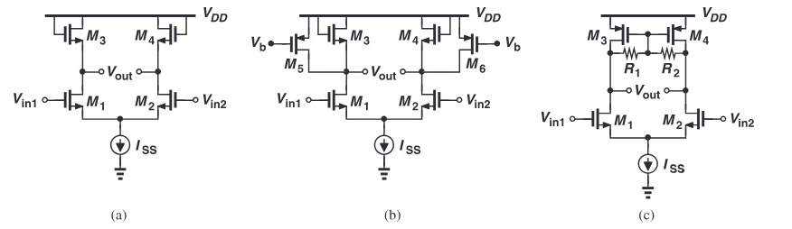

# 장말문제 10.52 — Fig 10.78 (a)–(c) MOS 차동 회로의 차동 전압 이득 (λ > 0)

## 원문
Calculate the differential voltage gain of the circuits depicted in Fig. 10.78. Assume perfect symmetry and $\lambda > 0$.

## 조건
- 회로: Fig 10.78 (a)–(c)의 세 MOS 차동 회로
- 완벽한 대칭
- $\lambda > 0$

## 구할 것
- (a)–(c) 각 회로의 차동 전압 이득 (소문항 표기 없음, 원문은 "the circuits depicted in Fig. 10.78"로 적음)

## 회로 — Fig 10.78(a)
```spice
M3   VDD   VDD   out1  nmos    ; 드레인·게이트 모두 VDD
M4   VDD   VDD   out2  nmos    ; 좌우 반전 (게이트 오른쪽), 드레인·게이트 모두 VDD
M1   out1  Vin1  n1    nmos
M2   out2  Vin2  n1    nmos    ; 좌우 반전 (게이트 오른쪽)
ISS  n1    0     {I_SS}
* n1 = 공통 소스(테일) 노드, 라벨 없음
* out1, out2 = 두 출력 점에서 안쪽으로 이어진 개방 원. 두 원 사이에 "V_out" 라벨 하나 (차동 출력)
```
- 단자: VDD = 전원, 값 미지정 (가로 레일) / Vin1, Vin2 = 입력 (개방 원) / out1, out2 = 차동 출력 V_out (개방 원 두 개, 각 원 옆 라벨 없음)
- 표시: 노드 라벨 V_DD (레일 오른쪽 끝), V_out (두 출력 원 사이), V_in1 (왼쪽 입력 원 왼쪽), V_in2 (오른쪽 입력 원 오른쪽) / 소자 라벨 M3 (M3 오른쪽), M4 (M4 왼쪽), M1 (M1 오른쪽), M2 (M2 왼쪽), I_SS (전류원 오른쪽) / 부호 없음 / 화살표 없음 / 수치·면적 라벨 없음
- 배치: 맨 위 굵은 가로 레일 V_DD / M3 nmos 보통 방향(게이트 왼쪽): 드레인은 위로 레일, 게이트는 왼쪽으로 나가 위로 꺾여 레일 (└ 꺾임), 소스는 아래로 / M4 nmos 좌우 반전(게이트 오른쪽), 게이트가 오른쪽으로 나가 위로 꺾여 레일 (└ 꺾임을 좌우 반전) / 왼쪽 세로줄 위→아래 M3, 출력 점, M1 / 오른쪽 세로줄 위→아래 M4, 출력 점, M2 / 각 출력 점에서 짧은 가로선이 안쪽으로 개방 원 (사이에 V_out 라벨) / M1 nmos 보통 방향(게이트 왼쪽), M2 nmos 좌우 반전(게이트 오른쪽) / V_in1 원 → M1 게이트, V_in2 원 → M2 게이트 / 두 소스는 꼬리 가로선 가운데 n1 점, n1에서 아래로 I_SS(화살표 아래), 그 아래 접지 / 접속점 (세 갈래 이상, 3곳): ① 왼쪽 출력 점 = 위 M3 소스 + 아래 M1 드레인 + 오른쪽 출력선 (점) ② 오른쪽 출력 점 = 위 M4 소스 + 아래 M2 드레인 + 왼쪽 출력선 (점) ③ n1 = 왼쪽 M1 소스 선 + 오른쪽 M2 소스 선 + 아래 I_SS (점) / 교차: 없음

## 회로 — Fig 10.78(b)
```spice
M5   out1  Vb    VDD   pmos    ; 소스 위(레일), 드레인 아래
M3   VDD   VDD   out1  nmos    ; 드레인·게이트 모두 VDD
M4   VDD   VDD   out2  nmos    ; 좌우 반전 (게이트 오른쪽), 드레인·게이트 모두 VDD
M6   out2  Vb    VDD   pmos    ; 좌우 반전 (게이트 오른쪽)
M1   out1  Vin1  n1    nmos
M2   out2  Vin2  n1    nmos    ; 좌우 반전 (게이트 오른쪽)
ISS  n1    0     {I_SS}
* Vb = 왼쪽·오른쪽 두 점 단자 모두 "V_b"로 인쇄 → 같은 노드로 적음
* n1 = 공통 소스(테일) 노드, 라벨 없음
* out1, out2 = 두 출력 점에서 안쪽으로 이어진 개방 원. 두 원 사이에 "V_out" 라벨 하나 (차동 출력)
```
- 단자: VDD = 전원, 값 미지정 (가로 레일) / Vb = 바이어스, 값 미지정 (점 단자 두 개, 왼쪽은 M5 게이트, 오른쪽은 M6 게이트) / Vin1, Vin2 = 입력 (개방 원) / out1, out2 = 차동 출력 V_out (개방 원 두 개, 각 원 옆 라벨 없음)
- 표시: 노드 라벨 V_DD (레일 오른쪽 끝), V_b (왼쪽 점 단자 왼쪽), V_b (오른쪽 점 단자 오른쪽), V_out (두 출력 원 사이), V_in1 (왼쪽 입력 원 왼쪽), V_in2 (오른쪽 입력 원 오른쪽) / 소자 라벨 M5 (M5 왼쪽 아래), M3 (M3 오른쪽), M4 (M4 왼쪽), M6 (M6 오른쪽 아래), M1 (M1 오른쪽), M2 (M2 왼쪽), I_SS (전류원 오른쪽) / 부호 없음 / 화살표 없음 / 수치·면적 라벨 없음
- 배치: 맨 위 굵은 가로 레일 V_DD / 레일에 왼쪽부터 M5, M3, M4, M6이 매달림 / M5 pmos 보통 방향(게이트 왼쪽, V_b 점 단자에서 가로선): 소스는 위로 레일, 드레인은 아래로 내려가 L자로 오른쪽 꺾여 왼쪽 출력 점 / M3는 (a)와 같음 (nmos, 게이트 되돌림선이 레일로), 소스가 아래로 왼쪽 출력 점 / 오른쪽은 좌우 대칭: M6 pmos 좌우 반전(게이트 오른쪽, V_b 점 단자), 드레인이 아래로 내려가 L자를 좌우 반전한 꺾임으로 오른쪽 출력 점, M4 소스가 아래로 오른쪽 출력 점 / 각 출력 점에서 짧은 가로선이 안쪽으로 개방 원 (사이에 V_out 라벨) / M1 nmos 보통 방향, M2 nmos 좌우 반전 / V_in1 원 → M1 게이트, V_in2 원 → M2 게이트 / 두 소스는 꼬리 가로선 가운데 n1 점, n1에서 아래로 I_SS(화살표 아래), 그 아래 접지 / 접속점 (세 갈래 이상, 3곳): ① 왼쪽 출력 점 = 위 M3 소스 + 아래 M1 드레인 + 왼쪽 M5 드레인 선 + 오른쪽 출력선 (점, 네 갈래) ② 오른쪽 출력 점 = 위 M4 소스 + 아래 M2 드레인 + 오른쪽 M6 드레인 선 + 왼쪽 출력선 (점, 네 갈래) ③ n1 = 왼쪽 M1 소스 선 + 오른쪽 M2 소스 선 + 아래 I_SS (점) / 교차: 없음

## 회로 — Fig 10.78(c)
```spice
M3   out1  n1    VDD   pmos    ; 좌우 반전 (게이트 오른쪽)
M4   out2  n1    VDD   pmos
R1   out1  n1    {R_1}
R2   n1    out2  {R_2}
M1   out1  Vin1  n2    nmos
M2   out2  Vin2  n2    nmos    ; 좌우 반전 (게이트 오른쪽)
ISS  n2    0     {I_SS}
* n1 = M3·M4 게이트를 잇는 가로선 가운데 점 + 거기서 아래로 내려간 세로선 끝의 R1–R2 사이 점 (같은 노드, 라벨 없음)
* n2 = 공통 소스(테일) 노드, 라벨 없음
* out1, out2 = 두 출력 점에서 안쪽으로 이어진 개방 원. 두 원 사이에 "V_out" 라벨 하나 (차동 출력)
```
- 단자: VDD = 전원, 값 미지정 (가로 레일) / Vin1, Vin2 = 입력 (개방 원) / out1, out2 = 차동 출력 V_out (개방 원 두 개, 각 원 옆 라벨 없음)
- 표시: 노드 라벨 V_DD (레일 오른쪽 끝), V_out (두 출력 원 사이), V_in1 (왼쪽 입력 원 왼쪽), V_in2 (오른쪽 입력 원 오른쪽) / 소자 라벨 M3 (M3 왼쪽), M4 (M4 오른쪽), R1 (R1 아래), R2 (R2 아래), M1 (M1 오른쪽), M2 (M2 왼쪽), I_SS (전류원 오른쪽) / 부호 없음 / 화살표 없음 / 수치·면적 라벨 없음
- 배치: 맨 위 굵은 가로 레일 V_DD / M3 pmos 좌우 반전(게이트 오른쪽, 소스는 왼쪽 위에서 레일로), M4 pmos 보통 방향(게이트 왼쪽, 소스는 오른쪽 위에서 레일로) / 두 게이트는 M3·M4 사이 가로선으로 이어지고 그 가운데 점에서 세로선이 아래로 R1–R2 사이 점 / M3 드레인 → 아래로 왼쪽 위 점, 거기서 오른쪽으로 가로 저항 R1 → 가운데 점 → 가로 저항 R2 → 오른쪽 위 점 ← M4 드레인 / 왼쪽 위 점에서 세로선이 아래로 왼쪽 출력 점, 그 아래 M1 드레인 (오른쪽 대칭) / 각 출력 점에서 짧은 가로선이 안쪽으로 개방 원 (사이에 V_out 라벨) / M1 nmos 보통 방향(게이트 왼쪽), M2 nmos 좌우 반전(게이트 오른쪽) / V_in1 원 → M1 게이트, V_in2 원 → M2 게이트 / 두 소스는 꼬리 가로선 가운데 n2 점, n2에서 아래로 I_SS(화살표 아래), 그 아래 접지 / 접속점 (세 갈래 이상, 7곳): ① 게이트선 가운데 점 = 왼쪽 M3 게이트 + 오른쪽 M4 게이트 + 아래 세로선 (점) ② R1–R2 사이 점 = 왼쪽 R1 + 오른쪽 R2 + 위 세로선 (점) ③ 왼쪽 위 점 = 위 M3 드레인 + 오른쪽 R1 + 아래 세로선 (점) ④ 오른쪽 위 점 = 위 M4 드레인 + 왼쪽 R2 + 아래 세로선 (점) ⑤ 왼쪽 출력 점 = 위 세로선 + 아래 M1 드레인 + 오른쪽 출력선 (점) ⑥ 오른쪽 출력 점 = 위 세로선 + 아래 M2 드레인 + 왼쪽 출력선 (점) ⑦ n2 = 왼쪽 M1 소스 선 + 오른쪽 M2 소스 선 + 아래 I_SS (점) / 교차: 없음


