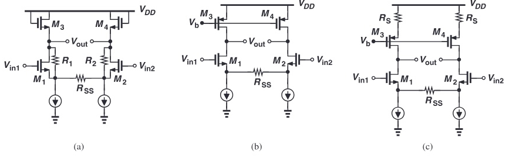

# 장말문제 10.53 — 소스 사이 R_SS로 축퇴된 Fig 10.79 (a)–(c) 차동 회로의 차동 전압 이득 (λ > 0)

## 원문
Calculate the differential voltage gain of the circuits depicted in Fig. 10.79. Assume perfect symmetry and $\lambda > 0$. You may need to compute the gain as $A_v = -G_m R_{out}$ in some cases.

## 조건
- 회로: Fig 10.79 (a)–(c)의 세 MOS 차동 회로 (두 소스 사이에 $R_{SS}$, 각 소스에 따로 전류원)
- 완벽한 대칭
- $\lambda > 0$
- 경우에 따라 이득을 $A_v = -G_m R_{out}$으로 계산해야 할 수도 있음

## 구할 것
- (a)–(c) 각 회로의 차동 전압 이득 (소문항 표기 없음, 원문은 "the circuits depicted in Fig. 10.79"로 적음)

## 회로 — Fig 10.79(a)
```spice
M3   VDD   VDD   out1  nmos    ; 드레인·게이트 모두 VDD
M4   VDD   VDD   out2  nmos    ; 좌우 반전 (게이트 오른쪽), 드레인·게이트 모두 VDD
M1   out1  Vin1  n1    nmos
M2   out2  Vin2  n2    nmos    ; 좌우 반전 (게이트 오른쪽)
R1   out1  n1    {R_1}         ; M1 드레인–소스 사이
R2   out2  n2    {R_2}         ; M2 드레인–소스 사이
RSS  n1    n2    {R_SS}
I1   n1    0                   ; 전류원, 라벨·값 없음
I2   n2    0                   ; 전류원, 라벨·값 없음
* n1 = M1 소스, n2 = M2 소스 (라벨 없음)
* out1, out2 = 두 출력 점에서 안쪽으로 이어진 개방 원. 두 원 사이에 "V_out" 라벨 하나 (차동 출력)
```
- 단자: VDD = 전원, 값 미지정 (가로 레일) / Vin1, Vin2 = 입력 (개방 원) / out1, out2 = 차동 출력 V_out (개방 원 두 개, 각 원 옆 라벨 없음)
- 표시: 노드 라벨 V_DD (레일 오른쪽 끝), V_out (두 출력 원 사이), V_in1 (왼쪽 입력 원 왼쪽), V_in2 (오른쪽 입력 원 오른쪽) / 소자 라벨 M3 (M3 오른쪽), M4 (M4 왼쪽), R1 (R1 오른쪽), R2 (R2 왼쪽), M1 (M1 왼쪽 아래), M2 (M2 오른쪽 아래), R_SS (가로 저항 아래), I1, I2 (라벨 없음) / 부호 없음 / 화살표 없음 / 수치·면적 라벨 없음
- 배치: 맨 위 굵은 가로 레일 V_DD / M3 nmos 보통 방향(게이트 왼쪽): 드레인은 위로 레일, 게이트는 왼쪽으로 나가 위로 꺾여 레일 (└ 꺾임), 소스는 아래로 / M4 nmos 좌우 반전(게이트 오른쪽), 게이트가 오른쪽으로 나가 위로 꺾여 레일 / 왼쪽 세로줄 위→아래 M3 소스, 출력 점, 두 번째 점, M1 드레인 / 두 번째 점에서 오른쪽으로 짧게 나가 아래로 R1, R1 아래 끝은 M1 소스 점 / M1 nmos 보통 방향(게이트 왼쪽), M1 소스는 아래로 내려가 오른쪽으로 꺾여 소스 점 / 오른쪽은 좌우 대칭 (M2 nmos 좌우 반전, R2는 M2 왼쪽) / 두 소스 점 사이 가로 저항 R_SS / 각 소스 점에서 아래로 전류원(화살표 아래), 그 아래 접지 / 각 출력 점에서 짧은 가로선이 안쪽으로 개방 원 (사이에 V_out 라벨) / V_in1 원 → M1 게이트, V_in2 원 → M2 게이트 / 접속점 (세 갈래 이상, 6곳): ① 왼쪽 출력 점 = 위 M3 소스 + 아래 세로선 + 오른쪽 출력선 (점) ② 왼쪽 두 번째 점 = 위 세로선 + 아래 M1 드레인 + 오른쪽 R1 선 (점) ③ n1 = 왼쪽 M1 소스 선 + 위 R1 + 오른쪽 R_SS + 아래 전류원 (점, 네 갈래) ④–⑥ 오른쪽 출력 점, 오른쪽 두 번째 점, n2 (점) (①–③의 좌우 대칭) / 교차: 없음

## 회로 — Fig 10.79(b)
```spice
M3   out1  Vb    VDD   pmos
M4   out2  Vb    VDD   pmos    ; 게이트는 M3 게이트 높이의 가로선에서 옴
M1   out1  Vin1  n1    nmos
M2   out2  Vin2  n2    nmos    ; 좌우 반전 (게이트 오른쪽)
RSS  n1    n2    {R_SS}
I1   n1    0                   ; 전류원, 라벨·값 없음
I2   n2    0                   ; 전류원, 라벨·값 없음
* Vb 점 단자 → M3 게이트. 같은 높이의 가로선이 M3 기호(채널 막대 오른쪽)에서 시작해 오른쪽 M4 게이트까지 이어짐 → M3·M4 게이트 공통(Vb)으로 읽음
* n1 = M1 소스, n2 = M2 소스 (라벨 없음)
* out1, out2 = 두 출력 점에서 안쪽으로 이어진 개방 원. 두 원 사이에 "V_out" 라벨 하나 (차동 출력)
```
- 단자: VDD = 전원, 값 미지정 (가로 레일) / Vb = 바이어스, 값 미지정 (점 단자) / Vin1, Vin2 = 입력 (개방 원) / out1, out2 = 차동 출력 V_out (개방 원 두 개, 각 원 옆 라벨 없음)
- 표시: 노드 라벨 V_DD (레일 오른쪽 끝), V_b (점 단자 왼쪽), V_out (두 출력 원 사이), V_in1 (왼쪽 입력 원 왼쪽), V_in2 (오른쪽 입력 원 오른쪽) / 소자 라벨 M3 (M3 왼쪽 위), M4 (M4 왼쪽 위), M1 (M1 오른쪽), M2 (M2 왼쪽), R_SS (가로 저항 아래), I1, I2 (라벨 없음) / 부호 없음 / 화살표 없음 / 수치·면적 라벨 없음
- 배치: 맨 위 굵은 가로 레일 V_DD / M3, M4 pmos 둘 다 보통 방향(게이트 왼쪽, 소스는 오른쪽 위에서 레일로, 드레인은 오른쪽 아래) / V_b 점 단자 → 가로선 → M3 게이트. 같은 높이의 가로선이 M3 기호를 가로질러(M3 소스·드레인 선 사이) 오른쪽 M4 게이트까지 감 / 왼쪽 세로줄 위→아래 M3 드레인, 출력 점, M1 드레인 / 오른쪽 세로줄 위→아래 M4 드레인, 출력 점, M2 드레인 / 각 출력 점에서 짧은 가로선이 안쪽으로 개방 원 (사이에 V_out 라벨) / M1 nmos 보통 방향(게이트 왼쪽), M2 nmos 좌우 반전(게이트 오른쪽) / V_in1 원 → M1 게이트, V_in2 원 → M2 게이트 / 각 소스는 아래로 소스 점, 두 소스 점 사이 가로 저항 R_SS, 각 소스 점에서 아래로 전류원(화살표 아래), 그 아래 접지 / 접속점 (세 갈래 이상, 4곳): ① 왼쪽 출력 점 = 위 M3 드레인 + 아래 M1 드레인 + 오른쪽 출력선 (점) ② 오른쪽 출력 점 = 위 M4 드레인 + 아래 M2 드레인 + 왼쪽 출력선 (점) ③ n1 = 위 M1 소스 + 오른쪽 R_SS + 아래 전류원 (점) ④ n2 = 위 M2 소스 + 왼쪽 R_SS + 아래 전류원 (점) / 교차: 없음 (게이트 가로선은 M3 기호를 지나지만 도선과 교차하지 않음)

## 회로 — Fig 10.79(c)
```spice
RS1  VDD   n3    {R_S}         ; 두 저항 모두 R_S로 인쇄
RS2  VDD   n4    {R_S}
M3   out1  Vb    n3    pmos
M4   out2  Vb    n4    pmos    ; 게이트는 M3 게이트 높이의 가로선에서 옴
M1   out1  Vin1  n1    nmos
M2   out2  Vin2  n2    nmos    ; 좌우 반전 (게이트 오른쪽)
RSS  n1    n2    {R_SS}
I1   n1    0                   ; 전류원, 라벨·값 없음
I2   n2    0                   ; 전류원, 라벨·값 없음
* Vb 점 단자 → M3 게이트. 같은 높이의 가로선이 M3 기호(채널 막대 오른쪽)에서 시작해 오른쪽 M4 게이트까지 이어짐 → M3·M4 게이트 공통(Vb)으로 읽음
* n1 = M1 소스, n2 = M2 소스, n3 = M3 소스, n4 = M4 소스 (라벨 없음)
* out1, out2 = 두 출력 점에서 안쪽으로 이어진 개방 원. 두 원 사이에 "V_out" 라벨 하나 (차동 출력)
```
- 단자: VDD = 전원, 값 미지정 (가로 레일) / Vb = 바이어스, 값 미지정 (점 단자) / Vin1, Vin2 = 입력 (개방 원) / out1, out2 = 차동 출력 V_out (개방 원 두 개, 각 원 옆 라벨 없음)
- 표시: 노드 라벨 V_DD (레일 오른쪽 끝), V_b (점 단자 왼쪽), V_out (두 출력 원 사이), V_in1 (왼쪽 입력 원 왼쪽), V_in2 (오른쪽 입력 원 오른쪽) / 소자 라벨 R_S (왼쪽 저항 왼쪽), R_S (오른쪽 저항 오른쪽), M3 (M3 왼쪽 위), M4 (M4 왼쪽 위), M1 (M1 오른쪽), M2 (M2 왼쪽), R_SS (가로 저항 아래), I1, I2 (라벨 없음) / 부호 없음 / 화살표 없음 / 수치·면적 라벨 없음
- 배치: (b)와 같은 구조에 M3, M4 소스와 레일 사이에 R_S가 하나씩 들어감 / 맨 위 굵은 가로 레일 V_DD / 왼쪽 세로줄 위→아래 R_S, M3 소스, M3 드레인, 출력 점, M1 드레인 / 오른쪽 세로줄 위→아래 R_S, M4 소스, M4 드레인, 출력 점, M2 드레인 / M3, M4 pmos 둘 다 보통 방향(게이트 왼쪽) / V_b 점 단자 → 가로선 → M3 게이트. 같은 높이의 가로선이 M3 기호를 가로질러 오른쪽 M4 게이트까지 감 / 각 출력 점에서 짧은 가로선이 안쪽으로 개방 원 (사이에 V_out 라벨) / M1 nmos 보통 방향, M2 nmos 좌우 반전 / V_in1 원 → M1 게이트, V_in2 원 → M2 게이트 / 각 소스는 아래로 소스 점, 두 소스 점 사이 가로 저항 R_SS, 각 소스 점에서 아래로 전류원(화살표 아래), 그 아래 접지 / 접속점 (세 갈래 이상, 4곳): ① 왼쪽 출력 점 (점) ② 오른쪽 출력 점 (점) ③ n1 = 위 M1 소스 + 오른쪽 R_SS + 아래 전류원 (점) ④ n2 = 위 M2 소스 + 왼쪽 R_SS + 아래 전류원 (점) (①②는 (b)와 같은 세 갈래) / 교차: 없음 (게이트 가로선은 M3 기호를 지나지만 도선과 교차하지 않음)



## 풀이
### 공통: 절반 회로
- 대칭인 차동 입력이면 $R_{SS}$ 가운데 점이 가상 접지라 $M_1$ 소스에 $R_{SS}/2$가 달린다(전류원 개방, 바디 효과 무시). $A_v = V_{out}/(V_{in1} - V_{in2})$는 절반 회로 이득
- $M_1$($g_{m1}$, $r_{O1}$): $G_m \approx g_{m1}/(1 + g_{m1} R_{SS}/2)$ (드레인–소스 사이 저항 $\gg R_{SS}/2$), 아래로 본 저항은 $(1 + g_{m1} R_{SS}/2) \times$(드레인–소스 사이 저항)
### (a) $R_1$과 다이오드 부하
- $R_1$은 $r_{O1}$과 병렬이다. $M_3$($g_{m3}$, $r_{O3}$)은 게이트·드레인이 교류 접지라 $1/g_{m3} \parallel r_{O3}$
- $A_v = -G_m\left[\dfrac{1}{g_{m3}} \parallel r_{O3} \parallel (1 + g_{m1} R_{SS}/2)(r_{O1} \parallel R_1)\right]$
### (b) 전류원 부하
- $M_3$은 $r_{O3}$로 보인다
### (c) $R_S$로 축퇴된 전류원 부하
- $M_3$ 위로 본 저항 $(1 + g_{m3} R_S)\, r_{O3}$ ($R_S$ 값이 없어 1을 남김)
### 답
- $G_m = g_{m1}/(1 + g_{m1} R_{SS}/2)$로
- (a) $A_v = -G_m\left[\dfrac{1}{g_{m3}} \parallel r_{O3} \parallel (1 + g_{m1} R_{SS}/2)(r_{O1} \parallel R_1)\right]$
- (b) $A_v = -G_m\left[r_{O3} \parallel (1 + g_{m1} R_{SS}/2)\, r_{O1}\right]$
- (c) $A_v = -G_m\left[(1 + g_{m3} R_S)\, r_{O3} \parallel (1 + g_{m1} R_{SS}/2)\, r_{O1}\right]$
