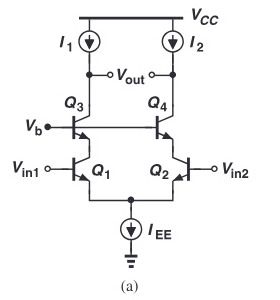

# 장말문제 10.54 — 전압 이득 4000을 내는 바이폴라 캐스코드 차동쌍(Fig 10.39(a))의 최소 Early 전압

## 원문
The cascode differential pair of Fig. 10.39(a) must achieve a voltage gain of 4000. If $Q_1$–$Q_4$ are identical and $\beta = 100$, what is the minimum required Early voltage?

## 조건
- 회로: 본문 Fig 10.39(a)의 바이폴라 캐스코드 차동쌍
- 전압 이득 $4000$을 달성해야 함
- $Q_1$–$Q_4$는 동일, $\beta = 100$

## 구할 것
- 필요한 최소 Early 전압

## 상속·참조
- 본문 (교재 539쪽): Fig 10.39(a)에서 $Q_3$, $Q_4$는 캐스코드 소자, $I_1$, $I_2$는 이상적. $Q_3$, $Q_4$의 베이스는 교류 접지이므로 절반 회로 Fig 10.39(b)($v_{in1}$ → $Q_1$ 베이스, $Q_1$ 이미터 접지, $Q_1$ 컬렉터 → $Q_3$ 이미터, $Q_3$ 베이스 접지, $Q_3$ 컬렉터 = $v_{out1}$)로 해석. 식 (9.51)로부터
  $$A_v = -g_{m1}\left[g_{m3}(r_{O1} \| r_{\pi 3})r_{O3} + r_{O1} \| r_{\pi 3}\right] \qquad (10.171)$$

## 회로 — Fig 10.39(a)
```spice
I1   VCC   out1  {I_1}
I2   VCC   out2  {I_2}
Q3   out1  Vb    n1    npn
Q4   out2  Vb    n2    npn     ; 베이스는 Q3 베이스 높이의 가로선에서 옴
Q1   n1    Vin1  n3    npn
Q2   n2    Vin2  n3    npn     ; 좌우 반전 (베이스 오른쪽)
IEE  n3    0     {I_EE}
* Vb 점 단자 → Q3 베이스. 같은 높이의 가로선이 Q3 기호(컬렉터·이미터 선 사이)를 가로질러 Q4 베이스까지 이어짐 → Q3·Q4 베이스 공통(Vb)
* n1 = Q3 이미터–Q1 컬렉터, n2 = Q4 이미터–Q2 컬렉터, n3 = 공통 이미터(테일) 노드 (라벨 없음)
* out1, out2 = 두 출력 점에서 안쪽으로 이어진 개방 원. 두 원 사이에 "V_out" 라벨 하나 (차동 출력)
```
- 단자: VCC = 전원, 값 미지정 (가로 레일) / Vb = 바이어스, 값 미지정 (점 단자) / Vin1, Vin2 = 입력 (개방 원) / out1, out2 = 차동 출력 V_out (개방 원 두 개, 각 원 옆 라벨 없음)
- 표시: 노드 라벨 V_CC (레일 오른쪽 끝), V_b (점 단자 왼쪽), V_out (두 출력 원 사이), V_in1 (왼쪽 입력 원 왼쪽), V_in2 (오른쪽 입력 원 오른쪽) / 소자 라벨 I_1 (왼쪽 전류원 왼쪽), I_2 (오른쪽 전류원 오른쪽), Q3 (Q3 왼쪽 위), Q4 (Q4 왼쪽 위), Q1 (Q1 오른쪽), Q2 (Q2 왼쪽), I_EE (전류원 오른쪽) / 부호 없음 / 화살표 없음 / 수치·면적 라벨 없음
- 배치: 맨 위 굵은 가로 레일 V_CC / 왼쪽 세로줄 위→아래 I_1(화살표 아래), 출력 점, Q3, Q1 / 오른쪽 세로줄 위→아래 I_2(화살표 아래), 출력 점, Q4, Q2 / 각 출력 점에서 짧은 가로선이 안쪽으로 개방 원 (사이에 V_out 라벨) / Q3, Q4 npn 둘 다 보통 방향(베이스 왼쪽) / V_b 점 단자 → Q3 베이스, 같은 높이 가로선이 Q3 기호를 가로질러 Q4 베이스 / Q3 이미터 → 바로 아래 Q1 컬렉터 (점 없음, 두 선만 이어짐), Q4 이미터 → Q2 컬렉터 / Q1 npn 보통 방향(베이스 왼쪽), Q2 npn 좌우 반전(베이스 오른쪽) / V_in1 원 → Q1 베이스, V_in2 원 → Q2 베이스 / 두 이미터는 꼬리 가로선 가운데 n3 점, n3에서 아래로 I_EE(화살표 아래), 그 아래 접지 / 접속점 (세 갈래 이상, 3곳): ① 왼쪽 출력 점 = 위 I_1 + 아래 Q3 컬렉터 + 오른쪽 출력선 (점) ② 오른쪽 출력 점 = 위 I_2 + 아래 Q4 컬렉터 + 왼쪽 출력선 (점) ③ n3 = 왼쪽 Q1 이미터 선 + 오른쪽 Q2 이미터 선 + 아래 I_EE (점) / 교차: 없음 (베이스 가로선은 Q3 기호를 지나지만 도선과 교차하지 않음)


> 참고: Fig 10.39는 본문 그림(교재 539쪽, PDF 22). 크롭은 패널 (a)만 담음 ((b)는 절반 회로로 상속·참조에 글로 적음)
