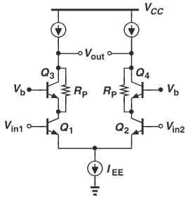

# 장말문제 10.56 — 캐스코드 소자 양단에 R_P가 붙은 바이폴라 캐스코드 차동쌍(Fig 10.81)에 대해 문제 10.53을 되풀이

## 원문
Repeat Problem 10.53 for the circuit shown in Fig. 10.81.

## 조건
- 회로: Fig 10.81 — 바이폴라 캐스코드 차동쌍. $Q_3$, $Q_4$ 각각의 컬렉터–이미터 사이에 저항 $R_P$
- 문제 10.53을 이 회로에 대해 되풀이 (아래 상속·참조)

## 구할 것
- Fig 10.81 회로의 차동 전압 이득 (문제 10.53의 요구)

## 상속·참조
- 문제 10.53 (P10.53): Fig 10.79 (a)–(c) 회로의 차동 전압 이득을 구함. 완벽한 대칭, $\lambda > 0$ 가정. 경우에 따라 $A_v = -G_m R_{out}$으로 계산해야 할 수도 있음
- 참고: 바로 앞 문제 10.55(Fig 10.80)도 $R_P$가 붙은 같은 종류의 바이폴라 캐스코드 차동쌍 문제임 (원문에 없음)

## 회로 — Fig 10.81
```spice
I1   VCC   out1                ; 전류원, 라벨·값 없음
I2   VCC   out2                ; 전류원, 라벨·값 없음
Q3   out1  Vb    n1    npn
RP1  out1  n1    {R_P}         ; Q3 컬렉터–이미터 사이
Q4   out2  Vb    n2    npn     ; 좌우 반전 (베이스 오른쪽)
RP2  out2  n2    {R_P}         ; Q4 컬렉터–이미터 사이, 두 저항 모두 R_P로 인쇄
Q1   n1    Vin1  n3    npn
Q2   n2    Vin2  n3    npn     ; 좌우 반전 (베이스 오른쪽)
IEE  n3    0     {I_EE}
* Vb = 왼쪽·오른쪽 두 점 단자 모두 "V_b"로 인쇄 → 같은 노드로 적음
* n1 = Q3 이미터–Q1 컬렉터, n2 = Q4 이미터–Q2 컬렉터, n3 = 공통 이미터(테일) 노드 (라벨 없음)
* out1, out2 = 두 출력 점에서 안쪽으로 이어진 개방 원. 두 원 사이에 "V_out" 라벨 하나 (차동 출력)
```
- 단자: VCC = 전원, 값 미지정 (가로 레일) / Vb = 바이어스, 값 미지정 (점 단자 두 개, 왼쪽은 Q3 베이스, 오른쪽은 Q4 베이스) / Vin1, Vin2 = 입력 (개방 원) / out1, out2 = 차동 출력 V_out (개방 원 두 개, 각 원 옆 라벨 없음)
- 표시: 노드 라벨 V_CC (레일 오른쪽 끝), V_b (왼쪽 점 단자 왼쪽), V_b (오른쪽 점 단자 오른쪽), V_out (두 출력 원 사이), V_in1 (왼쪽 입력 원 왼쪽), V_in2 (오른쪽 입력 원 오른쪽) / 소자 라벨 Q3 (Q3 왼쪽 위), Q4 (Q4 오른쪽 위), R_P (왼쪽 R_P 오른쪽), R_P (오른쪽 R_P 왼쪽), Q1 (Q1 오른쪽), Q2 (Q2 왼쪽), I_EE (전류원 오른쪽), 위 전류원 둘 I1, I2 (라벨 없음) / 부호 없음 / 화살표 없음 / 수치·면적 라벨 없음
- 배치: 맨 위 굵은 가로 레일 V_CC / 왼쪽 세로줄 위→아래 전류원(화살표 아래), 출력 점, R_P 위 점, Q3, R_P 아래 점(n1), Q1 / 오른쪽 세로줄 위→아래 전류원(화살표 아래), 출력 점, R_P 위 점, Q4, R_P 아래 점(n2), Q2 / 각 출력 점에서 짧은 가로선이 안쪽으로 개방 원 (사이에 V_out 라벨) / Q3 npn 보통 방향(베이스 왼쪽, 왼쪽 V_b 점 단자), R_P는 Q3 오른쪽에서 위 점과 아래 점을 잇는 세로 저항 (위 점에서 오른쪽으로 나가 아래로, 아래 끝에서 왼쪽으로 돌아와 아래 점) / Q4 npn 좌우 반전(베이스 오른쪽, 오른쪽 V_b 점 단자), R_P는 Q4 왼쪽에 대칭 / Q1 npn 보통 방향(베이스 왼쪽), Q2 npn 좌우 반전(베이스 오른쪽) / V_in1 원 → Q1 베이스, V_in2 원 → Q2 베이스 / 두 이미터는 꼬리 가로선 가운데 n3 점, n3에서 아래로 I_EE(화살표 아래), 그 아래 접지 / 접속점 (세 갈래 이상, 7곳): ① 왼쪽 출력 점 = 위 전류원 + 아래 세로선 + 오른쪽 출력선 (점) ② 왼쪽 R_P 위 점 = 위 세로선 + 아래 Q3 컬렉터 + 오른쪽 R_P 선 (점) ③ n1 = 위 Q3 이미터 + 아래 Q1 컬렉터 + 오른쪽 R_P 선 (점) ④–⑥ 오른쪽 출력 점, 오른쪽 R_P 위 점, n2 (점) (①–③의 좌우 대칭) ⑦ n3 = 왼쪽 Q1 이미터 선 + 오른쪽 Q2 이미터 선 + 아래 I_EE (점) / 교차: 없음


