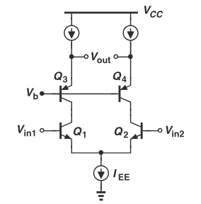

# 장말문제 10.57 — pnp 캐스코드 트랜지스터를 잘못 쓴 차동쌍(Fig 10.82)의 전압 이득

## 원문
A student has mistakenly used pnp cascode transistors in a differential pair as illustrated in Fig. 10.82. Calculate the voltage gain of the circuit. (Hint: $A_v = -G_m R_{out}$.)

## 조건
- 회로: Fig 10.82 — 학생이 실수로 캐스코드 트랜지스터 $Q_3$, $Q_4$를 pnp로 쓴 바이폴라 차동쌍
- 힌트: $A_v = -G_m R_{out}$

## 구할 것
- 회로의 전압 이득

## 회로 — Fig 10.82
```spice
I1   VCC   out1                ; 전류원, 라벨·값 없음
I2   VCC   out2                ; 전류원, 라벨·값 없음
Q3   n1    Vb    out1  pnp     ; 이미터(위) = out1, 컬렉터(아래) = n1
Q4   n2    Vb    out2  pnp     ; 베이스는 Q3 베이스 높이의 가로선에서 옴
Q1   n1    Vin1  n3    npn
Q2   n2    Vin2  n3    npn     ; 좌우 반전 (베이스 오른쪽)
IEE  n3    0     {I_EE}
* Vb 점 단자 → Q3 베이스. 같은 높이의 가로선이 Q3 기호(컬렉터·이미터 선 사이)를 가로질러 Q4 베이스까지 이어짐 → Q3·Q4 베이스 공통(Vb)
* n1 = Q3 컬렉터–Q1 컬렉터, n2 = Q4 컬렉터–Q2 컬렉터, n3 = 공통 이미터(테일) 노드 (라벨 없음)
* out1, out2 = 두 출력 점에서 안쪽으로 이어진 개방 원. 두 원 사이에 "V_out" 라벨 하나 (차동 출력)
```
- 단자: VCC = 전원, 값 미지정 (가로 레일) / Vb = 바이어스, 값 미지정 (점 단자) / Vin1, Vin2 = 입력 (개방 원) / out1, out2 = 차동 출력 V_out (개방 원 두 개, 각 원 옆 라벨 없음)
- 표시: 노드 라벨 V_CC (레일 오른쪽 끝), V_b (점 단자 왼쪽), V_out (두 출력 원 사이), V_in1 (왼쪽 입력 원 왼쪽), V_in2 (오른쪽 입력 원 오른쪽) / 소자 라벨 Q3 (Q3 왼쪽 위), Q4 (Q4 왼쪽 위), Q1 (Q1 오른쪽), Q2 (Q2 왼쪽), I_EE (전류원 오른쪽), 위 전류원 둘 I1, I2 (라벨 없음) / 부호 없음 / 화살표 없음 / 수치·면적 라벨 없음
- 배치: 맨 위 굵은 가로 레일 V_CC / 왼쪽 세로줄 위→아래 전류원(화살표 아래), 출력 점, Q3, Q1 / 오른쪽 세로줄 위→아래 전류원(화살표 아래), 출력 점, Q4, Q2 / 각 출력 점에서 짧은 가로선이 안쪽으로 개방 원 (사이에 V_out 라벨) / Q3, Q4 pnp 둘 다 보통 방향(베이스 왼쪽, 이미터 위·화살표 안쪽) / V_b 점 단자 → Q3 베이스, 같은 높이 가로선이 Q3 기호를 가로질러 Q4 베이스 / Q3 컬렉터 → 바로 아래 Q1 컬렉터 (점 없음, 두 선만 이어짐), Q4 컬렉터 → Q2 컬렉터 / Q1 npn 보통 방향(베이스 왼쪽), Q2 npn 좌우 반전(베이스 오른쪽) / V_in1 원 → Q1 베이스, V_in2 원 → Q2 베이스 / 두 이미터는 꼬리 가로선 가운데 n3 점, n3에서 아래로 I_EE(화살표 아래), 그 아래 접지 / 접속점 (세 갈래 이상, 3곳): ① 왼쪽 출력 점 = 위 전류원 + 아래 Q3 이미터 + 오른쪽 출력선 (점) ② 오른쪽 출력 점 = 위 전류원 + 아래 Q4 이미터 + 왼쪽 출력선 (점) ③ n3 = 왼쪽 Q1 이미터 선 + 오른쪽 Q2 이미터 선 + 아래 I_EE (점) / 교차: 없음 (베이스 가로선은 Q3 기호를 지나지만 도선과 교차하지 않음)



## 힌트
### 출력 접지 시 $Q_3$엔 $r_O$만
- $G_m$을 구하려고 출력을 AC 접지하면 $Q_3$의 베이스와 이미터가 모두 AC 접지라 $g_m$ 전류원은 꺼지고 $r_{O3}$만 남는다
- 그래서 $Q_1$의 신호 전류는 캐스코드처럼 출력으로 다 올라가지 못하고 $Q_1$ 컬렉터 노드에서 $r_{O1}$과 $r_{O3}$로 나뉜다. $R_{out}$은 출력에서 $Q_3$ 이미터를 들여다본 저항이다
