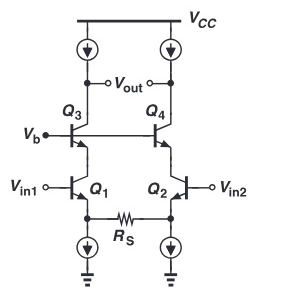

# 장말문제 10.58 — 두 이미터 사이 R_S로 축퇴된 바이폴라 캐스코드 차동쌍(Fig 10.83)의 전압 이득

## 원문
Calculate the voltage gain of the degenerated pair depicted in Fig. 10.83. (Hint: $A_v = -G_m R_{out}$.)

## 조건
- 회로: Fig 10.83 — 축퇴된(degenerated) 바이폴라 캐스코드 차동쌍. $Q_1$, $Q_2$ 이미터 사이에 $R_S$, 각 이미터에 따로 전류원
- 힌트: $A_v = -G_m R_{out}$

## 구할 것
- 전압 이득

## 회로 — Fig 10.83
```spice
I1   VCC   out1                ; 전류원, 라벨·값 없음
I2   VCC   out2                ; 전류원, 라벨·값 없음
Q3   out1  Vb    n1    npn
Q4   out2  Vb    n2    npn     ; 베이스는 Q3 베이스 높이의 가로선에서 옴
Q1   n1    Vin1  n3    npn
Q2   n2    Vin2  n4    npn     ; 좌우 반전 (베이스 오른쪽)
RS   n3    n4    {R_S}
I3   n3    0                   ; 전류원, 라벨·값 없음
I4   n4    0                   ; 전류원, 라벨·값 없음
* Vb 점 단자 → Q3 베이스. 같은 높이의 가로선이 Q3 기호(컬렉터·이미터 선 사이)를 가로질러 Q4 베이스까지 이어짐 → Q3·Q4 베이스 공통(Vb)
* n1 = Q3 이미터–Q1 컬렉터, n2 = Q4 이미터–Q2 컬렉터, n3 = Q1 이미터, n4 = Q2 이미터 (라벨 없음)
* out1, out2 = 두 출력 점에서 안쪽으로 이어진 개방 원. 두 원 사이에 "V_out" 라벨 하나 (차동 출력)
```
- 단자: VCC = 전원, 값 미지정 (가로 레일) / Vb = 바이어스, 값 미지정 (점 단자) / Vin1, Vin2 = 입력 (개방 원) / out1, out2 = 차동 출력 V_out (개방 원 두 개, 각 원 옆 라벨 없음)
- 표시: 노드 라벨 V_CC (레일 오른쪽 끝), V_b (점 단자 왼쪽), V_out (두 출력 원 사이), V_in1 (왼쪽 입력 원 왼쪽), V_in2 (오른쪽 입력 원 오른쪽) / 소자 라벨 Q3 (Q3 왼쪽 위), Q4 (Q4 왼쪽 위), Q1 (Q1 오른쪽), Q2 (Q2 왼쪽), R_S (가로 저항 아래), 위 전류원 둘 I1, I2, 아래 전류원 둘 I3, I4 (라벨 없음) / 부호 없음 / 화살표 없음 / 수치·면적 라벨 없음
- 배치: 맨 위 굵은 가로 레일 V_CC / 왼쪽 세로줄 위→아래 전류원(화살표 아래), 출력 점, Q3, Q1, n3 점, 전류원(화살표 아래), 접지 / 오른쪽 세로줄 위→아래 전류원, 출력 점, Q4, Q2, n4 점, 전류원, 접지 / 각 출력 점에서 짧은 가로선이 안쪽으로 개방 원 (사이에 V_out 라벨) / Q3, Q4 npn 둘 다 보통 방향(베이스 왼쪽) / V_b 점 단자 → Q3 베이스, 같은 높이 가로선이 Q3 기호를 가로질러 Q4 베이스 / Q3 이미터 → 바로 아래 Q1 컬렉터 (점 없음), Q4 이미터 → Q2 컬렉터 / Q1 npn 보통 방향(베이스 왼쪽), Q2 npn 좌우 반전(베이스 오른쪽) / V_in1 원 → Q1 베이스, V_in2 원 → Q2 베이스 / n3 점과 n4 점 사이 가로 저항 R_S / 접속점 (세 갈래 이상, 4곳): ① 왼쪽 출력 점 = 위 전류원 + 아래 Q3 컬렉터 + 오른쪽 출력선 (점) ② 오른쪽 출력 점 = 위 전류원 + 아래 Q4 컬렉터 + 왼쪽 출력선 (점) ③ n3 = 위 Q1 이미터 + 오른쪽 R_S + 아래 전류원 (점) ④ n4 = 위 Q2 이미터 + 왼쪽 R_S + 아래 전류원 (점) / 교차: 없음 (베이스 가로선은 Q3 기호를 지나지만 도선과 교차하지 않음)



## 풀이
### 절반 회로
- 차동 입력이면 두 이미터가 반대로 움직여 $R_S$의 가운데 점이 가상 접지다. 절반 회로의 $Q_1$ 이미터에는 $R_S/2$가 달리고, 아래 전류원은 개방이다. $Q_3$ 베이스는 교류 접지, 위 전류원은 이상적이다
- $g_{m1}$, $r_{\pi 1}$, $r_{O1}$은 $Q_1$, $g_{m3}$, $r_{\pi 3}$, $r_{O3}$은 $Q_3$의 소신호 값이다
### 트랜스컨덕턴스
- 출력을 접지하면 $Q_3$ 이미터(약 $1/g_{m3}$)가 $Q_1$ 컬렉터 전류를 거의 다 출력으로 넘긴다
- $G_m \approx \dfrac{g_{m1}}{1 + g_{m1} R_S/2}$ ($\beta \gg 1$, $r_{O1} \gg R_S/2$이므로)
### 출력 저항
- $Q_1$ 컬렉터에서 아래로 본 저항 $R_X = [1 + g_{m1}(R_S/2 \parallel r_{\pi 1})]\, r_{O1}$ ($R_S$ 값이 없어 1을 남김)
- $Q_3$은 $R_X \parallel r_{\pi 3}$로 축퇴되고 $g_{m3}(R_X \parallel r_{\pi 3}) \gg 1$이므로 $R_{out} \approx g_{m3} r_{O3} (R_X \parallel r_{\pi 3})$
### 전압 이득
- $A_v = -G_m R_{out} = -\dfrac{g_{m1}}{1 + g_{m1} R_S/2}\, g_{m3} r_{O3} \{[1 + g_{m1}(R_S/2 \parallel r_{\pi 1})]\, r_{O1} \parallel r_{\pi 3}\}$
### 답
- $A_v \approx -\dfrac{g_{m1}}{1 + g_{m1} R_S/2}\, g_{m3} r_{O3} \{[1 + g_{m1}(R_S/2 \parallel r_{\pi 1})]\, r_{O1} \parallel r_{\pi 3}\}$
