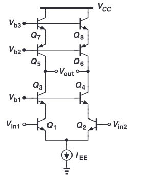

# 장말문제 10.61 — npn 폴로어 Q7/Q8과 pnp Q5/Q6를 쌓은 캐스코드 차동쌍(Fig 10.85)의 전압 이득과 텔레스코픽 여부

## 원문
Determine the voltage gain of the circuit depicted in Fig. 10.85. Is this topology considered a telescopic cascode?

## 조건
- 회로: Fig 10.85 — 바이폴라 캐스코드 차동쌍. 부하 쪽은 npn $Q_7$, $Q_8$(컬렉터 $V_{CC}$) 아래에 pnp $Q_5$, $Q_6$가 이미터끼리 이어져 쌓임

## 구할 것
- 회로의 전압 이득
- 이 토폴로지를 텔레스코픽 캐스코드로 볼 수 있는가

## 회로 — Fig 10.85
```spice
Q7   VCC   Vb3   n1    npn
Q8   VCC   Vb3   n2    npn     ; 베이스는 Q7 베이스 높이의 가로선에서 옴
Q5   out1  Vb2   n1    pnp     ; 이미터(위) = n1 = Q7 이미터
Q6   out2  Vb2   n2    pnp     ; 베이스는 Q5 베이스 높이의 가로선에서 옴
Q3   out1  Vb1   n3    npn
Q4   out2  Vb1   n4    npn     ; 베이스는 Q3 베이스 높이의 가로선에서 옴
Q1   n3    Vin1  n5    npn
Q2   n4    Vin2  n5    npn     ; 좌우 반전 (베이스 오른쪽)
IEE  n5    0     {I_EE}
* Vb3, Vb2, Vb1 점 단자 → 각각 Q7, Q5, Q3 베이스. 같은 높이의 가로선이 왼쪽 트랜지스터 기호(컬렉터·이미터 선 사이)를 가로질러 오른쪽 Q8, Q6, Q4 베이스까지 이어짐 → 베이스 공통
* n1 = Q7 이미터–Q5 이미터, n2 = Q8 이미터–Q6 이미터, n3 = Q3 이미터–Q1 컬렉터, n4 = Q4 이미터–Q2 컬렉터, n5 = 공통 이미터(테일) 노드 (라벨 없음)
* out1, out2 = 두 출력 점에서 안쪽으로 이어진 개방 원. 두 원 사이에 "V_out" 라벨 하나 (차동 출력)
```
- 단자: VCC = 전원, 값 미지정 (가로 레일) / Vb1, Vb2, Vb3 = 바이어스, 값 미지정 (점 단자) / Vin1, Vin2 = 입력 (개방 원) / out1, out2 = 차동 출력 V_out (개방 원 두 개, 각 원 옆 라벨 없음)
- 표시: 노드 라벨 V_CC (레일 오른쪽 끝), V_b3, V_b2, V_b1 (각 점 단자 왼쪽), V_out (두 출력 원 사이), V_in1 (왼쪽 입력 원 왼쪽), V_in2 (오른쪽 입력 원 오른쪽) / 소자 라벨 Q7 (Q7 아래), Q8 (Q8 아래), Q5 (Q5 아래), Q6 (Q6 아래), Q3 (Q3 위), Q4 (Q4 위), Q1 (Q1 오른쪽), Q2 (Q2 왼쪽), I_EE (전류원 오른쪽) / 부호 없음 / 화살표 없음 / 수치·면적 라벨 없음
- 배치: 맨 위 굵은 가로 레일 V_CC / 왼쪽 세로줄 위→아래 Q7, Q5, 출력 점, Q3, Q1 / 오른쪽 세로줄 위→아래 Q8, Q6, 출력 점, Q4, Q2 / Q7, Q8 npn 보통 방향(베이스 왼쪽, 컬렉터 위로 레일, 이미터 아래·화살표 바깥) / Q5, Q6 pnp 보통 방향(베이스 왼쪽, 이미터 위·화살표 안쪽) — Q7 이미터와 Q5 이미터가 세로선으로 바로 이어짐 (점 없음) / Q3, Q4, Q1 npn 보통 방향(베이스 왼쪽), Q2 npn 좌우 반전(베이스 오른쪽) / Q5 컬렉터 → 출력 점 → Q3 컬렉터, Q3 이미터 → Q1 컬렉터 (점 없음) / 각 출력 점에서 짧은 가로선이 안쪽으로 개방 원 (사이에 V_out 라벨) / V_in1 원 → Q1 베이스, V_in2 원 → Q2 베이스 / 두 이미터는 꼬리 가로선 가운데 n5 점, n5에서 아래로 I_EE(화살표 아래), 그 아래 접지 / 접속점 (세 갈래 이상, 3곳): ① 왼쪽 출력 점 = 위 Q5 컬렉터 + 아래 Q3 컬렉터 + 오른쪽 출력선 (점) ② 오른쪽 출력 점 = 위 Q6 컬렉터 + 아래 Q4 컬렉터 + 왼쪽 출력선 (점) ③ n5 = 왼쪽 Q1 이미터 선 + 오른쪽 Q2 이미터 선 + 아래 I_EE (점) / 교차: 없음 (세 베이스 가로선은 왼쪽 트랜지스터 기호를 지나지만 도선과 교차하지 않음)


