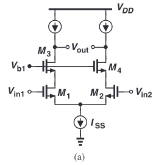

# 장말문제 10.62 — 전압 이득 300을 내는 MOS 캐스코드 차동쌍(Fig 10.42(a))의 필요 테일 전류

## 원문
The MOS cascode of Fig. 10.42(a) must provide a voltage gain of 300. If $W/L = 20/0.18$ for $M_1$-$M_4$ and $\mu_n C_{ox} = 100\ \mu\text{A/V}^2$, determine the required tail current. Assume $\lambda = 0.1\ \text{V}^{-1}$.

## 조건
- 회로: 본문 Fig 10.42(a)의 MOS 캐스코드 차동쌍
- 전압 이득 $300$을 내야 함
- $M_1$–$M_4$: $W/L = 20/0.18$
- $\mu_n C_{ox} = 100\ \mu\text{A/V}^2$
- $\lambda = 0.1\ \text{V}^{-1}$

## 구할 것
- 필요한 테일 전류 ($I_{SS}$) (괄호 안은 원문에 없음)

## 상속·참조
- 본문 (교재 541쪽): Fig 10.42(a)의 간략한 토폴로지를 절반 회로 Fig 10.42(b)($v_{in1}$ → $M_1$ 게이트, $M_1$ 소스 접지, $M_1$ 드레인 → $M_3$ 소스, $M_3$ 게이트 교류 접지, $M_3$ 드레인 = $v_{out1}$)로 해석. 식 (9.69)로부터
  $$A_v \approx -g_{m3}r_{O3}g_{m1}r_{O1} \qquad (10.175)$$

## 회로 — Fig 10.42(a)
```spice
I1   VDD   out1                ; 전류원, 라벨·값 없음
I2   VDD   out2                ; 전류원, 라벨·값 없음
M3   out1  Vb1   n1    nmos
M4   out2  Vb1   n2    nmos    ; 게이트는 M3 게이트 높이의 가로선에서 옴
M1   n1    Vin1  n3    nmos
M2   n2    Vin2  n3    nmos    ; 좌우 반전 (게이트 오른쪽)
ISS  n3    0     {I_SS}
* Vb1 점 단자 → M3 게이트. 같은 높이의 가로선이 M3 기호(채널 막대 오른쪽)에서 시작해 오른쪽 M4 게이트까지 이어짐 → M3·M4 게이트 공통(Vb1)으로 읽음
* n1 = M3 소스–M1 드레인, n2 = M4 소스–M2 드레인, n3 = 공통 소스(테일) 노드 (라벨 없음)
* out1, out2 = 두 출력 점에서 안쪽으로 이어진 개방 원. 두 원 사이에 "V_out" 라벨 하나 (차동 출력)
```
- 단자: VDD = 전원, 값 미지정 (가로 레일) / Vb1 = 바이어스, 값 미지정 (점 단자) / Vin1, Vin2 = 입력 (개방 원) / out1, out2 = 차동 출력 V_out (개방 원 두 개, 각 원 옆 라벨 없음)
- 표시: 노드 라벨 V_DD (레일 오른쪽 끝), V_b1 (점 단자 왼쪽), V_out (두 출력 원 사이), V_in1 (왼쪽 입력 원 왼쪽), V_in2 (오른쪽 입력 원 오른쪽) / 소자 라벨 M3 (M3 왼쪽 위), M4 (M4 오른쪽), M1 (M1 오른쪽), M2 (M2 왼쪽), I_SS (전류원 오른쪽), 위 전류원 둘 I1, I2 (라벨 없음) / 부호 없음 / 화살표 없음 / 수치·면적 라벨 없음
- 배치: 맨 위 굵은 가로 레일 V_DD / 왼쪽 세로줄 위→아래 전류원(화살표 아래), 출력 점, M3, M1 / 오른쪽 세로줄 위→아래 전류원(화살표 아래), 출력 점, M4, M2 / 각 출력 점에서 짧은 가로선이 안쪽으로 개방 원 (사이에 V_out 라벨) / M3, M4 nmos 둘 다 보통 방향(게이트 왼쪽) / V_b1 점 단자 → M3 게이트, 같은 높이 가로선이 M3 기호를 가로질러(M3 드레인·소스 선 사이) 오른쪽 M4 게이트 / M3 소스 → 바로 아래 M1 드레인 (점 없음), M4 소스 → M2 드레인 / M1 nmos 보통 방향(게이트 왼쪽), M2 nmos 좌우 반전(게이트 오른쪽) / V_in1 원 → M1 게이트, V_in2 원 → M2 게이트 / 두 소스는 꼬리 가로선 가운데 n3 점, n3에서 아래로 I_SS(화살표 아래), 그 아래 접지 / 접속점 (세 갈래 이상, 3곳): ① 왼쪽 출력 점 = 위 전류원 + 아래 M3 드레인 + 오른쪽 출력선 (점) ② 오른쪽 출력 점 = 위 전류원 + 아래 M4 드레인 + 왼쪽 출력선 (점) ③ n3 = 왼쪽 M1 소스 선 + 오른쪽 M2 소스 선 + 아래 I_SS (점) / 교차: 없음 (게이트 가로선은 M3 기호를 지나지만 도선과 교차하지 않음)


> 참고: Fig 10.42는 본문 그림(교재 541쪽, PDF 23). 크롭은 패널 (a)만 담음 ((b)는 절반 회로로 상속·참조에 글로 적음)
