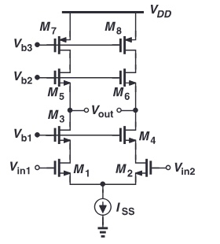

# 장말문제 10.63 — PMOS 캐스코드를 NMOS로 바꾼 CMOS 텔레스코픽 캐스코드(Fig 10.86)의 전압 이득

## 조건
- 회로: Fig 10.86 — 학생이 CMOS 텔레스코픽 캐스코드를 "모험적으로" 고친 회로. PMOS 캐스코드 트랜지스터($M_5$, $M_6$)를 NMOS 소자로 바꿈
- $\lambda > 0$
- 힌트: $M_5$ 또는 $M_6$의 소스에서 들여다본 임피던스는 $1/g_m \| r_O$와 같지 **않다** (원문 "not" 이탤릭)

## 구할 것
- 회로의 전압 이득

## 회로 — Fig 10.86
```spice
M7   n1    Vb3   VDD   pmos
M8   n2    Vb3   VDD   pmos    ; 게이트는 M7 게이트 높이의 가로선에서 옴
M5   n1    Vb2   out1  nmos    ; 드레인(위) = n1, 소스(아래) = out1
M6   n2    Vb2   out2  nmos    ; 게이트는 M5 게이트 높이의 가로선에서 옴
M3   out1  Vb1   n3    nmos
M4   out2  Vb1   n4    nmos    ; 게이트는 M3 게이트 높이의 가로선에서 옴
M1   n3    Vin1  n5    nmos
M2   n4    Vin2  n5    nmos    ; 좌우 반전 (게이트 오른쪽)
ISS  n5    0     {I_SS}
* Vb3, Vb2, Vb1 점 단자 → 각각 M7, M5, M3 게이트. 같은 높이의 가로선이 왼쪽 트랜지스터 기호(채널 막대 오른쪽)에서 시작해 오른쪽 M8, M6, M4 게이트까지 이어짐 → 게이트 공통으로 읽음
* n1 = M7 드레인–M5 드레인, n2 = M8 드레인–M6 드레인, n3 = M3 소스–M1 드레인, n4 = M4 소스–M2 드레인, n5 = 공통 소스(테일) 노드 (라벨 없음)
* out1, out2 = 두 출력 점에서 안쪽으로 이어진 개방 원. 두 원 사이에 "V_out" 라벨 하나 (차동 출력)
```
- 단자: VDD = 전원, 값 미지정 (가로 레일) / Vb1, Vb2, Vb3 = 바이어스, 값 미지정 (점 단자) / Vin1, Vin2 = 입력 (개방 원) / out1, out2 = 차동 출력 V_out (개방 원 두 개, 각 원 옆 라벨 없음)
- 표시: 노드 라벨 V_DD (레일 오른쪽 끝), V_b3, V_b2, V_b1 (각 점 단자 왼쪽), V_out (두 출력 원 사이), V_in1 (왼쪽 입력 원 왼쪽), V_in2 (오른쪽 입력 원 오른쪽) / 소자 라벨 M7 (M7 왼쪽 위), M8 (M8 왼쪽 위), M5 (M5 아래), M6 (M6 아래), M3 (M3 왼쪽 위), M4 (M4 오른쪽), M1 (M1 오른쪽), M2 (M2 왼쪽), I_SS (전류원 오른쪽) / 부호 없음 / 화살표 없음 / 수치·면적 라벨 없음
- 배치: 맨 위 굵은 가로 레일 V_DD / 왼쪽 세로줄 위→아래 M7, M5, 출력 점, M3, M1 / 오른쪽 세로줄 위→아래 M8, M6, 출력 점, M4, M2 / M7, M8 pmos 보통 방향(게이트 왼쪽, 소스 위로 레일·화살표 안쪽) / M5, M6 nmos 보통 방향(게이트 왼쪽, 소스 아래·화살표 바깥), 드레인이 위로 M7, M8 드레인에 이어짐 / M3, M4, M1 nmos 보통 방향(게이트 왼쪽), M2 nmos 좌우 반전(게이트 오른쪽) / 트랜지스터끼리는 세로선으로 바로 이어짐 (점 없음) / 각 출력 점에서 짧은 가로선이 안쪽으로 개방 원 (사이에 V_out 라벨) / V_in1 원 → M1 게이트, V_in2 원 → M2 게이트 / 두 소스는 꼬리 가로선 가운데 n5 점, n5에서 아래로 I_SS(화살표 아래), 그 아래 접지 / 접속점 (세 갈래 이상, 3곳): ① 왼쪽 출력 점 = 위 M5 소스 + 아래 M3 드레인 + 오른쪽 출력선 (점) ② 오른쪽 출력 점 = 위 M6 소스 + 아래 M4 드레인 + 왼쪽 출력선 (점) ③ n5 = 왼쪽 M1 소스 선 + 오른쪽 M2 소스 선 + 아래 I_SS (점) / 교차: 없음 (세 게이트 가로선은 왼쪽 트랜지스터 기호를 지나지만 도선과 교차하지 않음)


> 참고: 문제 진술은 PDF 39 왼쪽 단 아래에서 시작해 오른쪽 단 위로 이어짐
