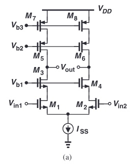

# 장말문제 10.64 — 이득 200, 테일 전류 1 mA의 MOS 텔레스코픽 캐스코드(Fig 10.43(a))의 (W/L)_1 = … = (W/L)_8

## 원문
The MOS telescopic cascode of Fig. 10.43(a) is designed for a voltage gain of 200 with a tail current of $1\ \text{mA}$. If $\mu_n C_{ox} = 100\ \mu\text{A/V}^2$, $\mu_p C_{ox} = 50\ \mu\text{A/V}^2$, $\lambda_n = 0.1\ \text{V}^{-1}$, and $\lambda_p = 0.2\ \text{V}^{-1}$, determine $(W/L)_1 = \cdots = (W/L)_8$.

## 조건
- 회로: 본문 Fig 10.43(a)의 MOS 텔레스코픽 캐스코드
- 전압 이득 $200$, 테일 전류 $1\ \text{mA}$로 설계됨
- $\mu_n C_{ox} = 100\ \mu\text{A/V}^2$, $\mu_p C_{ox} = 50\ \mu\text{A/V}^2$
- $\lambda_n = 0.1\ \text{V}^{-1}$, $\lambda_p = 0.2\ \text{V}^{-1}$
- 모든 트랜지스터의 $W/L$이 같음: $(W/L)_1 = \cdots = (W/L)_8$

## 구할 것
- $(W/L)_1 = \cdots = (W/L)_8$

## 상속·참조
- 본문 (교재 541쪽): 완전한 CMOS 텔레스코픽 캐스코드 증폭기 Fig 10.43(a)는 부하 전류원으로 PMOS 캐스코드($M_5$–$M_8$)를 가짐. 절반 회로 Fig 10.43(b)($v_{in1}$ → $M_1$ 게이트, $M_1$ 드레인 → $M_3$ 소스, $M_3$ 드레인 = $v_{out1}$ = $M_5$ 드레인, $M_5$ 소스 → $M_7$ 드레인, $M_1$ 소스·$M_3$·$M_5$·$M_7$ 게이트·$M_7$ 소스는 교류 접지)로 해석. 식 (9.72)로부터
  $$A_v \approx -g_{m1}[(g_{m3}r_{O3}r_{O1}) \| (g_{m5}r_{O5}r_{O7})] \qquad (10.176)$$

## 회로 — Fig 10.43(a)
```spice
M7   n1    Vb3   VDD   pmos
M8   n2    Vb3   VDD   pmos    ; 게이트는 M7 게이트 높이의 가로선에서 옴
M5   out1  Vb2   n1    pmos
M6   out2  Vb2   n2    pmos    ; 게이트는 M5 게이트 높이의 가로선에서 옴
M3   out1  Vb1   n3    nmos
M4   out2  Vb1   n4    nmos    ; 게이트는 M3 게이트 높이의 가로선에서 옴
M1   n3    Vin1  n5    nmos
M2   n4    Vin2  n5    nmos    ; 좌우 반전 (게이트 오른쪽)
ISS  n5    0     {I_SS}
* Vb3, Vb2, Vb1 점 단자 → 각각 M7, M5, M3 게이트. 같은 높이의 가로선이 왼쪽 트랜지스터 기호(채널 막대 오른쪽)에서 시작해 오른쪽 M8, M6, M4 게이트까지 이어짐 → 게이트 공통으로 읽음
* n1 = M7 드레인–M5 소스, n2 = M8 드레인–M6 소스, n3 = M3 소스–M1 드레인, n4 = M4 소스–M2 드레인, n5 = 공통 소스(테일) 노드 (라벨 없음)
* out1, out2 = 두 출력 점에서 안쪽으로 이어진 개방 원. 두 원 사이에 "V_out" 라벨 하나 (차동 출력)
```
- 단자: VDD = 전원, 값 미지정 (가로 레일) / Vb1, Vb2, Vb3 = 바이어스, 값 미지정 (점 단자) / Vin1, Vin2 = 입력 (개방 원) / out1, out2 = 차동 출력 V_out (개방 원 두 개, 각 원 옆 라벨 없음)
- 표시: 노드 라벨 V_DD (레일 오른쪽 끝), V_b3, V_b2, V_b1 (각 점 단자 왼쪽), V_out (두 출력 원 사이), V_in1 (왼쪽 입력 원 왼쪽), V_in2 (오른쪽 입력 원 오른쪽) / 소자 라벨 M7 (M7 왼쪽 위), M8 (M8 왼쪽 위), M5 (M5 아래), M6 (M6 아래), M3 (M3 왼쪽 위), M4 (M4 오른쪽), M1 (M1 오른쪽), M2 (M2 왼쪽), I_SS (전류원 오른쪽) / 부호 없음 / 화살표 없음 / 수치·면적 라벨 없음
- 배치: 맨 위 굵은 가로 레일 V_DD / 왼쪽 세로줄 위→아래 M7, M5, 출력 점, M3, M1 / 오른쪽 세로줄 위→아래 M8, M6, 출력 점, M4, M2 / M7, M8, M5, M6 pmos 모두 보통 방향(게이트 왼쪽, 소스 위·화살표 안쪽) / M3, M4, M1 nmos 보통 방향(게이트 왼쪽), M2 nmos 좌우 반전(게이트 오른쪽) / 트랜지스터끼리는 세로선으로 바로 이어짐 (점 없음) / 각 출력 점에서 짧은 가로선이 안쪽으로 개방 원 (사이에 V_out 라벨) / V_in1 원 → M1 게이트, V_in2 원 → M2 게이트 / 두 소스는 꼬리 가로선 가운데 n5 점, n5에서 아래로 I_SS(화살표 아래), 그 아래 접지 / 접속점 (세 갈래 이상, 3곳): ① 왼쪽 출력 점 = 위 M5 드레인 + 아래 M3 드레인 + 오른쪽 출력선 (점) ② 오른쪽 출력 점 = 위 M6 드레인 + 아래 M4 드레인 + 왼쪽 출력선 (점) ③ n5 = 왼쪽 M1 소스 선 + 오른쪽 M2 소스 선 + 아래 I_SS (점) / 교차: 없음 (세 게이트 가로선은 왼쪽 트랜지스터 기호를 지나지만 도선과 교차하지 않음)


> 참고: Fig 10.43은 본문 그림(교재 541쪽, PDF 23). 크롭은 패널 (a)만 담음 ((b)는 절반 회로로 상속·참조에 글로 적음)
