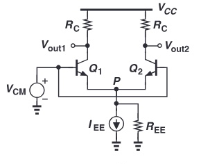

# 장말문제 10.65 — R_EE를 2R_EE 두 개로 나눠 공통 모드 절반 회로로 식 (10.180) 증명 (Fig 10.45(a))

## 원문
Consider the circuit of Fig. 10.45(a) and replace $R_{EE}$ with two parallel resistors equal to $2R_{EE}$ places on the two sides of the current source. Now draw a vertical line of symmetry through the circuit and decompose it to two common-mode half circuits, each having a degeneration resistor equal to $2R_{EE}$. Prove that Eq. (10.180) still holds.

## 조건
- 회로: 본문 Fig 10.45(a) — 테일 임피던스 $R_{EE}$가 유한한 바이폴라 차동쌍의 공통 모드 응답
- $R_{EE}$를 전류원 양쪽에 놓인 $2R_{EE}$ 병렬 저항 두 개로 바꿈
  - 원문 "equal to $2R_{EE}$ places on the two sides"의 "places"는 "placed"의 오식으로 보임 (원문에 없음)
- 회로에 수직 대칭선을 긋고 두 개의 공통 모드 절반 회로로 분해. 각 절반 회로는 $2R_{EE}$의 축퇴 저항을 가짐

## 구할 것
- 식 (10.180)이 여전히 성립함을 증명

## 상속·참조
- 본문 (교재 543쪽): Fig 10.45(a)에서 $R_{EE}$는 $I_{EE}$의 출력 임피던스를 나타냄. 입력 공통 모드 레벨이 조금 변해도 대칭성 때문에 $V_{out1} = V_{out2}$이므로 두 출력을 단락해 Fig 10.45(b)로 줄일 수 있음 (노드 $P$에 대해 $Q_1$, $Q_2$는 이미터 폴로어). 축퇴된 CE 단으로 보아
  $$\frac{\Delta V_{out,CM}}{\Delta V_{in,CM}} = -\frac{\dfrac{R_C}{2}}{R_{EE} + \dfrac{1}{2g_m}} \qquad (10.180)$$
  여기서 $2g_m$은 $Q_1$과 $Q_2$ 병렬 조합의 전도성

## 회로 — Fig 10.45(a)
```spice
RC1  VCC    Vout1  {R_C}
RC2  VCC    Vout2  {R_C}
Q1   Vout1  n1     P    npn
Q2   Vout2  n1     P    npn   ; 좌우 반전 (베이스 오른쪽)
VCM  n1     0      {V_CM}
IEE  P      0      {I_EE}
REE  P      0      {R_EE}
* n1 = V_CM의 + 단자와 두 베이스를 잇는 공통선 (라벨 없음)
* P 점에서 아래로 내려간 세로선이 베이스 공통선(가로)과 점 없이 교차한 뒤 아래 점에서 I_EE와 R_EE로 갈라짐 (모두 노드 P)
```
- 단자: VCC = 전원, 값 미지정 (가로 레일) / Vout1, Vout2 = 출력 (개방 원)
- 표시: 노드 라벨 V_CC (레일 오른쪽 끝), V_out1 (왼쪽 출력 원 왼쪽), V_out2 (오른쪽 출력 원 오른쪽), P (P 점 위) / 소자 라벨 R_C (왼쪽 저항 왼쪽), R_C (오른쪽 저항 오른쪽), Q1 (Q1 오른쪽), Q2 (Q2 왼쪽), V_CM (전압원 왼쪽), I_EE (전류원 왼쪽), R_EE (저항 오른쪽) / 부호 V_CM 전압원 원의 오른쪽 위에 +, 오른쪽 아래에 − / 화살표 없음 / 수치·면적 라벨 없음
- 배치: 맨 위 굵은 가로 레일 V_CC / 왼쪽 세로줄 위→아래 R_C, Vout1 점, Q1 / 오른쪽 세로줄 위→아래 R_C, Vout2 점, Q2 / Vout1 점에서 가로선이 왼쪽 출력 원, Vout2 점에서 가로선이 오른쪽 출력 원 / Q1 npn 보통 방향(베이스 왼쪽), Q2 npn 좌우 반전(베이스 오른쪽) / 두 이미터는 아래로 내려가 가로선으로 가운데 P 점 / V_CM 전압원은 Q1 왼쪽 아래, − 단자 아래 접지 / V_CM + 단자에서 선이 위로 올라가 오른쪽으로 꺾여 베이스 접속점 → 계속 오른쪽 Q1 베이스. 베이스 접속점에서 아래로 내려가 P 가로선보다 조금 아래 높이에서 오른쪽으로 길게 가로질러 Q2 오른쪽 바깥까지 간 뒤 위로 올라가 왼쪽으로 꺾여 Q2 베이스 / P에서 세로선이 아래로 내려가 베이스 공통선을 지나 아래 점, 그 점에서 아래로 I_EE(화살표 아래)·접지, 오른쪽으로 나가 아래로 꺾여(┐ 꺾임) R_EE·접지 / 접속점 (세 갈래 이상, 5곳): ① Vout1 = 위 R_C + 아래 Q1 컬렉터 + 왼쪽 출력선 (점) ② Vout2 = 위 R_C + 아래 Q2 컬렉터 + 오른쪽 출력선 (점) ③ 베이스 접속점 = 왼쪽 V_CM 선 + 오른쪽 Q1 베이스 선 + 아래로 내려가는 공통선 (점) ④ P = 왼쪽 Q1 이미터 선 + 오른쪽 Q2 이미터 선 + 아래 세로선 (점) ⑤ 아래 점 = 위 세로선 + 아래 I_EE + 오른쪽 R_EE 선 (점) / 교차: P에서 아래로 내려가는 세로선이 베이스 공통선(P 아래 가로선)과 점 없이 교차


> 참고: Fig 10.45는 본문 그림(교재 543쪽, PDF 24). 크롭은 패널 (a)만 담음 ((b)는 단순화 회로로 상속·참조에 글로 적음)

## 풀이
### 테일을 둘로 나누기
- $R_{EE}$를 $2R_{EE}$ 두 개의 병렬로, $I_{EE}$를 $I_{EE}/2$ 두 개로 나눠 각 이미터 쪽에 둔다. 병렬 합은 원래와 같으므로 회로는 바뀌지 않는다
- 공통 모드 입력에서는 회로가 좌우 대칭이라 두 쪽 전압·전류가 같다. 그래서 대칭선에서 두 이미터를 잇는 선에는 전류가 흐르지 않고, 이 선을 끊어도 된다
### 공통 모드 절반 회로
- 각 절반은 $Q_1$(컬렉터 $R_C$)의 이미터에 $2R_{EE}$가 달린 축퇴 CE 단이다. $V_A = \infty$로 보고, $g_m$은 $I_{EE}/2$를 흘리는 $Q_1$, $Q_2$ 각각의 트랜스컨덕턴스다
- $\dfrac{\Delta V_{out,CM}}{\Delta V_{in,CM}} = -\dfrac{R_C}{2R_{EE} + 1/g_m}$
### 식 (10.180)과 비교
- 분자·분모를 2로 나누면 $-\dfrac{R_C/2}{R_{EE} + \dfrac{1}{2g_m}}$로, 두 출력을 묶어 푼 식과 같다
### 답
- 절반 회로의 이득 $-R_C/(2R_{EE} + 1/g_m)$은 분자·분모를 2로 나누면 $-\dfrac{R_C/2}{R_{EE} + 1/(2g_m)}$이 되어 식 (10.180)이 그대로 성립한다
