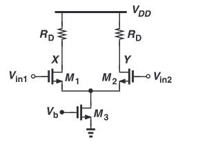

# 장말문제 10.67 — 테일 소자 M3만 λ ≠ 0인 MOS 차동쌍(Fig 10.88)의 공통 모드 이득 식 증명

## 조건
- 회로: Fig 10.88 — 저항 부하 $R_D$ MOS 차동쌍, 테일 전류원은 $M_3$(게이트 $V_b$)
- $M_1$, $M_2$: $\lambda = 0$
- $M_3$: $\lambda \neq 0$
- $(V_{GS} - V_{TH})_{eq.}$: $M_1$, $M_2$의 평형(equilibrium) 오버드라이브
- $I_{SS}$는 그림에 라벨이 없음. $M_3$가 흘리는 테일 전류로 보임 (원문에 없음)

## 구할 것
- 공통 모드 이득을 계산하고 다음을 증명
  $$A_{CM} = \frac{-R_D I_{SS}}{\dfrac{2}{\lambda} + (V_{GS} - V_{TH})_{eq.}} \qquad (10.224)$$

## 회로 — Fig 10.88
```spice
RD1  VDD   X     {R_D}
RD2  VDD   Y     {R_D}
M1   X     Vin1  n1    nmos
M2   Y     Vin2  n1    nmos    ; 좌우 반전 (게이트 오른쪽)
M3   n1    Vb    0     nmos    ; 소스가 바로 접지 기호에 이어짐
* n1 = 공통 소스(테일) 노드 (라벨 없음)
```
- 단자: VDD = 전원, 값 미지정 (가로 레일) / Vb = 바이어스, 값 미지정 (점 단자) / Vin1, Vin2 = 입력 (개방 원)
- 표시: 노드 라벨 V_DD (레일 오른쪽 끝), X (M1 드레인 선 왼쪽), Y (M2 드레인 선 오른쪽), V_in1 (왼쪽 입력 원 왼쪽), V_in2 (오른쪽 입력 원 오른쪽), V_b (점 단자 왼쪽) / 소자 라벨 R_D (왼쪽 저항 왼쪽), R_D (오른쪽 저항 오른쪽), M1 (M1 오른쪽), M2 (M2 왼쪽), M3 (M3 오른쪽) / 부호 없음 / 화살표 없음 / 수치·면적 라벨 없음
- 배치: 맨 위 굵은 가로 레일 V_DD / 왼쪽 세로줄 위→아래 R_D, X, M1 / 오른쪽 세로줄 위→아래 R_D, Y, M2 / X, Y는 저항과 드레인 사이 선에 붙은 글자 라벨뿐 (점·원 없음) / M1 nmos 보통 방향(게이트 왼쪽), M2 nmos 좌우 반전(게이트 오른쪽) / V_in1 원 → M1 게이트, V_in2 원 → M2 게이트 / 두 소스는 꼬리 가로선 가운데 n1 점, n1에서 아래로 M3 드레인 / M3 nmos 보통 방향(게이트 왼쪽): V_b 점 단자 → 가로선 → 게이트, 소스 → 바로 접지 / 접속점 (세 갈래 이상, 1곳): ① n1 = 왼쪽 M1 소스 선 + 오른쪽 M2 소스 선 + 아래 M3 드레인 (점) / 교차: 없음


> 참고: 그림은 문제 진술(교재 564쪽, PDF 39) 다음 쪽인 교재 565쪽(PDF 40)에 인쇄
