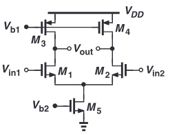

# 장말문제 10.68 — PMOS 전류원 부하와 테일 M5를 가진 MOS 차동쌍(Fig 10.89)의 공통 모드 이득

## 원문
Calculate the common-mode gain of the circuit depicted in Fig. 10.89. Assume $\lambda > 0$, $g_m r_O \gg 1$, and use the relationship $A_v = -G_m R_{out}$.

## 조건
- 회로: Fig 10.89 — PMOS 전류원 부하 $M_3$, $M_4$(게이트 $V_{b1}$)와 테일 전류원 $M_5$(게이트 $V_{b2}$)를 가진 MOS 차동쌍
- $\lambda > 0$
- $g_m r_O \gg 1$
- $A_v = -G_m R_{out}$ 관계를 사용

## 구할 것
- 회로의 공통 모드 이득

## 회로 — Fig 10.89
```spice
M3   out1  Vb1   VDD   pmos
M4   out2  Vb1   VDD   pmos    ; 게이트는 M3 게이트 높이의 가로선에서 옴
M1   out1  Vin1  n1    nmos
M2   out2  Vin2  n1    nmos    ; 좌우 반전 (게이트 오른쪽)
M5   n1    Vb2   0     nmos    ; 소스가 바로 접지 기호에 이어짐
* Vb1 점 단자 → M3 게이트. 같은 높이의 가로선이 M3 기호(채널 막대 오른쪽)에서 시작해 오른쪽 M4 게이트까지 이어짐 → M3·M4 게이트 공통(Vb1)으로 읽음
* n1 = 공통 소스(테일) 노드 (라벨 없음)
* out1, out2 = 두 출력 점에서 안쪽으로 이어진 개방 원. 두 원 사이에 "V_out" 라벨 하나 (차동 출력)
```
- 단자: VDD = 전원, 값 미지정 (가로 레일) / Vb1, Vb2 = 바이어스, 값 미지정 (점 단자) / Vin1, Vin2 = 입력 (개방 원) / out1, out2 = 차동 출력 V_out (개방 원 두 개, 각 원 옆 라벨 없음)
- 표시: 노드 라벨 V_DD (레일 오른쪽 끝), V_b1 (점 단자 왼쪽), V_out (두 출력 원 사이), V_in1 (왼쪽 입력 원 왼쪽), V_in2 (오른쪽 입력 원 오른쪽), V_b2 (점 단자 왼쪽) / 소자 라벨 M3 (M3 왼쪽 아래), M4 (M4 오른쪽), M1 (M1 오른쪽), M2 (M2 왼쪽), M5 (M5 오른쪽) / 부호 없음 / 화살표 없음 / 수치·면적 라벨 없음
- 배치: 맨 위 굵은 가로 레일 V_DD / 왼쪽 세로줄 위→아래 M3, 출력 점, M1 / 오른쪽 세로줄 위→아래 M4, 출력 점, M2 / M3, M4 pmos 둘 다 보통 방향(게이트 왼쪽, 소스 위로 레일·화살표 안쪽) / V_b1 점 단자 → M3 게이트, 같은 높이 가로선이 M3 기호를 가로질러(M3 소스·드레인 선 사이) 오른쪽 M4 게이트 / 각 출력 점에서 짧은 가로선이 안쪽으로 개방 원 (사이에 V_out 라벨) / M1 nmos 보통 방향(게이트 왼쪽), M2 nmos 좌우 반전(게이트 오른쪽) / V_in1 원 → M1 게이트, V_in2 원 → M2 게이트 / 두 소스는 꼬리 가로선 가운데 n1 점, n1에서 아래로 M5 드레인 / M5 nmos 보통 방향(게이트 왼쪽): V_b2 점 단자 → 가로선 → 게이트, 소스 → 바로 접지 / 접속점 (세 갈래 이상, 3곳): ① 왼쪽 출력 점 = 위 M3 드레인 + 아래 M1 드레인 + 오른쪽 출력선 (점) ② 오른쪽 출력 점 = 위 M4 드레인 + 아래 M2 드레인 + 왼쪽 출력선 (점) ③ n1 = 왼쪽 M1 소스 선 + 오른쪽 M2 소스 선 + 아래 M5 드레인 (점) / 교차: 없음 (게이트 가로선은 M3 기호를 지나지만 도선과 교차하지 않음)



## 풀이
### 공통 모드 절반 회로
- $M_5$는 공통 소스 노드에서 $r_{O5}$로 보인다. 이를 $2r_{O5}$ 둘의 병렬로 나누면 대칭선에 전류가 흐르지 않아, 절반 회로는 소스에 $2r_{O5}$가 달린 $M_1$과 부하 $M_3$($V_{b1}$ 교류 접지라 $r_{O3}$)이다
- 몸체 효과는 무시한다. $A_{CM} = -G_m R_{out}$로 구한다
### $G_m$
- 출력 단락 전류로 $G_m = \dfrac{g_{m1} r_{O1}}{r_{O1} + 2r_{O5} + 2g_{m1} r_{O1} r_{O5}}$, $g_m r_O \gg 1$이라 $G_m \approx \dfrac{1}{2r_{O5}}$
### $R_{out}$
- 아래로 본 저항은 $2r_{O5}$로 축퇴된 $M_1$이라 $\approx 2g_{m1} r_{O1} r_{O5}$ ($g_{m1} \cdot 2r_{O5} \gg 1$)
- 이는 $r_{O3}$보다 $g_m r_O$배쯤 커서 $R_{out} = r_{O3} \parallel 2g_{m1} r_{O1} r_{O5} \approx r_{O3}$
### 공통 모드 이득
- $A_{CM} = -G_m R_{out} \approx -\dfrac{r_{O3}}{2r_{O5}}$
- 부하와 테일이 같은 $r_O$ 수준이라 공통 모드 이득이 1보다 크게 작지 않다
### 답
- $A_{CM} \approx -\dfrac{r_{O3}}{2r_{O5}}$
