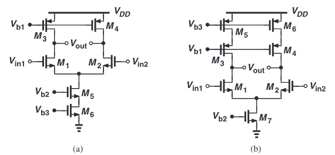

# 장말문제 10.69 — Fig 10.90 (a)(b) 회로에 대해 문제 10.68(공통 모드 이득)을 되풀이

## 원문
Repeat Problem 10.68 for the circuits shown in Fig. 10.90.

## 조건
- 회로: Fig 10.90 (a), (b) — Fig 10.89를 변형한 두 MOS 차동쌍. (a)는 PMOS 부하 $M_3$, $M_4$ 그대로에 테일을 $M_5$ 아래 $M_6$를 쌓은 캐스코드로, (b)는 PMOS 부하를 $M_5$ 아래 $M_3$를 쌓은 캐스코드(오른쪽 $M_6$–$M_4$)로 하고 테일은 $M_7$ 하나
- 문제 10.68을 되풀이
- 문제 10.68에서 이어받는 가정: 공통 모드 이득을 구함, $\lambda > 0$, $g_m r_O \gg 1$, $A_v = -G_m R_{out}$ 관계를 사용 (원문에 없음)

## 구할 것
- (a), (b) 각 회로의 공통 모드 이득 (소문항 표기 없음, 원문은 "the circuits shown in Fig. 10.90"으로 적음)

## 상속·참조
- 문제 10.68 (P10.68): Fig 10.89 회로의 공통 모드 이득을 계산. $\lambda > 0$, $g_m r_O \gg 1$로 가정하고 $A_v = -G_m R_{out}$ 관계를 사용

## 회로 — Fig 10.90(a)
```spice
M3   out1  Vb1   VDD   pmos
M4   out2  Vb1   VDD   pmos    ; 게이트는 M3 게이트 높이의 가로선에서 옴
M1   out1  Vin1  n1    nmos
M2   out2  Vin2  n1    nmos    ; 좌우 반전 (게이트 오른쪽)
M5   n1    Vb2   n2    nmos
M6   n2    Vb3   0     nmos    ; 소스가 바로 접지 기호에 이어짐
* Vb1 점 단자 → M3 게이트. 같은 높이의 가로선이 M3 기호(채널 막대 오른쪽)에서 시작해 오른쪽 M4 게이트까지 이어짐 → M3·M4 게이트 공통(Vb1)으로 읽음
* n1 = 공통 소스(테일) 노드, n2 = M5 소스–M6 드레인 (라벨 없음)
* out1, out2 = 두 출력 점에서 안쪽으로 이어진 개방 원. 두 원 사이에 "V_out" 라벨 하나 (차동 출력)
```
- 단자: VDD = 전원, 값 미지정 (가로 레일) / Vb1, Vb2, Vb3 = 바이어스, 값 미지정 (점 단자) / Vin1, Vin2 = 입력 (개방 원) / out1, out2 = 차동 출력 V_out (개방 원 두 개, 각 원 옆 라벨 없음)
- 표시: 노드 라벨 V_DD (레일 오른쪽 끝), V_b1 (점 단자 왼쪽), V_out (두 출력 원 사이), V_in1 (왼쪽 입력 원 왼쪽), V_in2 (오른쪽 입력 원 오른쪽), V_b2, V_b3 (각 점 단자 왼쪽) / 소자 라벨 M3 (M3 왼쪽 아래), M4 (M4 오른쪽), M1 (M1 오른쪽), M2 (M2 왼쪽), M5 (M5 오른쪽), M6 (M6 오른쪽) / 부호 없음 / 화살표 없음 / 수치·면적 라벨 없음
- 배치: 맨 위 굵은 가로 레일 V_DD / 왼쪽 세로줄 위→아래 M3, 출력 점, M1 / 오른쪽 세로줄 위→아래 M4, 출력 점, M2 / M3, M4 pmos 둘 다 보통 방향(게이트 왼쪽, 소스 위로 레일·화살표 안쪽) / V_b1 점 단자 → M3 게이트, 같은 높이 가로선이 M3 기호를 가로질러(M3 소스·드레인 선 사이) 오른쪽 M4 게이트 / 각 출력 점에서 짧은 가로선이 안쪽으로 개방 원 (사이에 V_out 라벨) / M1 nmos 보통 방향(게이트 왼쪽), M2 nmos 좌우 반전(게이트 오른쪽) / V_in1 원 → M1 게이트, V_in2 원 → M2 게이트 / 두 소스는 꼬리 가로선 가운데 n1 점, n1에서 아래로 M5, 그 아래 M6 (M5 소스 → M6 드레인, 점 없음), M6 소스 → 바로 접지 / M5, M6 nmos 보통 방향(게이트 왼쪽): V_b2 → M5 게이트, V_b3 → M6 게이트 (각 점 단자 → 가로선) / 접속점 (세 갈래 이상, 3곳): ① 왼쪽 출력 점 = 위 M3 드레인 + 아래 M1 드레인 + 오른쪽 출력선 (점) ② 오른쪽 출력 점 = 위 M4 드레인 + 아래 M2 드레인 + 왼쪽 출력선 (점) ③ n1 = 왼쪽 M1 소스 선 + 오른쪽 M2 소스 선 + 아래 M5 드레인 (점) / 교차: 없음 (게이트 가로선은 M3 기호를 지나지만 도선과 교차하지 않음)

## 회로 — Fig 10.90(b)
```spice
M5   n1    Vb3   VDD   pmos
M6   n2    Vb3   VDD   pmos    ; 게이트는 M5 게이트 높이의 가로선에서 옴
M3   out1  Vb1   n1    pmos
M4   out2  Vb1   n2    pmos    ; 게이트는 M3 게이트 높이의 가로선에서 옴
M1   out1  Vin1  n3    nmos
M2   out2  Vin2  n3    nmos    ; 좌우 반전 (게이트 오른쪽)
M7   n3    Vb2   0     nmos    ; 소스가 바로 접지 기호에 이어짐
* Vb3, Vb1 점 단자 → 각각 M5, M3 게이트. 같은 높이의 가로선이 왼쪽 트랜지스터 기호(채널 막대 오른쪽)에서 시작해 오른쪽 M6, M4 게이트까지 이어짐 → 게이트 공통으로 읽음
* n1 = M5 드레인–M3 소스, n2 = M6 드레인–M4 소스, n3 = 공통 소스(테일) 노드 (라벨 없음)
* out1, out2 = 두 출력 점에서 안쪽으로 이어진 개방 원. 두 원 사이에 "V_out" 라벨 하나 (차동 출력)
```
- 단자: VDD = 전원, 값 미지정 (가로 레일) / Vb1, Vb2, Vb3 = 바이어스, 값 미지정 (점 단자) / Vin1, Vin2 = 입력 (개방 원) / out1, out2 = 차동 출력 V_out (개방 원 두 개, 각 원 옆 라벨 없음)
- 표시: 노드 라벨 V_DD (레일 오른쪽 끝), V_b3, V_b1 (각 점 단자 왼쪽), V_out (두 출력 원 사이), V_in1 (왼쪽 입력 원 왼쪽), V_in2 (오른쪽 입력 원 오른쪽), V_b2 (점 단자 왼쪽) / 소자 라벨 M5 (M5 오른쪽 아래), M6 (M6 오른쪽), M3 (M3 왼쪽 아래), M4 (M4 오른쪽), M1 (M1 오른쪽), M2 (M2 왼쪽), M7 (M7 오른쪽) / 부호 없음 / 화살표 없음 / 수치·면적 라벨 없음
- 배치: 맨 위 굵은 가로 레일 V_DD / 왼쪽 세로줄 위→아래 M5, M3, 출력 점, M1 / 오른쪽 세로줄 위→아래 M6, M4, 출력 점, M2 / M5, M6, M3, M4 pmos 모두 보통 방향(게이트 왼쪽, 소스 위·화살표 안쪽), M5 드레인 → M3 소스 (점 없음) / V_b3 점 단자 → M5 게이트, V_b1 점 단자 → M3 게이트, 각 같은 높이 가로선이 왼쪽 트랜지스터 기호를 가로질러 오른쪽 M6, M4 게이트 / 각 출력 점에서 짧은 가로선이 안쪽으로 개방 원 (사이에 V_out 라벨) / M1 nmos 보통 방향(게이트 왼쪽), M2 nmos 좌우 반전(게이트 오른쪽) / V_in1 원 → M1 게이트, V_in2 원 → M2 게이트 / 두 소스는 꼬리 가로선 가운데 n3 점, n3에서 아래로 M7 드레인 / M7 nmos 보통 방향(게이트 왼쪽): V_b2 점 단자 → 가로선 → 게이트, 소스 → 바로 접지 / 접속점 (세 갈래 이상, 3곳): ① 왼쪽 출력 점 = 위 M3 드레인 + 아래 M1 드레인 + 오른쪽 출력선 (점) ② 오른쪽 출력 점 = 위 M4 드레인 + 아래 M2 드레인 + 왼쪽 출력선 (점) ③ n3 = 왼쪽 M1 소스 선 + 오른쪽 M2 소스 선 + 아래 M7 드레인 (점) / 교차: 없음 (두 게이트 가로선은 왼쪽 트랜지스터 기호를 지나지만 도선과 교차하지 않음)


> 참고: 패널 (a)는 PDF 40 왼쪽 단, (b)는 같은 높이의 오른쪽 단에 인쇄. 그림 번호 "Figure 10.90"은 (a) 아래에만 있음

## 힌트
### (b) $M_1$ 드레인 쪽 저항도 남기기
- 공통 모드 절반 회로에서 $M_1$ 소스에는 $2r_{O7}$이 축퇴 저항으로 달려 있어, $M_1$ 드레인에서 아래로 본 저항이 $g_m r_O \cdot r_O$ 크기다
- 문제 10.68과 (a)에서는 $r_O$ 하나짜리 부하에 견줘 버릴 수 있었지만, (b)의 캐스코드 부하와는 같은 차수라 출력 노드에서 둘을 병렬로 모두 남긴다

## 풀이
### 공통: 절반 회로
- 테일에서 본 저항 $R_T$를 $2R_T$ 둘로 나누면 공통 모드에서 대칭선에 전류가 없어, 절반 회로는 소스에 $2R_T$가 달린 $M_1$이다. 몸체 효과는 무시하고 한 출력 기준 $A_{CM} = -G_m R_{out}$로 푼다(대칭이면 차동 출력으로는 0)
- $g_{m1} \cdot 2R_T \gg 1$이면 $G_m \approx 1/(2R_T)$이고, $M_1$ 드레인에서 아래로 본 저항은 $\approx g_{m1} r_{O1} \cdot 2R_T$
### (a) 캐스코드 테일
- $M_5$는 $r_{O6}$로 축퇴되고 $g_{m5} r_{O6} \gg 1$이라 $R_T \approx g_{m5} r_{O5} r_{O6}$, $G_m \approx \dfrac{1}{2g_{m5} r_{O5} r_{O6}}$
- 부하 $r_{O3}$이 아래로 본 저항보다 훨씬 작아 $R_{out} \approx r_{O3}$
- $A_{CM} \approx -\dfrac{r_{O3}}{2g_{m5} r_{O5} r_{O6}}$
### (b) 캐스코드 부하
- $R_T = r_{O7}$, $G_m \approx \dfrac{1}{2r_{O7}}$
- 위로 본 저항 $g_{m3} r_{O3} r_{O5}$와 아래로 본 저항 $2g_{m1} r_{O1} r_{O7}$이 둘 다 $g_m r_O^2$ 차수라 병렬로 모두 남긴다: $R_{out} \approx (g_{m3} r_{O3} r_{O5}) \parallel (2g_{m1} r_{O1} r_{O7})$
- $A_{CM} \approx -\dfrac{(g_{m3} r_{O3} r_{O5}) \parallel (2g_{m1} r_{O1} r_{O7})}{2r_{O7}}$
### 답
- (a) $A_{CM} \approx -\dfrac{r_{O3}}{2g_{m5} r_{O5} r_{O6}}$
- (b) $A_{CM} \approx -\dfrac{(g_{m3} r_{O3} r_{O5}) \parallel (2g_{m1} r_{O1} r_{O7})}{2r_{O7}}$
