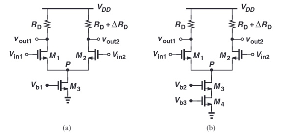

# 장말문제 10.70 — 부하 미스매치 ΔR_D가 있는 Fig 10.91 (a)(b) 두 단의 CMRR 비교

## 조건
- 회로: Fig 10.91 (a), (b) — 부하 $R_D$, $R_D + \Delta R_D$를 가진 MOS 차동쌍. (a) 테일 전류원은 $M_3$ 하나, (b) 테일은 $M_3$ 아래에 $M_4$를 쌓은 캐스코드
- 간단히 하기 위해 $M_1$, $M_2$의 채널 길이 변조는 무시, 다른 트랜지스터의 채널 길이 변조는 무시하지 않음

## 구할 것
- (a), (b) 각 단의 공통 모드 제거비(CMRR)
- 두 결과를 비교

## 회로 — Fig 10.91(a)
```spice
RD1  VDD    vout1  {R_D}
RD2  VDD    vout2  {R_D+ΔR_D}   ; 라벨 "R_D + ΔR_D"
M1   vout1  Vin1   P     nmos
M2   vout2  Vin2   P     nmos   ; 좌우 반전 (게이트 오른쪽)
M3   P      Vb1    0     nmos   ; 소스가 바로 접지 기호에 이어짐
```
- 단자: VDD = 전원, 값 미지정 (가로 레일) / Vb1 = 바이어스, 값 미지정 (점 단자) / Vin1, Vin2 = 입력 (개방 원) / vout1, vout2 = 출력 (개방 원)
- 표시: 노드 라벨 V_DD (레일 오른쪽 끝), v_out1 (왼쪽 출력 원 왼쪽, 소문자 v), v_out2 (오른쪽 출력 원 오른쪽, 소문자 v), V_in1 (왼쪽 입력 원 왼쪽), V_in2 (오른쪽 입력 원 오른쪽), P (P 점 위), V_b1 (점 단자 왼쪽) / 소자 라벨 R_D (왼쪽 저항 왼쪽), R_D + ΔR_D (오른쪽 저항 오른쪽), M1 (M1 오른쪽), M2 (M2 왼쪽), M3 (M3 오른쪽) / 부호 없음 / 화살표 없음 / 수치·면적 라벨 없음
- 배치: 맨 위 굵은 가로 레일 V_DD / 왼쪽 세로줄 위→아래 R_D, vout1 점, M1 / 오른쪽 세로줄 위→아래 R_D + ΔR_D, vout2 점, M2 / vout1 점에서 가로선이 왼쪽 출력 원, vout2 점에서 가로선이 오른쪽 출력 원 / M1 nmos 보통 방향(게이트 왼쪽), M2 nmos 좌우 반전(게이트 오른쪽) / V_in1 원 → M1 게이트, V_in2 원 → M2 게이트 / 두 소스는 꼬리 가로선 가운데 P 점, P에서 아래로 M3 드레인 / M3 nmos 보통 방향(게이트 왼쪽): V_b1 점 단자 → 가로선 → 게이트, 소스 → 바로 접지 / 접속점 (세 갈래 이상, 3곳): ① vout1 = 위 R_D + 아래 M1 드레인 + 왼쪽 출력선 (점) ② vout2 = 위 R_D + ΔR_D + 아래 M2 드레인 + 오른쪽 출력선 (점) ③ P = 왼쪽 M1 소스 선 + 오른쪽 M2 소스 선 + 아래 M3 드레인 (점) / 교차: 없음

## 회로 — Fig 10.91(b)
```spice
RD1  VDD    vout1  {R_D}
RD2  VDD    vout2  {R_D+ΔR_D}   ; 라벨 "R_D + ΔR_D"
M1   vout1  Vin1   P     nmos
M2   vout2  Vin2   P     nmos   ; 좌우 반전 (게이트 오른쪽)
M3   P      Vb2    n1    nmos
M4   n1     Vb3    0     nmos   ; 소스가 바로 접지 기호에 이어짐
* n1 = M3 소스–M4 드레인 (라벨 없음)
```
- 단자: VDD = 전원, 값 미지정 (가로 레일) / Vb2, Vb3 = 바이어스, 값 미지정 (점 단자) / Vin1, Vin2 = 입력 (개방 원) / vout1, vout2 = 출력 (개방 원)
- 표시: 노드 라벨 V_DD (레일 오른쪽 끝), v_out1 (왼쪽 출력 원 왼쪽, 소문자 v), v_out2 (오른쪽 출력 원 오른쪽, 소문자 v), V_in1 (왼쪽 입력 원 왼쪽), V_in2 (오른쪽 입력 원 오른쪽), P (P 점 위), V_b2, V_b3 (각 점 단자 왼쪽) / 소자 라벨 R_D (왼쪽 저항 왼쪽), R_D + ΔR_D (오른쪽 저항 오른쪽), M1 (M1 오른쪽), M2 (M2 왼쪽), M3 (M3 오른쪽), M4 (M4 오른쪽) / 부호 없음 / 화살표 없음 / 수치·면적 라벨 없음
- 배치: (a)와 같은 구조에서 테일이 M3 아래에 M4를 쌓은 형태 / 맨 위 굵은 가로 레일 V_DD / 왼쪽 세로줄 위→아래 R_D, vout1 점, M1 / 오른쪽 세로줄 위→아래 R_D + ΔR_D, vout2 점, M2 / vout1 점에서 가로선이 왼쪽 출력 원, vout2 점에서 가로선이 오른쪽 출력 원 / M1 nmos 보통 방향(게이트 왼쪽), M2 nmos 좌우 반전(게이트 오른쪽) / 두 소스는 꼬리 가로선 가운데 P 점, P에서 아래로 M3, 그 아래 M4 (M3 소스 → M4 드레인, 점 없음), M4 소스 → 바로 접지 / M3, M4 nmos 보통 방향(게이트 왼쪽): V_b2 → M3 게이트, V_b3 → M4 게이트 (각 점 단자 → 가로선) / 접속점 (세 갈래 이상, 3곳): ① vout1 (점) ② vout2 (점) ③ P (점) ((a)와 같은 세 갈래) / 교차: 없음


> 참고: 패널 (a)는 PDF 40 왼쪽 단, (b)는 같은 높이의 오른쪽 단에 인쇄. 그림 번호 "Figure 10.91"은 (a) 아래에만 있음
