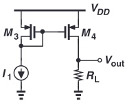

# 장말문제 10.71 — PMOS 전류 거울(Fig 10.92)의 소신호 이득 v_out/i_1, (W/L)_3 = N(W/L)_4

## 원문
Determine the small-signal gain $v_{out}/i_1$ in the circuit of Fig. 10.92 if $(W/L)_3 = N(W/L)_4$. Neglect channel-length modulation.

## 조건
- 회로: Fig 10.92 — 다이오드 연결 $M_3$와 $M_4$로 된 PMOS 전류 거울. $M_3$ 쪽에 전류원 $I_1$, $M_4$ 드레인(출력)에 부하 $R_L$
- $(W/L)_3 = N(W/L)_4$
- 채널 길이 변조 무시
- $i_1$은 $I_1$의 소신호 성분으로 보임 (원문에 없음)

## 구할 것
- 소신호 이득 $v_{out}/i_1$

## 회로 — Fig 10.92
```spice
M3   n1    n1    VDD   pmos    ; 좌우 반전 (게이트 오른쪽), 다이오드 연결 (게이트 = 드레인)
M4   Vout  n1    VDD   pmos
I1   n1    0     {I_1}
RL   Vout  0     {R_L}
* n1 = M3 드레인·게이트와 M4 게이트 (라벨 없음)
```
- 단자: VDD = 전원, 값 미지정 (가로 레일) / Vout = 출력 (개방 원)
- 표시: 노드 라벨 V_DD (레일 오른쪽 끝), V_out (출력 원 오른쪽) / 소자 라벨 M3 (M3 왼쪽), M4 (M4 오른쪽), I_1 (전류원 왼쪽, 대문자 I), R_L (저항 오른쪽) / 부호 없음 / 화살표 없음 / 수치·면적 라벨 없음
- 배치: 맨 위 굵은 가로 레일 V_DD / M3 pmos 좌우 반전(게이트 오른쪽, 소스 왼쪽 위 → 레일, 드레인 왼쪽 아래), M4 pmos 보통 방향(게이트 왼쪽, 소스 오른쪽 위 → 레일, 드레인 오른쪽 아래) / 게이트 가로선: M3 게이트에서 오른쪽으로 게이트 접속점 → 계속 오른쪽 M4 게이트. 게이트 접속점에서 아래로 내려가 왼쪽으로 꺾여 M3 드레인 접속점 (다이오드 연결) / 왼쪽 세로줄 위→아래 M3 드레인, 드레인 접속점, I_1(화살표 아래), 접지 / 오른쪽 세로줄 위→아래 M4 드레인, 출력 접속점, R_L, 접지 / 출력 접속점에서 가로선이 오른쪽 V_out 원 / 접속점 (세 갈래 이상, 3곳): ① 게이트 접속점 = 왼쪽 M3 게이트 선 + 오른쪽 M4 게이트 선 + 아래 되먹임 선 (점) ② M3 드레인 접속점 = 위 M3 드레인 + 오른쪽 되먹임 선 + 아래 I_1 (점) ③ 출력 접속점 = 위 M4 드레인 + 오른쪽 출력선 + 아래 R_L (점) / 교차: 없음



## 풀이
### 다이오드 쪽 게이트 전압
- $\lambda = 0$이다. $M_3$은 다이오드 연결이라 $i_1$이 늘면 $|V_{GS3}|$가 커져 게이트 전압이 내려간다: $v_g = -i_1/g_{m3}$ ($g_{m3}$는 $M_3$의 트랜스컨덕턴스)
### 출력 전류
- $M_4$는 같은 $V_{GS}$를 받고 전류가 $I_{D4} = I_1/N$, $W/L$도 $1/N$이라 $g_{m4} = \sqrt{2\mu_p C_{ox}(W/L)_4 I_{D4}} = g_{m3}/N$
- $M_4$가 $R_L$ 쪽으로 내보내는 전류 $i_{d4} = g_{m4}(-v_g) = \dfrac{g_{m3}}{N} \cdot \dfrac{i_1}{g_{m3}} = \dfrac{i_1}{N}$
### 이득
- $\lambda = 0$이라 $M_4$ 출력 저항이 무한이고 전류가 모두 $R_L$로 간다: $v_{out} = \dfrac{i_1}{N} R_L$
### 답
- $v_{out}/i_1 = R_L/N$
