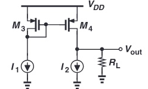

# 장말문제 10.73 — PMOS 전류 거울(Fig 10.94)의 소신호 이득 v_out/i_1, v_out/i_2

## 원문
Neglecting channel-length modulation, compute the small-signal gains $v_{out}/i_1$ and $v_{out}/i_2$ in Fig. 10.94.

## 조건
- 회로: Fig 10.94 — 다이오드 연결 $M_3$와 $M_4$로 된 PMOS 전류 거울. $M_3$ 쪽에 전류원 $I_1$, 출력 노드에 전류원 $I_2$와 부하 $R_L$ (Fig 10.93과 같은 모양으로 인쇄됨)
- 채널 길이 변조 무시
- $i_1$, $i_2$는 $I_1$, $I_2$의 소신호 성분으로 보임 (원문에 없음)

## 구할 것
- 소신호 이득 $v_{out}/i_1$과 $v_{out}/i_2$

## 회로 — Fig 10.94
```spice
M3   n1    n1    VDD   pmos    ; 좌우 반전 (게이트 오른쪽), 다이오드 연결 (게이트 = 드레인)
M4   Vout  n1    VDD   pmos
I1   n1    0     {I_1}
I2   Vout  0     {I_2}
RL   Vout  0     {R_L}
* n1 = M3 드레인·게이트와 M4 게이트 (라벨 없음)
```
- 단자: VDD = 전원, 값 미지정 (가로 레일) / Vout = 출력 (개방 원)
- 표시: 노드 라벨 V_DD (레일 오른쪽 끝), V_out (출력 원 오른쪽) / 소자 라벨 M3 (M3 왼쪽), M4 (M4 오른쪽), I_1 (왼쪽 전류원 왼쪽, 대문자 I), I_2 (가운데 전류원 왼쪽, 대문자 I), R_L (저항 오른쪽) / 부호 없음 / 화살표 없음 / 수치·면적 라벨 없음
- 배치: 맨 위 굵은 가로 레일 V_DD / M3 pmos 좌우 반전(게이트 오른쪽, 소스 왼쪽 위 → 레일, 드레인 왼쪽 아래), M4 pmos 보통 방향(게이트 왼쪽, 소스 오른쪽 위 → 레일, 드레인 오른쪽 아래) / 게이트 가로선: M3 게이트에서 오른쪽으로 게이트 접속점 → 계속 오른쪽 M4 게이트. 게이트 접속점에서 아래로 내려가 왼쪽으로 꺾여 M3 드레인 접속점 (다이오드 연결) / 왼쪽 세로줄 위→아래 M3 드레인, 드레인 접속점, I_1(화살표 아래), 접지 / 가운데 세로줄 위→아래 M4 드레인, 출력 접속점, I_2(화살표 아래), 접지 / 출력 접속점에서 가로선이 오른쪽으로 R_L 접속점을 지나 V_out 원. R_L 접속점에서 아래로 R_L, 접지 / 접속점 (세 갈래 이상, 4곳): ① 게이트 접속점 = 왼쪽 M3 게이트 선 + 오른쪽 M4 게이트 선 + 아래 되먹임 선 (점) ② M3 드레인 접속점 = 위 M3 드레인 + 오른쪽 되먹임 선 + 아래 I_1 (점) ③ 출력 접속점 = 위 M4 드레인 + 오른쪽 출력선 + 아래 I_2 (점) ④ R_L 접속점 = 왼쪽 출력선 + 오른쪽 V_out 선 + 아래 R_L (점) / 교차: 없음



## 풀이
### 소신호 모형
- $\lambda = 0$이라 $M_4$는 게이트 전압만으로 전류가 정해지는 전류원이고, 다이오드 연결 $M_3$은 게이트 노드에서 $1/g_{m3}$로 보인다 ($g_{m3}$, $g_{m4}$는 $M_3$, $M_4$의 트랜스컨덕턴스)
- $i_1$, $i_2$는 $I_1$, $I_2$가 아래로 흘리는 전류의 소신호 성분이다. 하나씩 따로 준다
### $v_{out}/i_1$
- $I_1$이 $M_3$에서 $i_1$을 더 끌어가면 게이트 전압이 $v_G = -i_1/g_{m3}$만큼 내려간다
- $M_4$ 전류가 $g_{m4}|v_G| = (g_{m4}/g_{m3})\, i_1$만큼 늘어 출력 노드로 들어가고, $I_2$는 고정이므로 모두 $R_L$로 흐른다
- $v_{out}/i_1 = (g_{m4}/g_{m3}) R_L$. 같은 전류 비로 $g_{m4}/g_{m3} = (W/L)_4/(W/L)_3$이고, 두 소자가 같으면 $R_L$
### $v_{out}/i_2$
- $i_1 = 0$이면 $M_4$ 전류가 고정된다($\lambda = 0$). $I_2$가 $i_2$를 더 끌어가면 그만큼 $R_L$ 전류가 준다: $v_{out} = -i_2 R_L$
### 답
- $v_{out}/i_1 = \dfrac{g_{m4}}{g_{m3}} R_L = \dfrac{(W/L)_4}{(W/L)_3} R_L$ (같은 소자면 $R_L$)
- $v_{out}/i_2 = -R_L$
