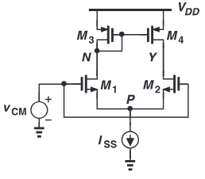

# 장말문제 10.74 — 입력을 공통 모드 레벨에 묶은 능동 부하 MOS 쌍(Fig 10.95)의 N, Y 노드 전압

## 원문
Consider the circuit of Fig. 10.95, where the inputs are tied to a common-mode level. Assume $M_1$ and $M_2$ are identical and so are $M_3$ and $M_4$.

(a) Neglecting channel-length modulation, calculate the voltage at node $N$.

(b) Invoking symmetry, determine the voltage at node $Y$.

(c) What happens to the results obtained in (a) and (b) if $V_{DD}$ changes by a small amount $\Delta V$?

## 조건
- 회로: Fig 10.95 — 전류 거울 부하($M_3$ 다이오드 연결, $M_4$)와 테일 $I_{SS}$를 가진 NMOS 차동쌍. 두 입력(게이트)은 공통 모드 레벨 $v_{CM}$에 묶임
- $M_1$과 $M_2$는 동일, $M_3$와 $M_4$도 동일

## 구할 것
- (a) 채널 길이 변조를 무시하고 $N$ 노드의 전압을 계산
- (b) 대칭성을 이용해 $Y$ 노드의 전압을 결정
- (c) $V_{DD}$가 작은 양 $\Delta V$만큼 변하면 (a), (b)의 결과는 어떻게 되는가?

## 회로 — Fig 10.95
```spice
M3   N     N     VDD   pmos    ; 좌우 반전 (게이트 오른쪽), 다이오드 연결 (게이트 = 드레인)
M4   Y     N     VDD   pmos
M1   N     n1    P     nmos
M2   Y     n1    P     nmos    ; 좌우 반전 (게이트 오른쪽)
VCM  n1    0     {v_CM}        ; 라벨 소문자 v_CM
ISS  P     0     {I_SS}
* n1 = v_CM의 + 단자와 두 게이트를 잇는 공통선 (라벨 없음)
```
- 단자: VDD = 전원, 값 미지정 (가로 레일) / 개방 단자 없음
- 표시: 노드 라벨 V_DD (레일 오른쪽 끝), N (M3 드레인 접속점 아래 세로선 왼쪽), Y (M4 드레인 아래 세로선 왼쪽), P (P 점 위) / 소자 라벨 M3 (M3 왼쪽), M4 (M4 오른쪽), M1 (M1 오른쪽), M2 (M2 왼쪽), v_CM (전압원 왼쪽, 소문자 v), I_SS (전류원 왼쪽) / 부호 v_CM 전압원 원의 오른쪽 위에 +, 오른쪽 아래에 − / 화살표 없음 / 수치·면적 라벨 없음
- 배치: 맨 위 굵은 가로 레일 V_DD / M3 pmos 좌우 반전(게이트 오른쪽, 소스 왼쪽 위 → 레일, 드레인 왼쪽 아래), M4 pmos 보통 방향(게이트 왼쪽, 소스 오른쪽 위 → 레일, 드레인 오른쪽 아래) / 게이트 가로선: M3 게이트에서 오른쪽으로 게이트 접속점 → 계속 오른쪽 M4 게이트. 게이트 접속점에서 아래로 내려가 왼쪽으로 꺾여 N 접속점 (다이오드 연결) / 왼쪽 세로줄 위→아래 M3 드레인, N 접속점, M1 드레인 / 오른쪽 세로줄 위→아래 M4 드레인, Y (점 없음), M2 드레인 / M1 nmos 보통 방향(게이트 왼쪽), M2 nmos 좌우 반전(게이트 오른쪽) / 두 소스는 아래로 내려가 가로선으로 가운데 P 점, P에서 아래로 I_SS(화살표 아래), 그 아래 접지 / v_CM 전압원은 M1 왼쪽 아래, − 단자 아래 접지 / v_CM + 단자에서 선이 위로 올라가 오른쪽으로 꺾여 게이트 입력 접속점 → 계속 오른쪽 M1 게이트. 입력 접속점에서 아래로 내려가 P 가로선보다 조금 아래 높이에서 오른쪽으로 길게 가로질러 M2 오른쪽 바깥까지 간 뒤 위로 올라가 왼쪽으로 꺾여 M2 게이트 / 접속점 (세 갈래 이상, 4곳): ① 게이트 접속점 = 왼쪽 M3 게이트 선 + 오른쪽 M4 게이트 선 + 아래 되먹임 선 (점) ② N = 위 M3 드레인 + 오른쪽 되먹임 선 + 아래 M1 드레인 선 (점) ③ 입력 접속점 = 왼쪽 v_CM 선 + 오른쪽 M1 게이트 선 + 아래로 내려가는 공통선 (점) ④ P = 왼쪽 M1 소스 선 + 오른쪽 M2 소스 선 + 아래 I_SS (점) / 교차: P에서 I_SS로 내려가는 세로선이 게이트 공통선(P 아래 가로선)과 점 없이 교차


