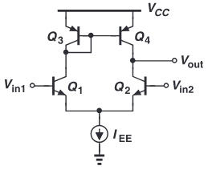

# 장말문제 10.75 — 능동 부하 바이폴라 쌍(Fig 10.96)의 이득 100을 위한 pnp Early 전압

## 원문
We wish to design the stage shown in Fig. 10.96 for a voltage gain of 100. If $V_{A,n} = 5\ \text{V}$, what is the required Early voltage for the pnp transistors?

## 조건
- 회로: Fig 10.96 — pnp 전류 거울 부하($Q_3$ 다이오드 연결, $Q_4$)와 테일 $I_{EE}$를 가진 npn 차동쌍, 싱글엔디드 출력 $V_{out}$
- 목표 전압 이득 100
- $V_{A,n} = 5\ \text{V}$

## 구할 것
- pnp 트랜지스터에 필요한 Early 전압

## 회로 — Fig 10.96
```spice
Q3   n1    n1    VCC   pnp     ; 좌우 반전 (베이스 오른쪽), 다이오드 연결 (베이스 = 컬렉터)
Q4   Vout  n1    VCC   pnp
Q1   n1    Vin1  n2    npn
Q2   Vout  Vin2  n2    npn     ; 좌우 반전 (베이스 오른쪽)
IEE  n2    0     {I_EE}
* n1 = Q3 컬렉터·베이스와 Q4 베이스, n2 = 공통 이미터(테일) 노드 (라벨 없음)
```
- 단자: VCC = 전원, 값 미지정 (가로 레일) / Vin1, Vin2 = 입력 (개방 원) / Vout = 출력 (개방 원)
- 표시: 노드 라벨 V_CC (레일 오른쪽 끝), V_out (출력 원 오른쪽), V_in1 (왼쪽 입력 원 왼쪽), V_in2 (오른쪽 입력 원 오른쪽) / 소자 라벨 Q3 (Q3 왼쪽), Q4 (Q4 오른쪽), Q1 (Q1 오른쪽), Q2 (Q2 왼쪽), I_EE (전류원 오른쪽) / 부호 없음 / 화살표 없음 / 수치·면적 라벨 없음
- 배치: 맨 위 굵은 가로 레일 V_CC / Q3 pnp 좌우 반전(베이스 오른쪽, 이미터 왼쪽 위 → 레일, 컬렉터 왼쪽 아래), Q4 pnp 보통 방향(베이스 왼쪽, 이미터 오른쪽 위 → 레일, 컬렉터 오른쪽 아래) / 베이스 가로선: Q3 베이스에서 오른쪽으로 베이스 접속점 → 계속 오른쪽 Q4 베이스. 베이스 접속점에서 아래로 내려가 왼쪽으로 꺾여 Q3 컬렉터 접속점 (다이오드 연결) / 왼쪽 세로줄 위→아래 Q3 컬렉터, 컬렉터 접속점, Q1 컬렉터 / 오른쪽 세로줄 위→아래 Q4 컬렉터, 출력 접속점, Q2 컬렉터 / 출력 접속점에서 가로선이 오른쪽 V_out 원 / Q1 npn 보통 방향(베이스 왼쪽), Q2 npn 좌우 반전(베이스 오른쪽) / V_in1 원 → Q1 베이스, V_in2 원 → Q2 베이스 / 두 이미터는 아래로 내려가 가로선으로 가운데 n2 점, n2에서 아래로 I_EE(화살표 아래), 그 아래 접지 / 접속점 (세 갈래 이상, 4곳): ① 베이스 접속점 = 왼쪽 Q3 베이스 선 + 오른쪽 Q4 베이스 선 + 아래 되먹임 선 (점) ② n1 컬렉터 접속점 = 위 Q3 컬렉터 + 오른쪽 되먹임 선 + 아래 Q1 컬렉터 선 (점) ③ 출력 접속점 = 위 Q4 컬렉터 + 오른쪽 출력선 + 아래 Q2 컬렉터 선 (점) ④ n2 = 왼쪽 Q1 이미터 선 + 오른쪽 Q2 이미터 선 + 아래 I_EE (점) / 교차: 없음


