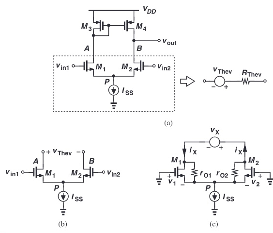

# 장말문제 10.76 — Fig 10.58의 해석을 입력 차동쌍의 노턴 등가회로로 다시 하기

## 원문
Repeat the analysis in Fig. 10.58 but by constructing a Norton equivalent for the input differential pair.

## 조건
- 회로: Fig 10.58 — 전류 거울 부하($M_3$ 다이오드 연결, $M_4$)를 가진 NMOS 차동쌍($M_1$, $M_2$, 테일 $I_{SS}$), 싱글엔디드 출력 $v_{out}$
- 본문(접근법 II)은 입력 차동쌍($v_{in1}$, $v_{in2}$, $M_1$, $M_2$ 부분)을 테브냉 등가회로로 바꿔 해석함 (아래 상속·참조)
- 이번에는 입력 차동쌍에 대해 노턴 등가회로를 구성해 같은 해석을 되풀이

## 구할 것
- 입력 차동쌍의 노턴 등가회로(노턴 전류와 노턴 저항)를 구하고, 그것으로 Fig 10.58 회로의 전압 이득 $v_{out}/(v_{in1} - v_{in2})$을 구함 (구할 값의 구체화는 원문에 없음, 원문은 "Repeat the analysis"만 적음)

## 상속·참조
- 본문 553–555쪽 접근법 II (Fig 10.58의 해석):
  - $v_{in1}$, $v_{in2}$는 차동이라고 가정. $v_{Thev}$는 개방 조건에서 $A$와 $B$ 사이의 전압 (Fig 10.58(b)). 이 조건에서 회로는 대칭이고 식 (10.97)에 의해
    $$v_{Thev} = -g_{mN} r_{ON}(v_{in1} - v_{in2}) \qquad (10.206)$$
    (아래첨자 $N$ = NMOS 소자)
  - 테브냉 저항: 입력을 0으로 두고 출력 단자 사이에 $v_X$를 인가 (Fig 10.58(c)). $M_1$과 $M_2$는 같은 게이트-소스 전압($v_1 = v_2$)을 가짐. 출력 루프 KVL:
    $$(i_X - g_{m1} v_1) r_{O1} + (i_X + g_{m2} v_2) r_{O2} = v_X \qquad (10.207)$$
    $$R_{Thev} = 2 r_{ON} \qquad (10.208)$$
  - 그림 10.59 (크롭 안 함, 본문 554쪽): $M_3$를 $(1/g_{m3}) \| r_{O3}$로, $M_4$의 출력 임피던스를 $r_{O4}$(B 노드–접지)로 그린 단순화 회로. $A$ 노드–$E$ 노드 사이에 $R_{Thev}$, $E$–$B$ 사이에 $v_{Thev}$(+ $E$ 쪽, − $B$ 쪽), $M_4$ 게이트 = $A$, 드레인 = $B$ = $v_{out}$. $E$ 노드 전압은 $v_{out} + v_{Thev}$
    $$v_A = \frac{\frac{1}{g_{m3}} \| r_{O3}}{\frac{1}{g_{m3}} \| r_{O3} + R_{Thev}}(v_{out} + v_{Thev}) \qquad (10.209)$$
    $$g_{m4} v_A + \frac{v_{out}}{r_{O4}} + \frac{v_{out} + v_{Thev}}{\frac{1}{g_{m3}} \| r_{O3} + R_{Thev}} = 0 \qquad (10.210)$$
  - $1/g_{m3} \ll r_{O3}$, $1/g_{m3} \ll R_{Thev}$, $g_{m3} = g_{m4} = g_{mP}$, $r_{O3} = r_{O4} = r_{OP}$로 두면
    $$\frac{2}{R_{Thev}}(v_{out} + v_{Thev}) + \frac{v_{out}}{r_{OP}} = 0 \qquad (10.212)$$
  - 결과: $$\frac{v_{out}}{v_{in1} - v_{in2}} = g_{mN}(r_{ON} \| r_{OP}) \qquad (10.214)$$
- 식 (10.211)은 (10.209)를 (10.210)에 넣은 식, (10.213)은 (10.206)과 (10.212)를 합친 중간식

## 회로 — Fig 10.58(a)
```spice
M3   A     A     VDD  pmos   ; 좌우 반전 (게이트 오른쪽), 다이오드 연결 (게이트 = 드레인)
M4   vout  A     VDD  pmos
M1   A     vin1  P    nmos
M2   vout  vin2  P    nmos   ; 좌우 반전 (게이트 오른쪽)
ISS  P     0     {I_SS}
* vout = 라벨 B가 인쇄된 M4·M2 드레인 노드. 출력 원 v_out이 이 노드에서 가로선으로 나감
```
- 단자: VDD = 전원, 값 미지정 (가로 레일) / vin1, vin2 = 소신호 입력 (개방 원) / vout = 출력 (개방 원)
- 표시: 노드 라벨 V_DD (레일 오른쪽 끝), A (A 접속점 아래 세로선 왼쪽), B (출력 접속점 아래 세로선 오른쪽), v_out (출력 원 오른쪽), v_in1 (왼쪽 입력 원 왼쪽), v_in2 (오른쪽 입력 원 오른쪽), P (P 점 왼쪽 아래) / 소자 라벨 M3 (M3 왼쪽), M4 (M4 오른쪽), M1 (M1 오른쪽), M2 (M2 왼쪽), I_SS (전류원 오른쪽) / 부호 없음 / 화살표 없음 / 수치·면적 라벨 없음
- 배치: 맨 위 굵은 가로 레일 V_DD / M3 pmos 좌우 반전(게이트 오른쪽, 소스 왼쪽 위 → 레일, 드레인 왼쪽 아래), M4 pmos 보통 방향(게이트 왼쪽, 소스 오른쪽 위 → 레일, 드레인 오른쪽 아래) / 게이트 가로선: M3 게이트에서 오른쪽으로 게이트 접속점 → 계속 오른쪽 M4 게이트. 게이트 접속점에서 아래로 내려가 왼쪽으로 꺾여 A 접속점 (다이오드 연결) / 왼쪽 세로줄 위→아래 M3 드레인, A 접속점, M1 드레인 / 오른쪽 세로줄 위→아래 M4 드레인, 출력 접속점, M2 드레인 / 출력 접속점에서 가로선이 오른쪽 v_out 원 / M1 nmos 보통 방향(게이트 왼쪽), M2 nmos 좌우 반전(게이트 오른쪽) / v_in1 원 → 가로선 → M1 게이트, v_in2 원 → 가로선 → M2 게이트 / 두 소스는 아래로 내려가 가로선으로 가운데 P 점, P에서 아래로 I_SS(화살표 아래), 그 아래 접지 / 점선 사각형 상자가 M1, M2, 두 입력 원, P, I_SS, 접지를 둘러쌈 (A, B 라벨은 상자 윗변 바로 위, 상자 밖) / 상자 오른쪽에 속이 빈 굵은 화살표(⇨)가 오른쪽 등가회로 (a-eq)를 가리킴 / 접속점 (세 갈래 이상, 4곳): ① 게이트 접속점 = 왼쪽 M3 게이트 선 + 오른쪽 M4 게이트 선 + 아래 되먹임 선 (점) ② A = 위 M3 드레인 + 오른쪽 되먹임 선 + 아래 M1 드레인 선 (점) ③ 출력 = 위 M4 드레인 + 오른쪽 출력선 + 아래 M2 드레인 선 (점) ④ P = 왼쪽 M1 소스 선 + 오른쪽 M2 소스 선 + 아래 I_SS (점) / 교차: 도선끼리의 교차 없음 (점선 상자 윗변이 A 세로선, B 세로선 위를 지나감)

## 회로 — Fig 10.58(a-eq)
```spice
VThev  n1  out1  {v_Thev}   ; + 오른쪽(n1), − 왼쪽(out1)
RThev  n1  out2  {R_Thev}
* out1, out2 = 등가회로 양 끝의 개방 원 (라벨 없음), n1 = 전압원–저항 사이 (라벨 없음)
```
- 단자: out1, out2 = 테브냉 등가회로의 두 단자 (개방 원, 각각 라벨 없음)
- 표시: 노드 라벨 없음 / 소자 라벨 v_Thev (전압원 위), R_Thev (저항 위) / 부호 전압원 원의 왼쪽 아래에 −, 오른쪽 아래에 + / 화살표 없음 / 수치·면적 라벨 없음
- 배치: 한 가로줄 왼쪽→오른쪽 개방 원, 전압원(원), R_Thev, 개방 원 / (a)의 ⇨ 오른쪽, 점선 상자 세로 가운데 높이 / 교차: 없음

## 회로 — Fig 10.58(b)
```spice
M1   A     vin1  P    nmos
M2   B     vin2  P    nmos   ; 좌우 반전 (게이트 오른쪽)
ISS  P     0     {I_SS}
* A, B = M1, M2 드레인에서 위로 올라간 선 끝의 개방 원 (라벨 A, B가 선 옆에 인쇄). 두 원 사이에 "+ v_Thev −"
```
- 단자: vin1, vin2 = 소신호 입력 (개방 원) / A, B = 개방 조건의 두 출력 단자, 그 사이 전압이 v_Thev (개방 원)
- 표시: 노드 라벨 A (M1 드레인 선 왼쪽), B (M2 드레인 선 오른쪽), v_in1 (왼쪽 입력 원 왼쪽), v_in2 (오른쪽 입력 원 오른쪽), P (P 점 왼쪽 아래) / 소자 라벨 M1 (M1 오른쪽), M2 (M2 왼쪽), I_SS (전류원 오른쪽) / 부호 + (A 원 오른쪽), − (B 원 왼쪽), 그 사이 라벨 v_Thev / 화살표 없음 / 수치·면적 라벨 없음
- 배치: M1 nmos 보통 방향(게이트 왼쪽), M2 nmos 좌우 반전(게이트 오른쪽) / M1 드레인이 위로 올라가 A 원, M2 드레인이 위로 올라가 B 원 (두 원은 같은 높이) / v_in1 원 → M1 게이트, v_in2 원 → M2 게이트 / 두 소스는 아래로 내려가 가로선으로 가운데 P 점, P에서 아래로 I_SS(화살표 아래), 그 아래 접지 / 접속점 (세 갈래 이상, 1곳): ① P = 왼쪽 M1 소스 선 + 오른쪽 M2 소스 선 + 아래 I_SS (점) / 교차: 없음

## 회로 — Fig 10.58(c)
```spice
VX   n2    n1    {v_X}      ; + 오른쪽(n2 쪽), − 왼쪽(n1 쪽)
M1   n1    0     P    nmos  ; 게이트가 바로 접지 기호에 이어짐
RO1  n1    P     {r_O1}
M2   n2    0     P    nmos  ; 좌우 반전 (게이트 오른쪽), 게이트가 바로 접지 기호에 이어짐
RO2  n2    P     {r_O2}
ISS  P     0     {I_SS}
* n1 = M1 드레인, n2 = M2 드레인 (라벨 없음). v_1, v_2는 각 트랜지스터의 게이트-소스 전압 표시 (소자 아님)
```
- 단자: 개방 단자 없음 (입력은 0으로 둠, 게이트는 접지 기호)
- 표시: 노드 라벨 P (P 점 왼쪽 아래) / 소자 라벨 v_X (전압원 위), M1 (M1 드레인 접속점 왼쪽 위), r_O1 (왼쪽 저항 오른쪽), r_O2 (오른쪽 저항 왼쪽), M2 (M2 드레인 접속점 오른쪽 위), I_SS (전류원 오른쪽) / 부호 v_X 원의 왼쪽 아래에 −, 오른쪽 아래에 + / M1 게이트 선 아래 왼쪽에 +, M1 소스 아래 오른쪽에 −, 그 사이 아래에 v_1 / M2 게이트 선 아래 오른쪽에 +, M2 소스 아래 왼쪽에 −, 그 사이 아래에 v_2 / 화살표 "i_X": v_X 왼쪽 선에서 M1 드레인으로 내려가는 세로선, 아래 방향, 도선 위 / "i_X": M2 드레인에서 v_X 오른쪽 선으로 올라가는 세로선, 위 방향, 도선 위 / 수치·면적 라벨 없음
- 배치: 맨 위 가로선 가운데에 v_X 전압원, 가로선 왼쪽 끝은 아래로 M1 드레인 접속점, 오른쪽 끝은 아래로 M2 드레인 접속점 / M1 nmos 보통 방향(게이트 왼쪽): 게이트는 왼쪽으로 나가 아래로 꺾여 접지 / M2 nmos 좌우 반전(게이트 오른쪽): 게이트는 오른쪽으로 나가 아래로 꺾여 접지 / 각 드레인 접속점에서 안쪽으로 짧게 나가 아래로 r_O1(왼쪽), r_O2(오른쪽), 아래 끝은 소스 가로선의 점 / 소스 가로선 왼쪽→오른쪽 M1 소스, r_O1 아래 점, P 점, r_O2 아래 점, M2 소스 / P에서 아래로 I_SS(화살표 아래), 그 아래 접지 / 접속점 (세 갈래 이상, 5곳): ① n1 = 위 v_X 선 + 아래 M1 드레인 + 오른쪽 r_O1 선 (점) ② n2 = 위 v_X 선 + 아래 M2 드레인 + 왼쪽 r_O2 선 (점) ③ r_O1 아래 점 = 왼쪽 M1 소스 선 + 위 r_O1 + 오른쪽 가로선 (점) ④ P = 왼쪽 가로선 + 오른쪽 가로선 + 아래 I_SS (점) ⑤ r_O2 아래 점 = 오른쪽 M2 소스 선 + 위 r_O2 + 왼쪽 가로선 (점) / 교차: 없음


> 참고: 그림은 본문 553쪽(PDF 29)의 그림 10.58 전체 ((a) 위 줄, (b)(c) 아래 줄). E10.29와 같은 크롭
