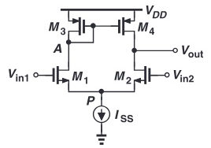

# 장말문제 10.77 — 능동 부하 MOS 쌍(Fig 10.56)의 출력 임피던스

## 원문
Determine the output impedance of the circuit shown in Fig. 10.56. Assume $g_m r_O \gg 1$.

## 조건
- 회로: Fig 10.56 — 전류 거울 부하($M_3$ 다이오드 연결, $M_4$)와 테일 $I_{SS}$를 가진 NMOS 차동쌍, 싱글엔디드 출력 $V_{out}$
- $g_m r_O \gg 1$

## 구할 것
- 회로의 출력 임피던스 ($V_{out}$ 노드에서 본 임피던스로 보임) (괄호 안은 원문에 없음)

## 회로 — Fig 10.56
```spice
M3   A     A     VDD   pmos    ; 좌우 반전 (게이트 오른쪽), 다이오드 연결 (게이트 = 드레인)
M4   Vout  A     VDD   pmos
M1   A     Vin1  P     nmos
M2   Vout  Vin2  P     nmos    ; 좌우 반전 (게이트 오른쪽)
ISS  P     0     {I_SS}
```
- 단자: VDD = 전원, 값 미지정 (가로 레일) / Vin1, Vin2 = 입력 (개방 원) / Vout = 출력 (개방 원)
- 표시: 노드 라벨 V_DD (레일 오른쪽 끝), A (A 접속점 아래 세로선 왼쪽), V_out (출력 원 오른쪽), V_in1 (왼쪽 입력 원 왼쪽), V_in2 (오른쪽 입력 원 오른쪽), P (P 점 왼쪽 아래) / 소자 라벨 M3 (M3 왼쪽), M4 (M4 오른쪽), M1 (M1 오른쪽), M2 (M2 왼쪽), I_SS (전류원 오른쪽) / 부호 없음 / 화살표 없음 / 수치·면적 라벨 없음
- 배치: 맨 위 굵은 가로 레일 V_DD / M3 pmos 좌우 반전(게이트 오른쪽, 소스 왼쪽 위 → 레일, 드레인 왼쪽 아래), M4 pmos 보통 방향(게이트 왼쪽, 소스 오른쪽 위 → 레일, 드레인 오른쪽 아래) / 게이트 가로선: M3 게이트에서 오른쪽으로 게이트 접속점 → 계속 오른쪽 M4 게이트. 게이트 접속점에서 아래로 내려가 왼쪽으로 꺾여 A 접속점 (다이오드 연결) / 왼쪽 세로줄 위→아래 M3 드레인, A 접속점, M1 드레인 / 오른쪽 세로줄 위→아래 M4 드레인, 출력 접속점, M2 드레인 / 출력 접속점에서 가로선이 오른쪽 V_out 원 / M1 nmos 보통 방향(게이트 왼쪽), M2 nmos 좌우 반전(게이트 오른쪽) / V_in1 원 → M1 게이트, V_in2 원 → M2 게이트 / 두 소스는 아래로 내려가 가로선으로 가운데 P 점, P에서 아래로 I_SS(화살표 아래), 그 아래 접지 / 접속점 (세 갈래 이상, 4곳): ① 게이트 접속점 = 왼쪽 M3 게이트 선 + 오른쪽 M4 게이트 선 + 아래 되먹임 선 (점) ② A = 위 M3 드레인 + 오른쪽 되먹임 선 + 아래 M1 드레인 선 (점) ③ 출력 접속점 = 위 M4 드레인 + 오른쪽 출력선 + 아래 M2 드레인 선 (점) ④ P = 왼쪽 M1 소스 선 + 오른쪽 M2 소스 선 + 아래 I_SS (점) / 교차: 없음


> 참고: 그림은 본문 551쪽(PDF 28)의 그림 10.56

## 힌트
### 입력 쌍을 $A$–출력 사이 저항으로
- 입력을 0으로 두면 $M_1$, $M_2$, $P$는 $A$와 출력 노드 사이에 걸린 두 단자 회로일 뿐이고, 본문 그림 10.58(c)의 테브냉 저항 계산과 같은 상황이다. 그 저항 하나로 바꾸면 $P$가 교류 접지인지 따질 필요가 없다
- 그 뒤는 문제 10.76처럼, 출력에서 이 저항을 지나 $A$로 간 전류를 $M_4$가 복사해 출력에서 한 번 더 끌어간다

## 풀이
### 입력 쌍을 저항 하나로
- $r_{ON} = r_{O1} = r_{O2}$, $r_{OP} = r_{O3} = r_{O4}$로 둔다. 입력을 0으로 두면 $M_1$, $M_2$, $P$는 $A$와 출력 사이의 두 단자 회로이고, 테일이 이상적 전류원이라 $M_1$로 들어간 전류가 그대로 $M_2$로 나온다
- 두 소자의 게이트-소스 전압이 같아($-v_P$) $g_m$ 전류가 KVL에서 서로 지워지고 $r_{O1}$, $r_{O2}$만 직렬로 남는다: $R_{AB} = 2r_{ON}$
### 테스트 전류
- 출력에 $v_X$를 걸면 $i_X$는 세 갈래다: $r_{O4}$로 $v_X/r_{OP}$, $R_{AB}$를 지나 $A$로 $i_R = v_X/(2r_{ON} + Z_A)$, $M_4$가 복사한 $g_{m4} Z_A i_R$ ($Z_A = 1/g_{m3} \parallel r_{O3}$은 $A$에서 본 다이오드 $M_3$)
- $g_m r_O \gg 1$이라 $Z_A \approx 1/g_{m3} \ll 2r_{ON}$이고 $g_{m4} Z_A \approx 1$(같은 소자)이다: $i_X \approx \dfrac{v_X}{r_{OP}} + 2\cdot\dfrac{v_X}{2r_{ON}}$
### 출력 임피던스
- $R_{out} = v_X/i_X \approx \left(\dfrac{1}{r_{OP}} + \dfrac{1}{r_{ON}}\right)^{-1} = r_{ON} \parallel r_{OP}$
- $R_{AB}$를 지난 전류가 거울로 한 번 더 흘러 $2r_{ON}$이 $r_{ON}$처럼 보인다
### 답
- $R_{out} \approx r_{ON} \parallel r_{OP}$ ($= r_{O2} \parallel r_{O4}$)
