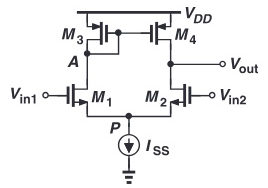

# 장말문제 10.78 — 문제 10.77의 출력 임피던스와 A_v = −G_m R_out으로 Fig 10.56 단의 전압 이득

## 원문
Using the result obtained in Problem 10.77 and the relationship $A_v = -G_m R_{out}$, compute the voltage gain of the stage.

## 조건
- 회로: 문제 10.77의 단 (Fig 10.56, 전류 거울 부하를 가진 NMOS 차동쌍) (그림 번호는 원문에 없음, 원문은 "the stage"로 적음)
- 문제 10.77에서 얻은 결과(출력 임피던스)를 사용
- $A_v = -G_m R_{out}$ 관계를 사용

## 구할 것
- 단의 전압 이득

## 상속·참조
- 문제 10.77 (P10.77): Fig 10.56 회로의 출력 임피던스를 구함. $g_m r_O \gg 1$ 가정

## 회로 — Fig 10.56
```spice
M3   A     A     VDD   pmos    ; 좌우 반전 (게이트 오른쪽), 다이오드 연결 (게이트 = 드레인)
M4   Vout  A     VDD   pmos
M1   A     Vin1  P     nmos
M2   Vout  Vin2  P     nmos    ; 좌우 반전 (게이트 오른쪽)
ISS  P     0     {I_SS}
```
- 단자: VDD = 전원, 값 미지정 (가로 레일) / Vin1, Vin2 = 입력 (개방 원) / Vout = 출력 (개방 원)
- 표시: 노드 라벨 V_DD (레일 오른쪽 끝), A (A 접속점 아래 세로선 왼쪽), V_out (출력 원 오른쪽), V_in1 (왼쪽 입력 원 왼쪽), V_in2 (오른쪽 입력 원 오른쪽), P (P 점 왼쪽 아래) / 소자 라벨 M3 (M3 왼쪽), M4 (M4 오른쪽), M1 (M1 오른쪽), M2 (M2 왼쪽), I_SS (전류원 오른쪽) / 부호 없음 / 화살표 없음 / 수치·면적 라벨 없음
- 배치: 맨 위 굵은 가로 레일 V_DD / M3 pmos 좌우 반전(게이트 오른쪽, 소스 왼쪽 위 → 레일, 드레인 왼쪽 아래), M4 pmos 보통 방향(게이트 왼쪽, 소스 오른쪽 위 → 레일, 드레인 오른쪽 아래) / 게이트 가로선: M3 게이트에서 오른쪽으로 게이트 접속점 → 계속 오른쪽 M4 게이트. 게이트 접속점에서 아래로 내려가 왼쪽으로 꺾여 A 접속점 (다이오드 연결) / 왼쪽 세로줄 위→아래 M3 드레인, A 접속점, M1 드레인 / 오른쪽 세로줄 위→아래 M4 드레인, 출력 접속점, M2 드레인 / 출력 접속점에서 가로선이 오른쪽 V_out 원 / M1 nmos 보통 방향(게이트 왼쪽), M2 nmos 좌우 반전(게이트 오른쪽) / V_in1 원 → M1 게이트, V_in2 원 → M2 게이트 / 두 소스는 아래로 내려가 가로선으로 가운데 P 점, P에서 아래로 I_SS(화살표 아래), 그 아래 접지 / 접속점 (세 갈래 이상, 4곳): ① 게이트 접속점 = 왼쪽 M3 게이트 선 + 오른쪽 M4 게이트 선 + 아래 되먹임 선 (점) ② A = 위 M3 드레인 + 오른쪽 되먹임 선 + 아래 M1 드레인 선 (점) ③ 출력 접속점 = 위 M4 드레인 + 오른쪽 출력선 + 아래 M2 드레인 선 (점) ④ P = 왼쪽 M1 소스 선 + 오른쪽 M2 소스 선 + 아래 I_SS (점) / 교차: 없음


> 참고: 그림은 본문 551쪽(PDF 28)의 그림 10.56
