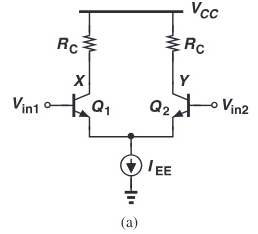

# 장말문제 10.79 — 바이폴라 차동쌍(Fig 10.7(a)) 설계: 전압 이득 10, 전력 예산 2 mW

## 조건
- 설계 대상: Fig 10.7(a)의 바이폴라 차동쌍 (저항 부하 $R_C$, 테일 $I_{EE}$)
- 목표 전압 이득 10
- 전력 예산 $2\ \text{mW}$
- $V_{CC} = 2.5\ \text{V}$, $V_A = \infty$

## 구할 것
- 회로 설계 (정할 값 예: $I_{EE}$, $R_C$) (원문에 없음, 원문은 "설계하라"만 적음)

## 회로 — Fig 10.7(a)
```spice
RC1  VCC   X     {R_C}
RC2  VCC   Y     {R_C}
Q1   X     Vin1  n1    npn
Q2   Y     Vin2  n1    npn     ; 좌우 반전 (베이스 오른쪽)
IEE  n1    0     {I_EE}
* n1 = 공통 이미터(테일) 노드 (라벨 없음)
```
- 단자: VCC = 전원, 값 미지정 (가로 레일) / Vin1, Vin2 = 입력 (개방 원) / X, Y = 컬렉터 노드 (글자 라벨만, 원·점 없음)
- 표시: 노드 라벨 V_CC (레일 오른쪽 끝), X (Q1 컬렉터 선 왼쪽), Y (Q2 컬렉터 선 오른쪽), V_in1 (왼쪽 입력 원 왼쪽), V_in2 (오른쪽 입력 원 오른쪽) / 소자 라벨 R_C (왼쪽 저항 왼쪽), R_C (오른쪽 저항 오른쪽), Q1 (Q1 오른쪽), Q2 (Q2 왼쪽), I_EE (전류원 오른쪽) / 부호 없음 / 화살표 없음 / 수치·면적 라벨 없음
- 배치: 맨 위 굵은 가로 레일 V_CC / 왼쪽 세로줄 위→아래 R_C, X, Q1 / 오른쪽 세로줄 위→아래 R_C, Y, Q2 / Q1 npn 보통 방향(베이스 왼쪽), Q2 npn 좌우 반전(베이스 오른쪽) / V_in1 원 → Q1 베이스, V_in2 원 → Q2 베이스 / 두 이미터는 아래로 내려가 가로선으로 가운데 n1 점, n1에서 아래로 I_EE(화살표 아래), 그 아래 접지 / 접속점 (세 갈래 이상, 1곳): ① n1 = 왼쪽 Q1 이미터 선 + 오른쪽 Q2 이미터 선 + 아래 I_EE (점) / 교차: 없음


> 참고: 그림은 본문 504쪽(PDF 5)의 그림 10.7에서 (a)만 크롭. (b)는 MOS 차동쌍으로 이 문제와 관계없음
