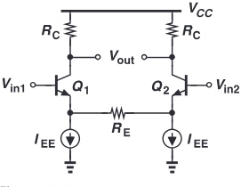

# 장말문제 10.81 — 이미터 축퇴 저항 R_E를 가진 바이폴라 차동쌍(Fig 10.97) 설계: 이득 5, 4 mW, I_C 10% 변화에 이득 변화 2% 미만

## 조건
- 설계 대상: Fig 10.97의 차동쌍 (저항 부하 $R_C$, 두 이미터 사이 $R_E$, 이미터마다 전류원 $I_{EE}$)
- 이득 5
- 전력 예산 $4\ \text{mW}$
- 어느 한 트랜지스터의 컬렉터 전류가 $10\%$ 변해도 회로의 이득 변화는 $2\%$ 미만이어야 함
- $V_{CC} = 2.5\ \text{V}$, $V_A = \infty$
- 힌트: $I_C$가 $10\%$ 변하면 $g_m$도 $10\%$ 변함

## 구할 것
- 회로 설계 (정할 값 예: $I_{EE}$, $R_C$, $R_E$) (원문에 없음, 원문은 "설계하라"만 적음)

## 회로 — Fig 10.97
```spice
RC1   VCC   out1  {R_C}
RC2   VCC   out2  {R_C}
Q1    out1  Vin1  n1    npn
Q2    out2  Vin2  n2    npn     ; 좌우 반전 (베이스 오른쪽)
RE    n1    n2    {R_E}
IEE1  n1    0     {I_EE}        ; 두 전류원 모두 I_EE로 인쇄
IEE2  n2    0     {I_EE}
* n1 = Q1 이미터, n2 = Q2 이미터 (라벨 없음)
* out1, out2 = 두 컬렉터 점에서 안쪽으로 이어진 개방 원. 두 원 사이에 "V_out" 라벨 하나 (차동 출력)
```
- 단자: VCC = 전원, 값 미지정 (가로 레일) / Vin1, Vin2 = 입력 (개방 원) / out1, out2 = 차동 출력 V_out (개방 원 두 개, 각 원 옆 라벨 없음)
- 표시: 노드 라벨 V_CC (레일 오른쪽 끝), V_out (두 출력 원 사이), V_in1 (왼쪽 입력 원 왼쪽), V_in2 (오른쪽 입력 원 오른쪽) / 소자 라벨 R_C (왼쪽 저항 왼쪽), R_C (오른쪽 저항 오른쪽), Q1 (Q1 오른쪽), Q2 (Q2 왼쪽), R_E (가로 저항 아래), I_EE (왼쪽 전류원 왼쪽), I_EE (오른쪽 전류원 오른쪽) / 부호 없음 / 화살표 없음 / 수치·면적 라벨 없음
- 배치: 맨 위 굵은 가로 레일 V_CC / 왼쪽 세로줄 위→아래 R_C, 출력 점, Q1, n1 점, I_EE(화살표 아래), 접지 / 오른쪽 세로줄 위→아래 R_C, 출력 점, Q2, n2 점, I_EE(화살표 아래), 접지 / 각 출력 점에서 짧은 가로선이 안쪽으로 개방 원 (사이에 V_out 라벨) / Q1 npn 보통 방향(베이스 왼쪽), Q2 npn 좌우 반전(베이스 오른쪽) / V_in1 원 → Q1 베이스, V_in2 원 → Q2 베이스 / n1 점과 n2 점 사이 가로 저항 R_E / 접속점 (세 갈래 이상, 4곳): ① 왼쪽 출력 점 = 위 R_C + 아래 Q1 컬렉터 + 오른쪽 출력선 (점) ② 오른쪽 출력 점 = 위 R_C + 아래 Q2 컬렉터 + 왼쪽 출력선 (점) ③ n1 = 위 Q1 이미터 + 오른쪽 R_E + 아래 I_EE (점) ④ n2 = 위 Q2 이미터 + 왼쪽 R_E + 아래 I_EE (점) / 교차: 없음


> 참고: 문제 진술은 교재 566쪽(PDF 41)에서 시작해 567쪽(PDF 42)으로 이어지고, 그림은 567쪽(PDF 42)에 인쇄
