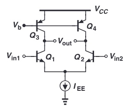

# 장말문제 10.82 — pnp 전류원 부하 바이폴라 차동쌍(Fig 10.98) 설계: 이득 50, 전력 예산 1 mW

## 원문
Design the circuit of Fig. 10.98 for a gain of 50 and a power budget of $1\ \text{mW}$. Assume $V_{A,n} = 6\ \text{V}$ and $V_{CC} = 2.5\ \text{V}$.

## 조건
- 설계 대상: Fig 10.98 — pnp 전류원 부하 $Q_3$, $Q_4$(베이스 $V_b$)와 테일 $I_{EE}$를 가진 npn 차동쌍
- 이득 50
- 전력 예산 $1\ \text{mW}$
- $V_{A,n} = 6\ \text{V}$, $V_{CC} = 2.5\ \text{V}$
- $V_{A,p}$는 주어지지 않음. $V_{A,p} = \infty$면 이득은 $V_{A,n}/V_T \approx 231$로 전류와 무관하게 정해져 50을 만들 수 없으므로, 이득 50에 필요한 $V_{A,p}$를 함께 정함 (원문에 없음)

## 구할 것
- 회로 설계 (정할 값: $I_{EE}$, 이득 50에 필요한 $V_{A,p}$. pnp의 $I_S$가 없어 $V_b$ 값은 정할 수 없음) (원문에 없음, 원문은 "설계하라"만 적음)

## 회로 — Fig 10.98
```spice
Q3   out1  Vb    VCC   pnp
Q4   out2  Vb    VCC   pnp     ; 베이스는 Q3 베이스 높이의 가로선에서 옴
Q1   out1  Vin1  n1    npn
Q2   out2  Vin2  n1    npn     ; 좌우 반전 (베이스 오른쪽)
IEE  n1    0     {I_EE}
* Vb 점 단자 → Q3 베이스. 같은 높이의 가로선이 Q3 기호(이미터·컬렉터 선 사이)를 가로질러 Q4 베이스까지 이어짐 → Q3·Q4 베이스 공통(Vb)
* n1 = 공통 이미터(테일) 노드 (라벨 없음)
* out1, out2 = 두 출력 점에서 안쪽으로 이어진 개방 원. 두 원 사이에 "V_out" 라벨 하나 (차동 출력)
```
- 단자: VCC = 전원, 값 미지정 (가로 레일) / Vb = 바이어스, 값 미지정 (점 단자) / Vin1, Vin2 = 입력 (개방 원) / out1, out2 = 차동 출력 V_out (개방 원 두 개, 각 원 옆 라벨 없음)
- 표시: 노드 라벨 V_CC (레일 오른쪽 끝), V_b (점 단자 왼쪽), V_out (두 출력 원 사이), V_in1 (왼쪽 입력 원 왼쪽), V_in2 (오른쪽 입력 원 오른쪽) / 소자 라벨 Q3 (Q3 왼쪽 아래), Q4 (Q4 오른쪽), Q1 (Q1 오른쪽), Q2 (Q2 왼쪽), I_EE (전류원 오른쪽) / 부호 없음 / 화살표 없음 / 수치·면적 라벨 없음
- 배치: 맨 위 굵은 가로 레일 V_CC / Q3, Q4 pnp 둘 다 보통 방향(베이스 왼쪽, 이미터 오른쪽 위 → 레일, 컬렉터 오른쪽 아래) / V_b 점 단자 → Q3 베이스, 같은 높이 가로선이 Q3 기호를 가로질러 Q4 베이스 / 왼쪽 세로줄 위→아래 Q3 컬렉터, 출력 점, Q1 컬렉터 / 오른쪽 세로줄 위→아래 Q4 컬렉터, 출력 점, Q2 컬렉터 / 각 출력 점에서 짧은 가로선이 안쪽으로 개방 원 (사이에 V_out 라벨) / Q1 npn 보통 방향(베이스 왼쪽), Q2 npn 좌우 반전(베이스 오른쪽) / V_in1 원 → Q1 베이스, V_in2 원 → Q2 베이스 / 두 이미터는 아래로 내려가 가로선으로 가운데 n1 점, n1에서 아래로 I_EE(화살표 아래), 그 아래 접지 / 접속점 (세 갈래 이상, 3곳): ① 왼쪽 출력 점 = 위 Q3 컬렉터 + 아래 Q1 컬렉터 + 오른쪽 출력선 (점) ② 오른쪽 출력 점 = 위 Q4 컬렉터 + 아래 Q2 컬렉터 + 왼쪽 출력선 (점) ③ n1 = 왼쪽 Q1 이미터 선 + 오른쪽 Q2 이미터 선 + 아래 I_EE (점) / 교차: 없음 (베이스 가로선은 Q3 기호를 지나지만 도선과 교차하지 않음)


