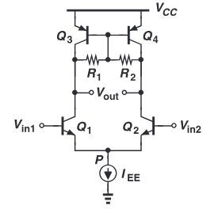

# 장말문제 10.83 — 공통 베이스를 R1–R2 가운데 점에 이은 pnp 부하 바이폴라 차동쌍(Fig 10.99) 설계: 이득 100, 전력 예산 1 mW

## 원문
Design the circuit of Fig. 10.99 for a gain of 100 and a power budget of $1\ \text{mW}$. Assume $V_{A,n} = 10\ \text{V}$, $V_{A,p} = 5\ \text{V}$, and $V_{CC} = 2.5\ \text{V}$. Also, $R_1 = R_2$.

## 조건
- 설계 대상: Fig 10.99 — pnp 부하 $Q_3$, $Q_4$의 공통 베이스를 두 컬렉터 사이 $R_1$–$R_2$ 가운데 점에 이은 npn 차동쌍, 테일 $I_{EE}$
- 이득 100
- 전력 예산 $1\ \text{mW}$
- $V_{A,n} = 10\ \text{V}$, $V_{A,p} = 5\ \text{V}$, $V_{CC} = 2.5\ \text{V}$
- $R_1 = R_2$

## 구할 것
- 회로 설계 (정할 값 예: $I_{EE}$, $R_1 = R_2$) (원문에 없음, 원문은 "설계하라"만 적음)

## 회로 — Fig 10.99
```spice
Q3   out1  n1    VCC   pnp     ; 좌우 반전 (베이스 오른쪽)
Q4   out2  n1    VCC   pnp
R1   out1  n1    {R_1}
R2   n1    out2  {R_2}
Q1   out1  Vin1  P     npn
Q2   out2  Vin2  P     npn     ; 좌우 반전 (베이스 오른쪽)
IEE  P     0     {I_EE}
* n1 = Q3·Q4 공통 베이스 = R1–R2 가운데 점 (라벨 없음)
* out1, out2 = 두 출력 점에서 안쪽으로 이어진 개방 원. 두 원 사이에 "V_out" 라벨 하나 (차동 출력). 각 컬렉터 세로줄의 R 접속점과 출력 점은 같은 노드
```
- 단자: VCC = 전원, 값 미지정 (가로 레일) / Vin1, Vin2 = 입력 (개방 원) / out1, out2 = 차동 출력 V_out (개방 원 두 개, 각 원 옆 라벨 없음)
- 표시: 노드 라벨 V_CC (레일 오른쪽 끝), V_out (두 출력 원 사이), V_in1 (왼쪽 입력 원 왼쪽), V_in2 (오른쪽 입력 원 오른쪽), P (P 점 왼쪽 아래) / 소자 라벨 Q3 (Q3 왼쪽), Q4 (Q4 오른쪽), R1 (왼쪽 가로 저항 아래), R2 (오른쪽 가로 저항 아래), Q1 (Q1 오른쪽), Q2 (Q2 왼쪽), I_EE (전류원 오른쪽) / 부호 없음 / 화살표 없음 / 수치·면적 라벨 없음
- 배치: 맨 위 굵은 가로 레일 V_CC / Q3 pnp 좌우 반전(베이스 오른쪽, 이미터 왼쪽 위 → 레일, 컬렉터 왼쪽 아래), Q4 pnp 보통 방향(베이스 왼쪽, 이미터 오른쪽 위 → 레일, 컬렉터 오른쪽 아래) / 두 베이스를 잇는 가로선 가운데 베이스 접속점, 거기서 세로선이 아래로 R1–R2 가운데 점 / 왼쪽 세로줄 위→아래 Q3 컬렉터, R1 접속점, 출력 점, Q1 컬렉터 / 오른쪽 세로줄 위→아래 Q4 컬렉터, R2 접속점, 출력 점, Q2 컬렉터 / 왼쪽 R1 접속점과 오른쪽 R2 접속점 사이 가로줄 왼쪽→오른쪽 R1, 가운데 점, R2 / 각 출력 점에서 짧은 가로선이 안쪽으로 개방 원 (사이에 V_out 라벨) / Q1 npn 보통 방향(베이스 왼쪽), Q2 npn 좌우 반전(베이스 오른쪽) / V_in1 원 → Q1 베이스, V_in2 원 → Q2 베이스 / 두 이미터는 아래로 내려가 가로선으로 가운데 P 점, P에서 아래로 I_EE(화살표 아래), 그 아래 접지 / 접속점 (세 갈래 이상, 7곳): ① 베이스 접속점 = 왼쪽 Q3 베이스 선 + 오른쪽 Q4 베이스 선 + 아래 세로선 (점) ② R1–R2 가운데 점 = 왼쪽 R1 + 오른쪽 R2 + 위 세로선 (점) ③ 왼쪽 R1 접속점 = 위 Q3 컬렉터 + 오른쪽 R1 + 아래 세로선 (점) ④ 왼쪽 출력 점 = 위 세로선 + 오른쪽 출력선 + 아래 Q1 컬렉터 (점) ⑤ 오른쪽 R2 접속점 (점) ⑥ 오른쪽 출력 점 (점) (③④의 좌우 대칭) ⑦ P = 왼쪽 Q1 이미터 선 + 오른쪽 Q2 이미터 선 + 아래 I_EE (점) / 교차: 없음


