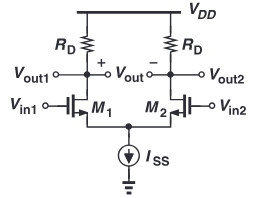

# 장말문제 10.84 — MOS 차동쌍(Fig 10.31) 설계: ΔV_in,max = 0.3 V, 전력 예산 3 mW

## 원문
Design the MOS differential pair of Fig. 10.31 for $\Delta V_{in,max} = 0.3\ \text{V}$ and a power budget of $3\ \text{mW}$. Assume $R_D = 500\ \Omega$, $\lambda = 0$, $\mu_n C_{ox} = 100\ \mu\text{A/V}^2$, and $V_{DD} = 1.8\ \text{V}$.

## 조건
- 설계 대상: 본문 Fig 10.31의 MOS 차동쌍 (저항 부하 $R_D$, 테일 $I_{SS}$)
- $\Delta V_{in,max} = 0.3\ \text{V}$
- 전력 예산 $3\ \text{mW}$
- $R_D = 500\ \Omega$, $\lambda = 0$, $\mu_n C_{ox} = 100\ \mu\text{A/V}^2$, $V_{DD} = 1.8\ \text{V}$

## 구할 것
- 회로 설계 (정할 값 예: $I_{SS}$, $W/L$) (원문에 없음, 원문은 "설계하라"만 적음)

## 상속·참조
- 본문 (교재 532–533쪽): 한 트랜지스터가 전도의 끝에 놓이는 차동 입력. 533쪽에서 이 값을 $\Delta V_{in,max}$로 부름
  $$\Delta V_{in,max} = |V_{in1} - V_{in2}|_{max} = \sqrt{\frac{2I_{SS}}{\mu_n C_{ox}\frac{W}{L}}} \qquad (10.150)$$ (좌변 $\Delta V_{in,max}$는 원문 533쪽 본문 표기, 식 (10.150)에는 없음)

## 회로 — Fig 10.31
```spice
RD1  VDD    Vout1  {R_D}
RD2  VDD    Vout2  {R_D}
M1   Vout1  Vin1   n1    nmos
M2   Vout2  Vin2   n1    nmos    ; 좌우 반전 (게이트 오른쪽)
ISS  n1     0      {I_SS}
* n1 = 공통 소스(테일) 노드 (라벨 없음)
* 각 드레인 점에서 바깥쪽으로 Vout1, Vout2 개방 원. 안쪽으로도 개방 원이 하나씩 있고 두 원 사이에 "V_out" 라벨 (+ 왼쪽, − 오른쪽, 차동 출력). 안쪽 원은 각각 Vout1, Vout2와 같은 노드
```
- 단자: VDD = 전원, 값 미지정 (가로 레일) / Vin1, Vin2 = 입력 (개방 원) / Vout1, Vout2 = 출력 (바깥쪽 개방 원) / 안쪽 개방 원 두 개 = 차동 출력 V_out = Vout1 − Vout2 (개방 원)
- 표시: 노드 라벨 V_DD (레일 오른쪽 끝), V_out1 (왼쪽 바깥 원 왼쪽), V_out2 (오른쪽 바깥 원 오른쪽), V_out (안쪽 두 원 사이), V_in1 (왼쪽 입력 원 왼쪽), V_in2 (오른쪽 입력 원 오른쪽) / 소자 라벨 R_D (왼쪽 저항 왼쪽), R_D (오른쪽 저항 오른쪽), M1 (M1 오른쪽), M2 (M2 왼쪽), I_SS (전류원 오른쪽) / 부호 + (왼쪽 안쪽 원 위), − (오른쪽 안쪽 원 위) / 화살표 없음 / 수치·면적 라벨 없음
- 배치: 맨 위 굵은 가로 레일 V_DD / 왼쪽 세로줄 위→아래 R_D, 드레인 점, M1 / 오른쪽 세로줄 위→아래 R_D, 드레인 점, M2 / 왼쪽 드레인 점에서 가로선이 왼쪽으로 V_out1 원, 오른쪽으로 안쪽 원(+) / 오른쪽 드레인 점에서 가로선이 오른쪽으로 V_out2 원, 왼쪽으로 안쪽 원(−) / M1 nmos 보통 방향(게이트 왼쪽), M2 nmos 좌우 반전(게이트 오른쪽) / V_in1 원 → M1 게이트, V_in2 원 → M2 게이트 / 두 소스는 아래로 내려가 가로선으로 가운데 n1 점, n1에서 아래로 I_SS(화살표 아래), 그 아래 접지 / 접속점 (세 갈래 이상, 3곳): ① 왼쪽 드레인 점 = 위 R_D + 아래 M1 드레인 + 왼쪽 V_out1 선 + 오른쪽 안쪽 원 선 (점) ② 오른쪽 드레인 점 = 위 R_D + 아래 M2 드레인 + 오른쪽 V_out2 선 + 왼쪽 안쪽 원 선 (점) ③ n1 = 왼쪽 M1 소스 선 + 오른쪽 M2 소스 선 + 아래 I_SS (점) / 교차: 없음


> 참고: Fig 10.31은 본문 그림(교재 530쪽, PDF 18, 패널 없음). 문제 진술은 교재 567쪽(PDF 42) 왼쪽 단 아래에서 시작해 오른쪽 단 위로 이어짐

## 풀이
### 전력으로 테일 전류
- 전력에서 $I_{SS} = 3\ \text{mW}/1.8\ \text{V} = 1.67\ \text{mA}$, 평형에서 각 트랜지스터 $I_D = I_{SS}/2 = 0.833\ \text{mA}$
### $W/L$
- 한 트랜지스터가 막 꺼지는 차동 입력이 $\Delta V_{in,max} = \sqrt{\dfrac{2I_{SS}}{\mu_n C_{ox} W/L}}$이므로
- $W/L = \dfrac{2I_{SS}}{\mu_n C_{ox} \Delta V_{in,max}^2} = \dfrac{2(1.67\ \text{mA})}{(100\ \mu\text{A/V}^2)(0.3\ \text{V})^2} = 370$
### 이득과 출력 레벨 확인
- 평형 과구동 $V_{GS} - V_{TH} = \sqrt{\dfrac{2I_D}{\mu_n C_{ox} W/L}} = \dfrac{\Delta V_{in,max}}{\sqrt{2}} = 0.212\ \text{V}$
- $g_m = 2I_D/(V_{GS} - V_{TH}) = 7.86\ \text{mS}$, $|A_v| = g_m R_D = 7.86\ \text{mS} \times 500\ \Omega = 3.93$
- 평형 출력 전압 $V_{DD} - R_D I_D = 1.8\ \text{V} - 500\ \Omega \times 0.833\ \text{mA} = 1.38\ \text{V}$
### 답
- $I_{SS} = 1.67\ \text{mA}$, $W/L = 370$ (이때 이득 $g_m R_D = 3.93$)
