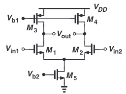

# 장말문제 10.87 — PMOS 전류원 부하 MOS 차동쌍(Fig 10.100) 설계: 이득 40, 2 mW, 모든 트랜지스터 같은 과구동

## 원문
The differential pair depicted in Fig. 10.100 must provide a gain of 40. Assuming the same (equilibrium) overdrive for all of the transistors and a power dissipation of $2\ \text{mW}$, design the circuit. Assume $\lambda_n = 0.1\ \text{V}^{-1}$, $\lambda_p = 0.2\ \text{V}^{-1}$, $\mu_n C_{ox} = 100\ \mu\text{A/V}^2$, $\mu_p C_{ox} = 100\ \mu\text{A/V}^2$, and $V_{DD} = 1.8\ \text{V}$.

## 조건
- 설계 대상: Fig 10.100의 차동쌍 (NMOS 입력쌍 $M_1$, $M_2$, PMOS 부하 $M_3$, $M_4$, 테일 $M_5$)
- 이득 $40$
- 모든 트랜지스터의 (평형) 과구동 전압이 같음
- 전력 소모 $2\ \text{mW}$
- $\lambda_n = 0.1\ \text{V}^{-1}$, $\lambda_p = 0.2\ \text{V}^{-1}$
- $\mu_n C_{ox} = 100\ \mu\text{A/V}^2$, $\mu_p C_{ox} = 100\ \mu\text{A/V}^2$
  - $\mu_p C_{ox}$도 $100$으로 인쇄됨 (인쇄 그대로 적음) (원문에 없음)
- $V_{DD} = 1.8\ \text{V}$

## 구할 것
- 회로 설계 (정할 값 예: 과구동 전압, $I_{D5}$, 각 $W/L$) (원문에 없음, 원문은 "설계하라"만 적음)

## 회로 — Fig 10.100
```spice
M3   out1  Vb1   VDD   pmos
M4   out2  Vb1   VDD   pmos    ; 게이트는 M3 게이트 높이의 가로선에서 옴
M1   out1  Vin1  n1    nmos
M2   out2  Vin2  n1    nmos    ; 좌우 반전 (게이트 오른쪽)
M5   n1    Vb2   0     nmos    ; 소스가 바로 접지 기호에 이어짐
* Vb1 점 단자 → M3 게이트. 같은 높이의 가로선이 M3 기호(채널 막대 오른쪽)에서 시작해 오른쪽 M4 게이트까지 이어짐 → M3·M4 게이트 공통(Vb1)으로 읽음
* n1 = 공통 소스(테일) 노드 = M5 드레인 (라벨 없음)
* out1, out2 = 두 출력 점에서 안쪽으로 이어진 개방 원. 두 원 사이에 "V_out" 라벨 하나 (차동 출력)
```
- 단자: VDD = 전원, 값 미지정 (가로 레일) / Vb1, Vb2 = 바이어스, 값 미지정 (점 단자) / Vin1, Vin2 = 입력 (개방 원) / out1, out2 = 차동 출력 V_out (개방 원 두 개, 각 원 옆 라벨 없음)
- 표시: 노드 라벨 V_DD (레일 오른쪽 끝), V_b1 (위 점 단자 왼쪽), V_out (두 출력 원 사이), V_in1 (왼쪽 입력 원 왼쪽), V_in2 (오른쪽 입력 원 오른쪽), V_b2 (아래 점 단자 왼쪽) / 소자 라벨 M3 (M3 왼쪽 아래), M4 (M4 오른쪽), M1 (M1 오른쪽), M2 (M2 왼쪽), M5 (M5 오른쪽) / 부호 없음 / 화살표 없음 / 수치·면적 라벨 없음
- 배치: 맨 위 굵은 가로 레일 V_DD / M3, M4 pmos 둘 다 보통 방향(게이트 왼쪽, 소스 위 → 레일, 소스 화살표 안쪽) / V_b1 점 단자 → M3 게이트, 같은 높이 가로선이 M3 기호를 지나 M4 게이트 / 왼쪽 세로줄 위→아래 M3, 출력 점, M1 / 오른쪽 세로줄 위→아래 M4, 출력 점, M2 / 각 출력 점에서 짧은 가로선이 안쪽으로 개방 원 (사이에 V_out 라벨) / M1 nmos 보통 방향(게이트 왼쪽), M2 nmos 좌우 반전(게이트 오른쪽) / V_in1 원 → M1 게이트, V_in2 원 → M2 게이트 / 두 소스는 아래로 내려가 가로선으로 가운데 n1 점, n1에서 아래로 M5 드레인 / M5 nmos 보통 방향(게이트 왼쪽): V_b2 점 단자 → 가로선 → 게이트, 소스 → 바로 접지 / 접속점 (세 갈래 이상, 3곳): ① 왼쪽 출력 점 = 위 M3 드레인 + 아래 M1 드레인 + 오른쪽 출력선 (점) ② 오른쪽 출력 점 = 위 M4 드레인 + 아래 M2 드레인 + 왼쪽 출력선 (점) ③ n1 = 왼쪽 M1 소스 선 + 오른쪽 M2 소스 선 + 아래 M5 드레인 (점) / 교차: 없음 (게이트 가로선은 M3 기호를 지나지만 도선과 교차하지 않음)



## 풀이
### 전류와 출력 저항
- 전력에서 $I_{D5} = 2\ \text{mW}/1.8\ \text{V} = 1.11\ \text{mA}$, 나머지 각 $I_D = I_{D5}/2 = 0.556\ \text{mA}$
- NMOS $M_1$, $M_2$의 $r_{On} = 1/(\lambda_n I_D) = 18.0\ \text{k}\Omega$, PMOS $M_3$, $M_4$의 $r_{Op} = 1/(\lambda_p I_D) = 9.00\ \text{k}\Omega$
### 이득으로 과구동
- 차동 입력에서 테일 노드는 가상 접지, $V_{b1}$은 교류 접지라 $M_3$은 $r_{Op}$로 보인다: $|A_v| = g_{m1}(r_{On} \parallel r_{Op})$ ($g_{m1}$은 $M_1$의 트랜스컨덕턴스)
- $g_{m1} = 40/(18.0\ \text{k}\Omega \parallel 9.00\ \text{k}\Omega) = 40/6.00\ \text{k}\Omega = 6.67\ \text{mS}$
- 과구동 $V_{GS} - V_{TH} = 2I_D/g_{m1} = 0.167\ \text{V}$ (곧 $2/[40(\lambda_n + \lambda_p)]$로 전류와 무관)
### $W/L$
- $(W/L)_{1,2} = \dfrac{2I_D}{\mu_n C_{ox}(V_{GS} - V_{TH})^2} = \dfrac{2(0.556\ \text{mA})}{(100\ \mu\text{A/V}^2)(0.167\ \text{V})^2} = 400$
- $\mu_p C_{ox} = \mu_n C_{ox}$이고 전류·과구동이 같아 $(W/L)_{3,4} = 400$, 전류가 두 배인 $M_5$는 $(W/L)_5 = 800$
### 답
- $I_{D5} = 1.11\ \text{mA}$, 과구동 $167\ \text{mV}$
- $(W/L)_1 = \cdots = (W/L)_4 = 400$, $(W/L)_5 = 800$
