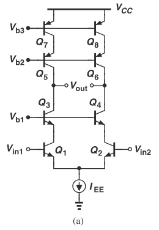

# 장말문제 10.89 — 바이폴라 텔레스코픽 캐스코드(Fig 10.40(a)) 설계: 전압 이득 2000, 2 mW

## 원문
Design the telescopic cascode of Fig. 10.40(a) for a voltage gain of 2000. Assume $Q_1$-$Q_4$ are identical and so are $Q_5$-$Q_8$. Also, $\beta_n = 100$, $\beta_p = 50$, $V_{A,n} = 5\ \text{V}$, $V_{CC} = 2.5\ \text{V}$, and the power budget is $2\ \text{mW}$.

## 조건
- 설계 대상: 본문 Fig 10.40(a)의 텔레스코픽 캐스코드
- 전압 이득 $2000$
- $Q_1$–$Q_4$는 서로 동일, $Q_5$–$Q_8$도 서로 동일
- $\beta_n = 100$, $\beta_p = 50$, $V_{A,n} = 5\ \text{V}$, $V_{CC} = 2.5\ \text{V}$
- 전력 예산 $2\ \text{mW}$
- $\beta_n$, $V_{A,n}$은 npn($Q_1$–$Q_4$), $\beta_p$는 pnp($Q_5$–$Q_8$) 값 (원문에 없음)
- $V_{A,p}$는 주어지지 않음 (원문에 없음)

## 구할 것
- 회로 설계 (정할 값 예: $I_{EE}$, 필요한 $V_{A,p}$) (원문에 없음, 원문은 "설계하라"만 적음)

## 상속·참조
- 본문 (교재 539쪽): Fig 10.39(a)의 전류원 $I_1$, $I_2$ 대신 pnp 캐스코드를 쓴 구성이 Fig 10.40(a). 절반 회로 Fig 10.40(b)($v_{in1}$ → $Q_1$ 베이스, $Q_1$ 컬렉터 → $Q_3$ 이미터, $Q_3$ 컬렉터 = $v_{out1}$ = $Q_5$ 컬렉터, $Q_5$ 이미터 → $Q_7$ 컬렉터, $Q_1$ 이미터·$Q_3$·$Q_5$·$Q_7$ 베이스·$Q_7$ 이미터는 교류 접지)로 해석. 식 (9.61)을 이용하면
  $$A_v \approx -g_{m1}[g_{m3}r_{O3}(r_{O1} \| r_{\pi 3})] \| [g_{m5}r_{O5}(r_{O7} \| r_{\pi 5})] \qquad (10.172)$$

## 회로 — Fig 10.40(a)
```spice
Q7   n1    Vb3   VCC   pnp
Q8   n2    Vb3   VCC   pnp     ; 베이스는 Q7 베이스 높이의 가로선에서 옴
Q5   out1  Vb2   n1    pnp
Q6   out2  Vb2   n2    pnp     ; 베이스는 Q5 베이스 높이의 가로선에서 옴
Q3   out1  Vb1   n3    npn
Q4   out2  Vb1   n4    npn     ; 베이스는 Q3 베이스 높이의 가로선에서 옴
Q1   n3    Vin1  n5    npn
Q2   n4    Vin2  n5    npn     ; 좌우 반전 (베이스 오른쪽)
IEE  n5    0     {I_EE}
* Vb3, Vb2, Vb1 점 단자 → 각각 Q7, Q5, Q3 베이스. 같은 높이의 가로선이 왼쪽 트랜지스터 기호(컬렉터·이미터 선 사이)를 가로질러 오른쪽 Q8, Q6, Q4 베이스까지 이어짐 → 베이스 공통
* n1 = Q7 컬렉터–Q5 이미터, n2 = Q8 컬렉터–Q6 이미터, n3 = Q3 이미터–Q1 컬렉터, n4 = Q4 이미터–Q2 컬렉터, n5 = 공통 이미터(테일) 노드 (라벨 없음)
* out1, out2 = 두 출력 점에서 안쪽으로 이어진 개방 원. 두 원 사이에 "V_out" 라벨 하나 (차동 출력)
```
- 단자: VCC = 전원, 값 미지정 (가로 레일) / Vb1, Vb2, Vb3 = 바이어스, 값 미지정 (점 단자) / Vin1, Vin2 = 입력 (개방 원) / out1, out2 = 차동 출력 V_out (개방 원 두 개, 각 원 옆 라벨 없음)
- 표시: 노드 라벨 V_CC (레일 오른쪽 끝), V_b3, V_b2, V_b1 (각 점 단자 왼쪽), V_out (두 출력 원 사이), V_in1 (왼쪽 입력 원 왼쪽), V_in2 (오른쪽 입력 원 오른쪽) / 소자 라벨 Q7 (Q7 아래), Q8 (Q8 아래), Q5 (Q5 아래), Q6 (Q6 아래), Q3 (Q3 위), Q4 (Q4 위), Q1 (Q1 오른쪽), Q2 (Q2 왼쪽), I_EE (전류원 오른쪽) / 부호 없음 / 화살표 없음 / 수치·면적 라벨 없음
- 배치: 맨 위 굵은 가로 레일 V_CC / 왼쪽 세로줄 위→아래 Q7, Q5, 출력 점, Q3, Q1 / 오른쪽 세로줄 위→아래 Q8, Q6, 출력 점, Q4, Q2 / Q7, Q8, Q5, Q6 pnp 모두 보통 방향(베이스 왼쪽, 이미터 위·화살표 안쪽) / Q3, Q4, Q1 npn 보통 방향(베이스 왼쪽), Q2 npn 좌우 반전(베이스 오른쪽) / 트랜지스터끼리는 세로선으로 바로 이어짐 (Q7 컬렉터–Q5 이미터, Q3 이미터–Q1 컬렉터 등, 점 없음) / 각 출력 점에서 짧은 가로선이 안쪽으로 개방 원 (사이에 V_out 라벨) / V_in1 원 → Q1 베이스, V_in2 원 → Q2 베이스 / 두 이미터는 꼬리 가로선 가운데 n5 점, n5에서 아래로 I_EE(화살표 아래), 그 아래 접지 / 접속점 (세 갈래 이상, 3곳): ① 왼쪽 출력 점 = 위 Q5 컬렉터 + 아래 Q3 컬렉터 + 오른쪽 출력선 (점) ② 오른쪽 출력 점 = 위 Q6 컬렉터 + 아래 Q4 컬렉터 + 왼쪽 출력선 (점) ③ n5 = 왼쪽 Q1 이미터 선 + 오른쪽 Q2 이미터 선 + 아래 I_EE (점) / 교차: 없음 (세 베이스 가로선은 왼쪽 트랜지스터 기호를 지나지만 도선과 교차하지 않음)


> 참고: Fig 10.40은 본문 그림(교재 539쪽, PDF 22). 크롭은 패널 (a)만 담음 ((b)는 절반 회로로 상속·참조에 글로 적음)

## 풀이
### 바이어스와 소신호 값
- $I_{EE} = P/V_{CC} = 2\ \text{mW}/2.5\ \text{V} = 0.800\ \text{mA}$, 모든 트랜지스터 $I_C = 0.400\ \text{mA}$, $g_m = I_C/V_T = 15.4\ \text{mS}$ ($V_T = 26\ \text{mV}$)
- npn $r_{\pi n} = \beta_n/g_m = 6.50\ \text{k}\Omega$, $r_{On} = V_{A,n}/I_C = 12.5\ \text{k}\Omega$, pnp $r_{\pi p} = \beta_p/g_m = 3.25\ \text{k}\Omega$
### 이득 식과 아래 저항
- 절반 회로는 npn 캐스코드 $Q_1$–$Q_3$과 pnp 캐스코드 부하 $Q_5$–$Q_7$이다(테일 가상 접지). 축퇴 저항 $r_O \parallel r_\pi$와의 $g_m$ 곱이 커 1을 빼면 $|A_v| \approx g_m(R_{dn} \parallel R_{up})$, 위로 본 저항 $R_{up} = g_m r_{Op}(r_{Op} \parallel r_{\pi p})$
- 아래로 본 저항 $R_{dn} = g_m r_{On}(r_{On} \parallel r_{\pi n}) = 15.4\ \text{mS} \times 12.5\ \text{k}\Omega \times 4.28\ \text{k}\Omega = 822\ \text{k}\Omega$
### 필요한 $V_{A,p}$
- $R_{dn} \parallel R_{up} = 2000/g_m = 130\ \text{k}\Omega$ → $R_{up} = 154\ \text{k}\Omega$
- $g_m r_{Op}(r_{Op} \parallel 3.25\ \text{k}\Omega) = 154\ \text{k}\Omega$를 풀면 $r_{Op} = 5.07\ \text{k}\Omega$ → $V_{A,p} = r_{Op} I_C = 2.03\ \text{V}$
- 정확식(절반 회로 노드 해석)으로는 $V_{A,p} = 1.98\ \text{V}$ (뺀 1과 뒤 항 때문에 약 2% 차이)
### 답
- $I_{EE} = 0.800\ \text{mA}$, 필요한 $V_{A,p} \approx 2.03\ \text{V}$
