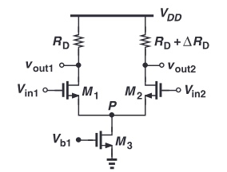

# 장말문제 10.91 — 부하 미스매치가 있는 MOS 차동쌍(Fig 10.101)이 CMRR 60 dB를 얻기 위한 M3의 최소 λ

## 원문
The differential pair of Fig. 10.101 must achieve a CMRR of $60\ \text{dB}\ (= 1000)$. Assume a power budget of $2\ \text{mW}$, a nominal differential voltage gain of 5, and neglecting channel-length modulation in $M_1$ and $M_2$, compute the minimum required $\lambda$ for $M_3$. Assume $(W/L)_{1,2} = 10/0.18$, $\mu_n C_{ox} = 100\ \mu\text{A/V}^2$, $V_{DD} = 1.8\ \text{V}$, and $\Delta R/R = 2\%$.

## 조건
- 회로: Fig 10.101 — 부하 $R_D$, $R_D + \Delta R_D$를 가진 MOS 차동쌍, 테일 전류원 $M_3$
- CMRR $60\ \text{dB}$ ($= 1000$)를 얻어야 함
- 전력 예산 $2\ \text{mW}$
- 공칭 차동 전압 이득 $5$
- $M_1$, $M_2$의 채널 길이 변조는 무시
- $(W/L)_{1,2} = 10/0.18$, $\mu_n C_{ox} = 100\ \mu\text{A/V}^2$, $V_{DD} = 1.8\ \text{V}$
- $\Delta R/R = 2\%$
  - 원문의 $\Delta R/R$은 그림의 $\Delta R_D/R_D$로 보임 (원문에 없음)
- 원문은 "minimum"이라 적었지만 $\lambda$가 클수록 $r_{O3}$가 작아져 CMRR이 나빠지므로, 구하는 값은 CMRR 1000을 지키는 허용 최대 $\lambda$로 봄 (원문에 없음)

## 구할 것
- $M_3$에 필요한 최소 $\lambda$

## 회로 — Fig 10.101
```spice
RD1  VDD    vout1  {R_D}
RD2  VDD    vout2  {R_D+ΔR_D}   ; 라벨 "R_D + ΔR_D"
M1   vout1  Vin1   P     nmos
M2   vout2  Vin2   P     nmos   ; 좌우 반전 (게이트 오른쪽)
M3   P      Vb1    0     nmos   ; 소스가 바로 접지 기호에 이어짐
```
- 단자: VDD = 전원, 값 미지정 (가로 레일) / Vb1 = 바이어스, 값 미지정 (점 단자) / Vin1, Vin2 = 입력 (개방 원) / vout1, vout2 = 출력 (개방 원)
- 표시: 노드 라벨 V_DD (레일 오른쪽 끝), v_out1 (왼쪽 출력 원 왼쪽, 소문자 v), v_out2 (오른쪽 출력 원 오른쪽, 소문자 v), V_in1 (왼쪽 입력 원 왼쪽), V_in2 (오른쪽 입력 원 오른쪽), P (P 점 위), V_b1 (점 단자 왼쪽) / 소자 라벨 R_D (왼쪽 저항 왼쪽), R_D + ΔR_D (오른쪽 저항 오른쪽), M1 (M1 오른쪽), M2 (M2 왼쪽), M3 (M3 오른쪽) / 부호 없음 / 화살표 없음 / 수치·면적 라벨 없음
- 배치: 맨 위 굵은 가로 레일 V_DD / 왼쪽 세로줄 위→아래 R_D, vout1 점, M1 / 오른쪽 세로줄 위→아래 R_D + ΔR_D, vout2 점, M2 / vout1 점에서 가로선이 왼쪽 출력 원, vout2 점에서 가로선이 오른쪽 출력 원 / M1 nmos 보통 방향(게이트 왼쪽), M2 nmos 좌우 반전(게이트 오른쪽) / V_in1 원 → M1 게이트, V_in2 원 → M2 게이트 / 두 소스는 꼬리 가로선 가운데 P 점, P에서 아래로 M3 드레인 / M3 nmos 보통 방향(게이트 왼쪽): V_b1 점 단자 → 가로선 → 게이트, 소스 → 바로 접지 / 접속점 (세 갈래 이상, 3곳): ① vout1 = 위 R_D + 아래 M1 드레인 + 왼쪽 출력선 (점) ② vout2 = 위 R_D + ΔR_D + 아래 M2 드레인 + 오른쪽 출력선 (점) ③ P = 왼쪽 M1 소스 선 + 오른쪽 M2 소스 선 + 아래 M3 드레인 (점) / 교차: 없음


> 참고: Fig 10.101은 Fig 10.91(a)(교재 565쪽, PDF 40)와 같은 모양·라벨로 인쇄됨
