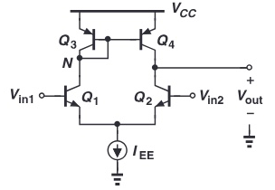

# 장말문제 10.92 — 능동 부하 바이폴라 차동쌍(Fig 10.50) 설계: 전압 이득 200, 3 mW, 2.5 V 전원

## 원문
Design the differential pair of Fig. 10.50 for a voltage gain of 200 and a power budget of $3\ \text{mW}$ with a $2.5$-V supply. Assume $V_{A,n} = 2V_{A,p}$.

## 조건
- 설계 대상: 본문 Fig 10.50의 능동 부하(pnp 전류 거울 $Q_3$, $Q_4$) 차동쌍
- 전압 이득 $200$
- 전력 예산 $3\ \text{mW}$, 전원 $2.5\ \text{V}$ (그림의 $V_{CC}$로 봄, 원문에 없음)
- $V_{A,n} = 2V_{A,p}$

## 구할 것
- 회로 설계 (정할 값 예: $I_{EE}$, 필요한 $V_{A,n}$, $V_{A,p}$) (원문에 없음, 원문은 "설계하라"만 적음)

## 회로 — Fig 10.50
```spice
Q3   N     N     VCC   pnp     ; 좌우 반전 (베이스 오른쪽), 다이오드 연결 (베이스 = 컬렉터 = N)
Q4   Vout  N     VCC   pnp
Q1   N     Vin1  n1    npn
Q2   Vout  Vin2  n1    npn     ; 좌우 반전 (베이스 오른쪽)
IEE  n1    0     {I_EE}
* n1 = 공통 이미터(테일) 노드 (라벨 없음)
* Vout = 출력 점에서 오른쪽으로 이어진 개방 원. 원 아래에 +, "V_out", −가 차례로 인쇄되고 그 아래 따로 떨어진 접지 기호 (출력 전압의 기준, 원과 도선으로 이어지지 않음)
```
- 단자: VCC = 전원, 값 미지정 (가로 레일) / Vin1, Vin2 = 입력 (개방 원) / Vout = 싱글엔디드 출력 (개방 원)
- 표시: 노드 라벨 V_CC (레일 오른쪽 끝), N (N 점 왼쪽), V_in1 (왼쪽 입력 원 왼쪽), V_in2 (오른쪽 입력 원 오른쪽), V_out (출력 원 아래, + 와 − 사이) / 소자 라벨 Q3 (Q3 왼쪽), Q4 (Q4 오른쪽), Q1 (Q1 오른쪽), Q2 (Q2 왼쪽), I_EE (전류원 오른쪽) / 부호 + (출력 원 바로 아래, V_out 위), − (V_out 아래) / 화살표 없음 / 수치·면적 라벨 없음
- 배치: 맨 위 굵은 가로 레일 V_CC / Q3 pnp 좌우 반전(베이스 오른쪽, 이미터 왼쪽 위 → 레일, 컬렉터 왼쪽 아래), Q4 pnp 보통 방향(베이스 왼쪽, 이미터 오른쪽 위 → 레일, 컬렉터 오른쪽 아래) / 베이스 가로선: Q3 베이스 바로 오른쪽 베이스 접속점 → 오른쪽 Q4 베이스. 베이스 접속점에서 아래로 내려가 왼쪽으로 꺾여 N 점 (다이오드 연결) / 왼쪽 세로줄 위→아래 Q3 컬렉터, N 점, Q1 컬렉터 / 오른쪽 세로줄 위→아래 Q4 컬렉터, 출력 점, Q2 컬렉터 / 출력 점에서 긴 가로선이 오른쪽 V_out 원 (V_in2 라벨보다 오른쪽) / 원 아래 +, V_out, −, 짧은 세로선과 접지 기호 / Q1 npn 보통 방향(베이스 왼쪽), Q2 npn 좌우 반전(베이스 오른쪽) / V_in1 원 → Q1 베이스, V_in2 원 → Q2 베이스 / 두 이미터는 아래로 내려가 가로선으로 가운데 n1 점, n1에서 아래로 I_EE(화살표 아래), 그 아래 접지 / 접속점 (세 갈래 이상, 4곳): ① 베이스 접속점 = 왼쪽 Q3 베이스 + 오른쪽 Q4 베이스로 가는 선 + 아래 다이오드 연결 선 (점) ② N = 위 Q3 컬렉터 + 오른쪽 다이오드 연결 선 + 아래 Q1 컬렉터 (점) ③ 출력 점 = 위 Q4 컬렉터 + 아래 Q2 컬렉터 + 오른쪽 출력선 (점) ④ n1 = 왼쪽 Q1 이미터 선 + 오른쪽 Q2 이미터 선 + 아래 I_EE (점) / 교차: 없음


> 참고: Fig 10.50은 본문 그림(교재 548쪽, PDF 27, 패널 없음). 문제 진술은 교재 568쪽(PDF 43) 왼쪽 단 아래에서 시작해 오른쪽 단 위로 이어짐

## 풀이
### 바이어스
- 전력에서 $I_{EE} = 3\ \text{mW}/2.5\ \text{V} = 1.20\ \text{mA}$, 각 트랜지스터 $I_C = 0.600\ \text{mA}$
- $g_m = I_C/V_T = 0.600\ \text{mA}/26\ \text{mV} = 23.1\ \text{mS}$ ($V_T = 26\ \text{mV}$)
### 이득 식
- 전류 거울 부하가 $Q_1$의 신호 전류를 출력으로 옮겨, 단일 출력 이득이 $|A_v| = g_m(r_{O2} \parallel r_{O4})$이다. $r_{O2} = V_{A,n}/I_C$, $r_{O4} = V_{A,p}/I_C$
- $V_{A,n} = 2V_{A,p}$라 $r_{O2} \parallel r_{O4} = \tfrac{2}{3} r_{O4}$ → $|A_v| = \dfrac{I_C}{V_T} \cdot \dfrac{2V_{A,p}}{3I_C} = \dfrac{2V_{A,p}}{3V_T}$
### Early 전압
- $\dfrac{2V_{A,p}}{3V_T} = 200$ → $V_{A,p} = 300V_T = 7.80\ \text{V}$, $V_{A,n} = 15.6\ \text{V}$
- 이득이 $I_C$와 무관하므로 전력 예산은 $I_{EE}$만 정한다 ($r_{O4} = 13.0\ \text{k}\Omega$, $r_{O2} = 26.0\ \text{k}\Omega$)
### 답
- $I_{EE} = 1.20\ \text{mA}$, $V_{A,n} = 15.6\ \text{V}$, $V_{A,p} = 7.80\ \text{V}$
