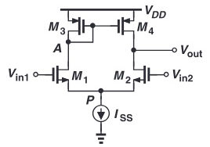

# 장말문제 10.93 — 능동 부하 MOS 차동쌍(Fig 10.56) 설계: 전압 이득 20, 1 mW, 입력 공통 모드 1 V에서 M1 포화 경계

## 원문
Design the circuit of Fig. 10.56 for a voltage gain of 20 and a power budget of $1\ \text{mW}$ with $V_{DD} = 1.8\ \text{V}$. Assume $M_1$ operates at the edge of saturation if the input common-mode level is $1\ \text{V}$. Also, $\mu_n C_{ox} = 2\mu_p C_{ox} = 100\ \mu\text{A/V}^2$, $V_{TH,n} = 0.5\ \text{V}$, $V_{TH,p} = -0.4\ \text{V}$, $\lambda_n = 0.5\lambda_p = 0.1\ \text{V}^{-1}$.

## 조건
- 설계 대상: 본문 Fig 10.56 — 전류 거울 부하($M_3$ 다이오드 연결, $M_4$)와 테일 $I_{SS}$를 가진 NMOS 차동쌍
- 전압 이득 $20$
- 전력 예산 $1\ \text{mW}$, $V_{DD} = 1.8\ \text{V}$
- 입력 공통 모드 레벨이 $1\ \text{V}$이면 $M_1$이 포화 영역의 경계에서 동작
- $\mu_n C_{ox} = 2\mu_p C_{ox} = 100\ \mu\text{A/V}^2$
- $V_{TH,n} = 0.5\ \text{V}$, $V_{TH,p} = -0.4\ \text{V}$
- $\lambda_n = 0.5\lambda_p = 0.1\ \text{V}^{-1}$

## 구할 것
- 회로 설계 (정할 값 예: $I_{SS}$, 각 $W/L$) (원문에 없음, 원문은 "설계하라"만 적음)

## 회로 — Fig 10.56
```spice
M3   A     A     VDD   pmos    ; 좌우 반전 (게이트 오른쪽), 다이오드 연결 (게이트 = 드레인)
M4   Vout  A     VDD   pmos
M1   A     Vin1  P     nmos
M2   Vout  Vin2  P     nmos    ; 좌우 반전 (게이트 오른쪽)
ISS  P     0     {I_SS}
```
- 단자: VDD = 전원, 값 미지정 (가로 레일) / Vin1, Vin2 = 입력 (개방 원) / Vout = 출력 (개방 원)
- 표시: 노드 라벨 V_DD (레일 오른쪽 끝), A (A 접속점 아래 세로선 왼쪽), V_out (출력 원 오른쪽), V_in1 (왼쪽 입력 원 왼쪽), V_in2 (오른쪽 입력 원 오른쪽), P (P 점 왼쪽 아래) / 소자 라벨 M3 (M3 왼쪽), M4 (M4 오른쪽), M1 (M1 오른쪽), M2 (M2 왼쪽), I_SS (전류원 오른쪽) / 부호 없음 / 화살표 없음 / 수치·면적 라벨 없음
- 배치: 맨 위 굵은 가로 레일 V_DD / M3 pmos 좌우 반전(게이트 오른쪽, 소스 왼쪽 위 → 레일, 드레인 왼쪽 아래), M4 pmos 보통 방향(게이트 왼쪽, 소스 오른쪽 위 → 레일, 드레인 오른쪽 아래) / 게이트 가로선: M3 게이트에서 오른쪽으로 게이트 접속점 → 계속 오른쪽 M4 게이트. 게이트 접속점에서 아래로 내려가 왼쪽으로 꺾여 A 접속점 (다이오드 연결) / 왼쪽 세로줄 위→아래 M3 드레인, A 접속점, M1 드레인 / 오른쪽 세로줄 위→아래 M4 드레인, 출력 접속점, M2 드레인 / 출력 접속점에서 가로선이 오른쪽 V_out 원 / M1 nmos 보통 방향(게이트 왼쪽), M2 nmos 좌우 반전(게이트 오른쪽) / V_in1 원 → M1 게이트, V_in2 원 → M2 게이트 / 두 소스는 아래로 내려가 가로선으로 가운데 P 점, P에서 아래로 I_SS(화살표 아래), 그 아래 접지 / 접속점 (세 갈래 이상, 4곳): ① 게이트 접속점 = 왼쪽 M3 게이트 선 + 오른쪽 M4 게이트 선 + 아래 되먹임 선 (점) ② A = 위 M3 드레인 + 오른쪽 되먹임 선 + 아래 M1 드레인 선 (점) ③ 출력 접속점 = 위 M4 드레인 + 오른쪽 출력선 + 아래 M2 드레인 선 (점) ④ P = 왼쪽 M1 소스 선 + 오른쪽 M2 소스 선 + 아래 I_SS (점) / 교차: 없음


> 참고: 그림은 본문 551쪽(PDF 28)의 그림 10.56

## 풀이
### 전력으로 전류
- 전류는 모두 $V_{DD}$에서 $I_{SS}$로 흐르므로 $I_{SS} = 1\ \text{mW}/1.8\ \text{V} = 0.556\ \text{mA}$
- 평형에서 각 가지 $I_D = I_{SS}/2 = 0.278\ \text{mA}$
### 출력 저항과 필요한 $g_m$
- $M_2$, $M_4$의 출력 저항 $r_{O2} = 1/(\lambda_n I_D) = 36.0\ \text{k}\Omega$, $r_{O4} = 1/(\lambda_p I_D) = 18.0\ \text{k}\Omega$
- 거울이 $M_1$의 신호 전류를 출력으로 복사하므로 $|A_v| = g_{m1}(r_{O2} \parallel r_{O4})$, $r_{O2} \parallel r_{O4} = 12.0\ \text{k}\Omega$
- $M_1$, $M_2$의 트랜스컨덕턴스 $g_{m1} = 20/12.0\ \text{k}\Omega = 1.67\ \text{mS}$
### 입력쌍 크기
- $(W/L)_{1,2} = g_{m1}^2/(2\mu_n C_{ox} I_D) = (1.67\ \text{mS})^2/(2 \times 100\ \mu\text{A/V}^2 \times 0.278\ \text{mA}) = 50.0$ (바이어스 계산에서 $1 + \lambda V_{DS}$는 무시)
- 과구동 전압 $V_{GS1} - V_{TH,n} = 2I_D/g_{m1} = 0.333\ \text{V}$, 꼬리 노드 $V_P = 1\ \text{V} - 0.5\ \text{V} - 0.333\ \text{V} = 0.167\ \text{V}$
### 포화 경계로 부하 크기
- 입력 공통 모드 레벨 $V_{in,CM} = 1\ \text{V}$에서 $M_1$이 경계이면 $V_A = V_{in,CM} - V_{TH,n} = 0.5\ \text{V}$ → $|V_{GS3}| = V_{DD} - V_A = 1.3\ \text{V}$, 과구동 $1.3 - 0.4 = 0.9\ \text{V}$
- $(W/L)_{3,4} = 2I_D/[\mu_p C_{ox}(0.9\ \text{V})^2] = 2 \times 0.278\ \text{mA}/(50\ \mu\text{A/V}^2 \times 0.81\ \text{V}^2) = 13.7$
- 대칭으로 $V_{out} = V_A$이므로 $M_2$도 같은 경계에 있다
### 답
- $I_{SS} = 0.556\ \text{mA}$, $(W/L)_1 = (W/L)_2 = 50.0$, $(W/L)_3 = (W/L)_4 = 13.7$ ($V_P = 0.167\ \text{V}$, $V_A = V_{out} = 0.5\ \text{V}$)
