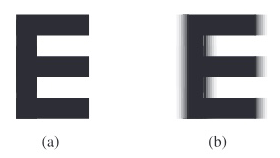

# 연습문제 11.3 — 영상을 위에서 아래로 스캔할 때 대역폭 부족의 효과

## 원문
위 그림의 영상이 위에서 아래로 스캔된다면 무슨 일이 일어나겠는가?

## 조건
- "위 그림"(예제 11.3의 Fig 11.3)의 영상
- 예제에서는 영상이 좌에서 우로 스캔됨. 이 연습문제에서는 위에서 아래로 스캔됨
- 대역폭이 부족한 (저대역) 드라이버의 경우로 해석 (원문에 없음, 원문은 "위 그림의 영상"만 적음)

## 구할 것
- 위 그림의 영상이 위에서 아래로 스캔된다면 무슨 일이 일어나겠는가?

## 상속·참조
- 예제 11.3 (E11.03): 영상 신호의 대역폭은 약 $5\ \text{MHz}$. 대역폭이 부족하면 구동 회로가 한 픽셀에서 다음 픽셀로 백색↔검정색을 급격히 바꾸지 못해 테두리가 흐려짐. Fig 11.3(a) = 고대역 드라이버, (b) = 저대역 드라이버 (좌에서 우로 스캔)
- Fig 11.3 (예제 풀이 그림, 크롭함): 영상 예시 (회로 그림 아님)
  - (a) 검은 굵은 대문자 "E" 한 글자, 모든 테두리가 뚜렷함
  - (b) 같은 "E"인데 세로 방향 테두리(글자 왼쪽 끝, 세로획의 오른쪽 안쪽 경계, 가로획 세 개의 오른쪽 끝)가 회색으로 번져 흐릿함. 가로 방향 테두리(가로획의 위아래 경계)는 뚜렷함

## 회로 — 없음 (영상 그림 문제, 그림 11.3은 회로가 아닌 영상 예시로 상속·참조에 적음)
