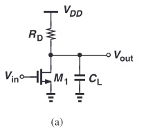

# 연습문제 11.4 — 채널길이 변조가 있을 때 CS 단의 전달 함수 (예제 11.4 변형)

## 원문
$\lambda \neq 0$일 경우 위 예제의 결과를 유도하라.

## 조건
- 예제 11.4와 같은 회로: Fig 11.5(a) CS 단 ($M_1$, $R_D$, $C_L$)
- 바뀐 점: $\lambda \neq 0$
- 즉 채널길이 변조를 고려해 $M_1$의 출력 저항 $r_O$가 유한 (원문에 없음)
- 소자 값은 주어지지 않음 (답은 기호로) (원문에 없음)

## 구할 것
- $\lambda \neq 0$일 때 예제 11.4의 결과 유도
  - 즉 전달 함수 $V_{out}/V_{in}(s)$, 그 크기 $|V_{out}/V_{in}|$, −3 dB 대역폭 (원문에 없음, 원문은 "위 예제의 결과"만 적음)

## 상속·참조
- 예제 11.4 (E11.04), $\lambda = 0$일 때의 결과: $H(s) = -g_m\left(R_D \parallel \dfrac{1}{C_L s}\right) = \dfrac{-g_m R_D}{R_D C_L s + 1}$ (식 11.4–11.5), $\left|\dfrac{V_{out}}{V_{in}}\right| = \dfrac{g_m R_D}{\sqrt{R_D^2 C_L^2 \omega^2 + 1}}$ (식 11.6), −3 dB 대역폭 $1/(R_D C_L)$
- 식 (11.1) (본문 Fig 11.5(b) 소신호 모델, 채널길이 변조 무시): $V_{out} = -g_m V_{in}\left(R_D \parallel \dfrac{1}{C_L s}\right)$

## 회로 — Fig 11.5(a)
```spice
RD  VDD   Vout  {R_D}
M1  Vout  Vin   0  nmos
CL  Vout  0     {C_L}
```
- 단자: VDD = 전원, 값 미지정 (T 전원 기호) / Vin = 입력 (개방 원) / Vout = 출력 (개방 원)
- 표시: 노드 라벨 V_DD (T 기호 오른쪽), V_in (입력 원 왼쪽), V_out (출력 원 오른쪽) / 소자 라벨 R_D (저항 왼쪽), M1 (트랜지스터 오른쪽, 소스 옆), C_L (커패시터 오른쪽) / 부호 없음 / 화살표 없음 / 수치·면적 라벨 없음
- 배치: 왼쪽 세로줄 위→아래 V_DD T 기호, R_D, 드레인 접속점, M1, 접지 / M1 NMOS 보통 방향(게이트 왼쪽, 드레인 위, 소스 아래) / V_in 원 → 짧은 가로선 → 게이트 / 드레인 접속점에서 가로선이 오른쪽으로 C_L 접속점을 지나 V_out 원에서 끝남 / C_L은 C_L 접속점에서 세로로 내려가고 그 아래 접지 / 접지 기호는 M1 소스 아래, C_L 아래에 따로 / 접속점 (세 갈래 이상, 2곳): ① 드레인 = 위 R_D + 아래 M1 드레인 + 오른쪽 가로선 (점) ② C_L 위 = 왼쪽 가로선 + 오른쪽 V_out 선 + 아래 C_L (점) / 교차: 없음



## 풀이
### 출력 노드의 저항
- $\lambda \neq 0$이면 $M_1$은 드레인에서 접지로 출력 저항 $r_O$를 가진다. $V_{DD}$는 AC 접지이므로 출력 노드에서 $R_D$, $r_O$, $C_L$이 모두 접지로 병렬이다
- $V_{out} = -g_m V_{in}\left(R_D \parallel r_O \parallel \dfrac{1}{C_L s}\right)$
### 전달 함수
- $\dfrac{V_{out}}{V_{in}}(s) = \dfrac{-g_m (R_D \parallel r_O)}{(R_D \parallel r_O)C_L s + 1}$
### 크기와 대역폭
- $\left|\dfrac{V_{out}}{V_{in}}\right| = \dfrac{g_m (R_D \parallel r_O)}{\sqrt{(R_D \parallel r_O)^2 C_L^2 \omega^2 + 1}}$
- −3 dB 대역폭은 분모 제곱근 안의 두 항이 같아지는 $\omega$: $\omega_{-3\text{dB}} = \dfrac{1}{(R_D \parallel r_O)C_L}$
- 예제 11.4의 $R_D$ 자리를 $R_D \parallel r_O$로 바꾼 것이다. 저주파 이득은 줄고 대역폭은 넓어진다
### 답
- $\dfrac{V_{out}}{V_{in}}(s) = \dfrac{-g_m (R_D \parallel r_O)}{(R_D \parallel r_O)C_L s + 1}$
- $\left|\dfrac{V_{out}}{V_{in}}\right| = \dfrac{g_m (R_D \parallel r_O)}{\sqrt{(R_D \parallel r_O)^2 C_L^2 \omega^2 + 1}}$, −3 dB 대역폭 $\dfrac{1}{(R_D \parallel r_O)C_L}$
