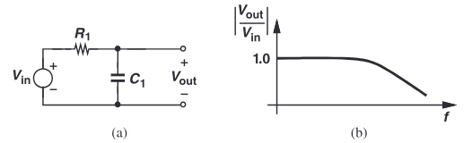

# 연습문제 11.6 — 저역여파기의 |H|가 절반이 되는 주파수

## 원문
$|H|$가 2배로 감소할 때의 주파수는 얼마인가?

## 조건
- 예제 11.6의 저역여파기: Fig 11.4(a) ($R_1$, $C_1$)
- $|H|$가 2배로 감소 (저주파 값 1의 절반, $|H| = 1/2$로 해석) (원문에 없음)
- 소자 값은 주어지지 않음 (답은 $R_1$, $C_1$ 기호로) (원문에 없음)

## 구할 것
- $|H|$가 2배로 감소할 때의 주파수

## 상속·참조
- 예제 11.6 (E11.06): $H(s) = \dfrac{1}{R_1 C_1 s + 1}$ (식 11.11), $|H(s = j\omega)| = \dfrac{1}{\sqrt{R_1^2 C_1^2 \omega^2 + 1}}$ (식 11.12), −3 dB 대역폭 $1/(R_1 C_1)$

## 회로 — Fig 11.4(a)
```spice
* 접지 기호 없음: 아래 가로선(전압원 − 쪽, C1 아래, 아래 출력 원)을 out2로 적음
* out1/out2 = 두 출력 원. 그 사이에 "V_out" 라벨 하나와 + (위), − (아래)만 인쇄됨
VIN  n1    out2  {V_in}
R1   n1    out1  {R_1}
C1   out1  out2  {C_1}
```
- 단자: out1, out2 = 출력 전압 V_out의 + 쪽, − 쪽 (개방 원) / 입력은 개방 단자 없이 전압원 V_in이 회로 안에 그려짐
- 표시: 노드 라벨 V_out (두 출력 원 사이, 원보다 조금 왼쪽) / 소자 라벨 V_in (전압원 왼쪽), R_1 (저항 위), C_1 (커패시터 오른쪽) / 부호 전압원 원 오른쪽 위 +, 오른쪽 아래 −; 출력 V_out 라벨 위 +, 아래 − / 화살표 없음 / 수치·면적 라벨 없음
- 배치: 왼쪽에 세로 방향 전압원 V_in(원, + 위 − 아래) / 전압원 위 끝에서 세로선이 올라가 모서리에서 오른쪽으로 꺾여 가로 R_1, 위 접속점, 계속 오른쪽 위 출력 원(out1) / 위 접속점에서 C_1이 세로로 내려가 아래 접속점 / 전압원 아래 끝에서 세로선이 내려가 모서리에서 오른쪽으로 꺾여 아래 가로선, 아래 접속점, 계속 오른쪽 아래 출력 원(out2) / 접지 기호 없음 / 접속점 (세 갈래 이상, 2곳): ① 위 = 왼쪽 R_1 + 아래 C_1 + 오른쪽 out1 선 (점) ② 아래 = 왼쪽 가로선 + 위 C_1 + 오른쪽 out2 선 (점) / 교차: 없음


> 참고: 크롭 이미지 오른쪽의 (b)는 본문 그림 11.4(b)(저역여파기의 주파수 응답: 세로 라벨 "|V_out/V_in|", 높이 "1.0"에서 평평하다가 내려가는 곡선, 가로축 "f")
