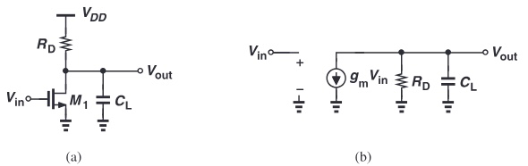

# 연습문제 11.7 — 수치가 주어진 CS 단의 보데 플롯 (예제 11.7 변형)

## 조건
- 예제 11.7과 같은 회로: Fig 11.5(a) CS 단 ($M_1$, $R_D$, $C_L$)
- $g_m = (150\ \Omega)^{-1}$
- $R_D = 2\ \text{k}\Omega$
- $C_L = 100\ \text{fF}$

## 구할 것
- 이 값일 때 $|H(j\omega)|$의 보데 플롯

## 상속·참조
- 예제 11.7 (E11.07): $H(s) = \dfrac{-g_m R_D}{R_D C_L s + 1}$ (식 11.5, 채널길이 변조 무시), 극점 $|\omega_{p1}| = \dfrac{1}{R_D C_L}$ (식 11.15). 보데 플롯은 저주파 크기 $g_m R_D$에서 $\omega = |\omega_{p1}|$까지 평평, 그 뒤 기울기 $-20\ \text{dB/dec}$ (Fig 11.10)

## 회로 — Fig 11.5(a)
```spice
RD  VDD   Vout  {R_D}
M1  Vout  Vin   0  nmos
CL  Vout  0     {C_L}
```
- 단자: VDD = 전원, 값 미지정 (T 전원 기호) / Vin = 입력 (개방 원) / Vout = 출력 (개방 원)
- 표시: 노드 라벨 V_DD (T 기호 오른쪽), V_in (입력 원 왼쪽), V_out (출력 원 오른쪽) / 소자 라벨 R_D (저항 왼쪽), M1 (트랜지스터 오른쪽, 소스 옆), C_L (커패시터 오른쪽) / 부호 없음 / 화살표 없음 / 수치·면적 라벨 없음
- 배치: 왼쪽 세로줄 위→아래 V_DD T 기호, R_D, 드레인 접속점, M1, 접지 / M1 NMOS 보통 방향(게이트 왼쪽, 드레인 위, 소스 아래) / V_in 원 → 짧은 가로선 → 게이트 / 드레인 접속점에서 가로선이 오른쪽으로 C_L 접속점을 지나 V_out 원에서 끝남 / C_L은 C_L 접속점에서 세로로 내려가고 그 아래 접지 / 접지 기호는 M1 소스 아래, C_L 아래에 따로 / 접속점 (세 갈래 이상, 2곳): ① 드레인 = 위 R_D + 아래 M1 드레인 + 오른쪽 가로선 (점) ② C_L 위 = 왼쪽 가로선 + 오른쪽 V_out 선 + 아래 C_L (점) / 교차: 없음


> 참고: 크롭 이미지 오른쪽의 (b)는 본문 소신호 모델(그림 11.5(b))이라 이 문제의 회로가 아님
