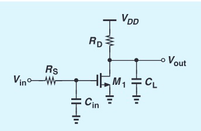

# 연습문제 11.8 — 두 극점이 같을 때의 −3 dB 주파수 (예제 11.8 변형)

## 원문
$\omega_{p1} = \omega_{p2}$라면, 어느 주파수에서 전압 이득이 3 dB만큼 떨어지는가?

## 조건
- 예제 11.8의 회로: Fig 11.11 CS 단 ($R_S$, $C_{in}$, $M_1$, $R_D$, $C_L$), $\lambda = 0$
- $\omega_{p1} = \omega_{p2}$
- 즉 $R_S C_{in} = R_D C_L$ (원문에 없음)

## 구할 것
- 전압 이득이 3 dB만큼 떨어지는 주파수

## 상속·참조
- 예제 11.8 (E11.08): $|\omega_{p1}| = \dfrac{1}{R_S C_{in}}$ (식 11.16), $|\omega_{p2}| = \dfrac{1}{R_D C_L}$ (식 11.17), $\left|\dfrac{V_{out}}{V_{in}}\right| = \dfrac{g_m R_D}{\sqrt{\left(1 + \omega^2/\omega_{p1}^2\right)\left(1 + \omega^2/\omega_{p2}^2\right)}}$ (식 11.18), 저주파 이득 $-g_m R_D$

## 회로 — Fig 11.11
```spice
RS  Vin   n1    {R_S}
CIN n1    0     {C_in}
M1  Vout  n1    0  nmos
RD  VDD   Vout  {R_D}
CL  Vout  0     {C_L}
```
- 단자: VDD = 전원, 값 미지정 (T 전원 기호) / Vin = 입력 (개방 원) / Vout = 출력 (개방 원)
- 표시: 노드 라벨 V_DD (T 기호 오른쪽), V_in (입력 원 왼쪽), V_out (출력 원 오른쪽) / 소자 라벨 R_S (저항 위), C_in (커패시터 오른쪽), R_D (저항 왼쪽), M1 (트랜지스터 오른쪽, 소스 옆), C_L (커패시터 오른쪽) / 부호 없음 / 화살표 없음 / 수치·면적 라벨 없음
- 배치: 가운데 세로줄 위→아래 V_DD T 기호, R_D, 드레인 접속점, M1, 접지 / M1 NMOS 보통 방향(게이트 왼쪽, 드레인 위, 소스 아래) / 왼쪽 V_in 원 → 가로 R_S → 게이트 접속점 → 게이트 / C_in은 게이트 접속점에서 세로로 내려가고 그 아래 접지 / 드레인 접속점에서 가로선이 오른쪽으로 C_L 접속점을 지나 V_out 원에서 끝남 / C_L은 C_L 접속점에서 세로로 내려가고 그 아래 접지 / 접지 기호는 C_in 아래, M1 소스 아래, C_L 아래에 따로 / 접속점 (세 갈래 이상, 3곳): ① 게이트 = 왼쪽 R_S + 오른쪽 게이트 + 아래 C_in (점) ② 드레인 = 위 R_D + 아래 M1 드레인 + 오른쪽 가로선 (점) ③ C_L 위 = 왼쪽 가로선 + 오른쪽 V_out 선 + 아래 C_L (점) / 교차: 없음



## 풀이
### 크기 식
- 저주파 이득을 $g_m R_D$ ($g_m$: $M_1$의 트랜스컨덕턴스), $\omega_{p1} = \omega_{p2} = \omega_p$로 두면 두 인수가 같아져 $\left|\dfrac{V_{out}}{V_{in}}\right| = \dfrac{g_m R_D}{1 + \omega^2/\omega_p^2}$
### −3 dB 조건
- 저주파 이득 $g_m R_D$의 $1/\sqrt{2}$가 되는 곳: $1 + \dfrac{\omega^2}{\omega_p^2} = \sqrt{2}$
- $\omega_{-3\text{dB}} = \omega_p\sqrt{\sqrt{2} - 1} = 0.644\,\omega_p$
- 극점이 하나일 때와 달리 각 극점이 $\omega_p$에서 $3\ \text{dB}$씩 깎으므로 $\omega_p$보다 먼저 $3\ \text{dB}$가 떨어진다
### 답
- $\omega = \sqrt{\sqrt{2} - 1}\,\omega_{p1} \approx 0.644\,\omega_{p1}$ ($\omega_{p1} = \dfrac{1}{R_S C_{in}} = \dfrac{1}{R_D C_L}$)
