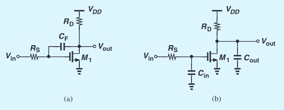

# 연습문제 11.10 — 수치가 주어진 CS 단의 밀러 입력 커패시턴스 (예제 11.10 변형)

## 원문
$g_m = (150\ \Omega)^{-1}$, $R_D = 2\ \text{k}\Omega$, $C_F = 80\ \text{fF}$일 경우에 $C_{in}$을 계산하라.

## 조건
- 예제 11.10의 회로: Fig 11.16(a) CS 단 ($R_S$, $C_F$, $M_1$, $R_D$), $\lambda = 0$
- $g_m = (150\ \Omega)^{-1}$
- $R_D = 2\ \text{k}\Omega$
- $C_F = 80\ \text{fF}$

## 구할 것
- $C_{in}$

## 상속·참조
- 예제 11.10 (E11.10): $M_1$과 $R_D$는 이득 $-g_m R_D$의 반전 증폭기, 밀러 이론으로 입력–접지 사이 $C_{in} = (1 + g_m R_D)C_F$ (식 11.31), 출력–접지 사이 $C_{out} = \left(1 + \dfrac{1}{g_m R_D}\right)C_F$

## 회로 — Fig 11.16(a)
```spice
RS  Vin   n1    {R_S}
CF  n1    Vout  {C_F}
M1  Vout  n1    0  nmos
RD  VDD   Vout  {R_D}
```
- 단자: VDD = 전원, 값 미지정 (T 전원 기호) / Vin = 입력 (개방 원) / Vout = 출력 (개방 원)
- 표시: 노드 라벨 V_DD (T 기호 오른쪽), V_in (입력 원 왼쪽), V_out (출력 원 오른쪽) / 소자 라벨 R_S (저항 위), C_F (커패시터 위), R_D (저항 왼쪽), M1 (트랜지스터 오른쪽, 소스 옆) / 부호 없음 / 화살표 없음 / 수치·면적 라벨 없음
- 배치: 오른쪽 세로줄 위→아래 V_DD T 기호, R_D, 드레인 접속점, M1, 접지 / M1 NMOS 보통 방향(게이트 왼쪽, 드레인 위, 소스 아래) / 왼쪽 V_in 원 → 가로 R_S → 게이트 접속점 → 게이트 / 게이트 접속점에서 선이 위로 올라가 모서리에서 오른쪽으로 꺾여 가로 C_F를 지나 드레인 접속점 (C_F는 게이트선보다 한 단 위, 드레인 높이) / 드레인 접속점에서 가로선이 오른쪽 V_out 원에서 끝남 / 접지 기호는 M1 소스 아래 하나 / 접속점 (세 갈래 이상, 2곳): ① 게이트 = 왼쪽 R_S + 오른쪽 게이트 + 위 C_F 선 (점) ② 드레인 = 위 R_D + 아래 M1 드레인 + 왼쪽 C_F + 오른쪽 V_out 선 (점) / 교차: 없음


> 참고: 크롭 이미지 오른쪽의 (b)는 예제 11.10의 풀이 그림 (입력–접지 C_in, 출력–접지 C_out으로 바꾼 등가 회로)
