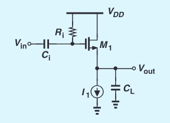

# 연습문제 11.11 — I_1과 M_1의 폭을 반으로 줄인 소스 폴로어 (예제 11.11 변형)

## 원문
$I_1$과 $M_1$의 폭이 반으로 줄어들었을 때, 위의 예제를 반복하라.

## 조건
- 예제 11.11의 회로: Fig 11.18 소스 폴로어 ($C_i$, $R_i$, $M_1$, $I_1$, $C_L$)
- 예제 11.11의 값: $\lambda = 0$, $g_m = 1/(200\ \Omega)$, $R_i = 100\ \text{k}\Omega$ (예제에는 $R_1$로 인쇄됨, $R_i$로 읽음) (원문에 없음)
- 바뀐 점: $I_1$과 $M_1$의 폭이 반으로 줄어듦
- 즉 $g_m = \sqrt{2\mu_n C_{ox}(W/L)I_D}$가 반으로 줄어 $g_m = 1/(400\ \Omega)$ (원문에 없음)
- 예제 11.11과 같이 오디오 대역 $20\ \text{Hz}$–$20\ \text{kHz}$를 통과시켜야 함 (원문에 없음)

## 구할 것
- 위의 예제 반복: 필요한 최소 $C_i$ 값과 허용 가능한 최대 $C_L$ 값

## 상속·참조
- 예제 11.11 (E11.11): 입력 코너 주파수 $1/(R_i C_i) = 2\pi \times (20\ \text{Hz})$로 $C_i = 79.6\ \text{nF}$ (식 11.40), 출력 극점 $\omega_{p,out} = g_m / C_L = 2\pi \times (20\ \text{kHz})$로 $C_L = 39.8\ \text{nF}$ (식 11.41–11.43). 출력 노드에서 접지를 바라본 저항은 $1/g_m$

## 회로 — Fig 11.18
```spice
CI  Vin   n1    {C_i}
RI  VDD   n1    {R_i}
M1  VDD   n1    Vout  nmos
I1  Vout  0     {I_1}
CL  Vout  0     {C_L}
```
- 단자: VDD = 전원, 값 미지정 (가로 레일) / Vin = 입력 (개방 원) / Vout = 출력 (개방 원)
- 표시: 노드 라벨 V_DD (레일 오른쪽 끝), V_in (입력 원 왼쪽), V_out (출력 원 오른쪽) / 소자 라벨 C_i (커패시터 아래), R_i (저항 왼쪽), M1 (트랜지스터 오른쪽, 소스 옆), I_1 (전류원 왼쪽), C_L (커패시터 오른쪽) / 부호 없음 / 화살표 없음 / 수치·면적 라벨 없음
- 배치: 맨 위 V_DD 가로 레일에 R_i(왼쪽)와 M1 드레인 선(오른쪽)이 매달림 / M1 NMOS 보통 방향(게이트 왼쪽, 드레인 위, 소스 아래) / 왼쪽 V_in 원 → 가로 C_i → 게이트 접속점 → 게이트 / R_i는 레일에서 세로로 내려와 게이트 접속점 / M1 소스에서 세로로 내려가 출력 접속점, 그 아래 전류원 I_1(원 안 화살표 아래 방향), 접지 / 출력 접속점에서 가로선이 오른쪽으로 C_L 접속점을 지나 V_out 원에서 끝남 / C_L은 C_L 접속점에서 세로로 내려가고 그 아래 접지 / 접지 기호는 I_1 아래, C_L 아래에 따로 / 접속점 (세 갈래 이상, 3곳): ① 게이트 = 왼쪽 C_i + 위 R_i + 오른쪽 게이트 (점) ② 출력 = 위 M1 소스 + 아래 I_1 + 오른쪽 가로선 (점) ③ C_L 위 = 왼쪽 가로선 + 오른쪽 V_out 선 + 아래 C_L (점) / 교차: 없음



## 풀이
### 새 $g_m$
- $g_m = \sqrt{2\mu_n C_{ox}(W/L)I_D}$에서 $W$와 $I_D$가 모두 반이 되면 $g_m$은 $\sqrt{1/4} = 1/2$배
- $g_m = \dfrac{1}{400\ \Omega}$
### 최소 $C_i$
- $V_{DD}$는 AC 접지라 $R_i$는 게이트에서 접지로 가고, 게이트는 전류를 끌지 않으므로 직렬 $C_i$와 $R_i$가 고역통과 여파기다
- 오디오 대역 아래 끝을 통과시키려면 $\dfrac{1}{R_i C_i} \le 2\pi \times 20\ \text{Hz}$ → $C_i \ge \dfrac{1}{2\pi (20\ \text{Hz})(100\ \text{k}\Omega)} = 79.6\ \text{nF}$ ($g_m$과 상관없어 그대로)
### 최대 $C_L$
- $\lambda = 0$, $I_1$이 이상적이므로 출력 노드에서 접지를 본 저항은 $M_1$ 소스로 들여다본 $1/g_m$뿐 → $|\omega_{p,out}| = g_m/C_L$
- $\dfrac{g_m}{C_L} \ge 2\pi \times 20\ \text{kHz}$ → $C_L \le \dfrac{1/(400\ \Omega)}{2\pi (20\ \text{kHz})} = 19.9\ \text{nF}$ (예제의 절반)
### 답
- 최소 $C_i \approx 79.6\ \text{nF}$ (그대로)
- 최대 $C_L \approx 19.9\ \text{nF}$
