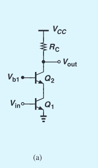

# 연습문제 11.12 — 바이폴라 캐스코드의 소신호 등가 회로 (예제 11.12 이어서)

## 원문
위 캐스코드의 소신호 등가 회로를 그려라.

## 조건
- 예제 11.12의 캐스코드: Fig 11.24(a) ($Q_1$, $Q_2$, $V_{b1}$, $R_C$)

## 구할 것
- 위 캐스코드의 소신호 등가 회로 그리기
  - 예제 11.12에서 찾은 커패시턴스를 포함한 고주파 등가 회로로 봄 (원문에 없음)

## 상속·참조
- 예제 11.12 (E11.12)의 결과 Fig 11.24(b) (크롭 이미지 오른쪽): 각 트랜지스터에 3개의 커패시턴스 추가. $C_{\mu 2}$: $Q_2$ 베이스($V_b$)–$V_{out}$, $C_{\pi 2}$: $Q_2$ 베이스–중간 노드($Q_2$ 이미터 = $Q_1$ 컬렉터), $C_{CS2}$: $V_{out}$–접지, $C_{\mu 1}$: $V_{in}$–중간 노드, $C_{\pi 1}$: $V_{in}$–접지 ($Q_1$ 이미터는 접지), $C_{CS1}$: 중간 노드–접지. $C_{CS1}$과 $C_{\pi 2}$는 병렬, $C_{\mu 2}$와 $C_{CS2}$도 마찬가지
- 본문 Fig 11.23(b) (교재 592쪽, 크롭 안 함): 바이폴라 소신호 모델 = $B$–$E$ 사이 $C_\pi$, $r_\pi$ ($v_\pi$: $B$ 쪽 +), $B$–$C$ 사이 $C_\mu$, $C$→$E$ 종속 전류원 $g_m v_\pi$, $C$–$E$ 사이 $r_O$, $C$–접지 사이 $C_{CS}$

## 회로 — Fig 11.24(a)
```spice
RC  VCC   Vout  {R_C}
Q2  Vout  Vb1   n1  npn
Q1  n1    Vin   0   npn
```
- 단자: VCC = 전원, 값 미지정 (T 전원 기호) / Vb1 = 이상적 DC 바이어스 (점 단자) / Vin = 입력 (개방 원) / Vout = 출력 (개방 원)
- 표시: 노드 라벨 V_CC (T 기호 오른쪽), V_b1 (점 왼쪽), V_in (입력 원 왼쪽), V_out (출력 원 오른쪽) / 소자 라벨 R_C (저항 오른쪽), Q2 (트랜지스터 오른쪽, 이미터 옆), Q1 (트랜지스터 오른쪽, 이미터 옆) / 부호 없음 / 화살표 없음 / 수치·면적 라벨 없음
- 배치: 한 세로줄 위→아래 V_CC T 기호, R_C, 출력 접속점, Q2, Q1, 접지 / Q1, Q2 모두 npn 보통 방향(베이스 왼쪽, 컬렉터 위, 이미터 아래) / Q2 이미터가 세로선으로 Q1 컬렉터에 바로 이어짐 (중간 노드 라벨 없음) / V_b1 점 단자 → 가로선 → Q2 베이스, V_in 원 → 가로선 → Q1 베이스 / 출력 접속점에서 가로선이 오른쪽 V_out 원에서 끝남 / 접속점 (세 갈래 이상, 1곳): 출력 = 위 R_C + 아래 Q2 컬렉터 + 오른쪽 V_out 선 (점) / 교차: 없음


