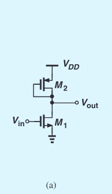

# 연습문제 11.13 — 다이오드 연결 부하 CS 단의 소신호 등가 회로 (예제 11.13 이어서)

## 원문
$M_2$가 다이오드 연결 소자임을 유념하고, 위 증폭기의 소신호 등가 회로를 그려라.

## 조건
- 예제 11.13의 증폭기: Fig 11.28(a) (입력 NMOS $M_1$, 다이오드 연결 PMOS $M_2$ 부하)
- $M_2$가 다이오드 연결 소자임에 유념

## 구할 것
- 위 증폭기의 소신호 등가 회로 그리기
  - 예제 11.13에서 찾은 커패시턴스를 포함한 고주파 등가 회로로 봄 (원문에 없음)

## 상속·참조
- 예제 11.13 (E11.13)의 결과 Fig 11.28(c) (크롭 이미지 오른쪽): $C_{SB1}$, $C_{SB2}$는 양 끝이 교류 접지에 단락, $C_{GD2}$는 양 끝이 출력에 단락되어 빠짐. 남는 것: $V_{in}$–접지 $C_{GS1}$, $V_{in}$–$V_{out}$ $C_{GD1}$, $V_{out}$–접지 $C_{DB1} + C_{DB2} + C_{GS2}$
- 본문 Fig 11.27(a) (교재 594쪽, 크롭 안 함): MOSFET 고주파 모델 = $G$–$S$ 사이 $C_{GS}$ ($v_{GS}$: $G$ 쪽 +), $G$–$D$ 사이 $C_{GD}$, $D$→$S$ 종속 전류원 $g_m v_{GS}$, $D$–$S$ 사이 $r_O$, $D$–접지 $C_{DB}$, $S$–접지 $C_{SB}$

## 회로 — Fig 11.28(a)
```spice
* M2는 다이오드 연결: 게이트가 드레인(Vout)에 선으로 이어짐
M2  Vout  Vout  VDD  pmos
M1  Vout  Vin   0    nmos
```
- 단자: VDD = 전원, 값 미지정 (T 전원 기호) / Vin = 입력 (개방 원) / Vout = 출력 (개방 원)
- 표시: 노드 라벨 V_DD (T 기호 오른쪽), V_in (입력 원 왼쪽), V_out (출력 원 오른쪽) / 소자 라벨 M2 (트랜지스터 오른쪽), M1 (트랜지스터 오른쪽, 소스 옆) / 부호 없음 / 화살표 없음 / 수치·면적 라벨 없음
- 배치: 한 세로줄 위→아래 V_DD T 기호, M2, M2 드레인 접속점, V_out 접속점, M1, 접지 / M2 PMOS(게이트 왼쪽, 소스 위, 드레인 아래, 소스 화살표는 게이트 쪽을 향함) / M2 게이트에서 선이 왼쪽으로 나가 아래로 꺾이고 다시 오른쪽으로 꺾여 M2 드레인 접속점 (다이오드 연결) / M1 NMOS 보통 방향 / V_in 원 → 가로선 → M1 게이트 / V_out 접속점에서 가로선이 오른쪽 V_out 원에서 끝남 / 접속점 (세 갈래 이상, 2곳): ① M2 드레인 = 위 M2 드레인 + 왼쪽 게이트 연결선 + 아래 (점) ② V_out = 위 + 오른쪽 V_out 선 + 아래 M1 드레인 (점) / 교차: 없음


