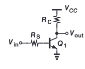

# 연습문제 11.15 — I_C = 2 mA, C_π = 180 fF인 CE 단의 극점 (예제 11.15 변형)

## 원문
$I_C = 2\ \text{mA}$이고 $C_\pi = 180\ \text{fF}$인 경우에 위의 예제를 반복하라.

## 조건
- 예제 11.15의 CE 단 (Fig 11.31(a))
- $I_C = 2\ \text{mA}$ (예제는 $1\ \text{mA}$)
- $C_\pi = 180\ \text{fF}$ (예제는 $100\ \text{fF}$)
- 나머지는 예제 11.15와 같음: $R_S = 200\ \Omega$, $\beta = 100$, $C_\mu = 20\ \text{fF}$, $C_{CS} = 30\ \text{fF}$, (a)에서 $R_L = 2\ \text{k}\Omega$ (원문에 없음)

## 구할 것
- 예제 11.15 반복
  - (a) $R_L = 2\ \text{k}\Omega$일 때 입력과 출력 극점, 대역폭을 제한하는 노드
  - (b) 출력 극점이 대역폭을 제한하도록 $R_L$을 선택하는 것이 가능한가?

## 상속·참조
- 예제 11.15 (E11.15): 밀러 근사 통합 모델 (본문 Fig 11.32, 크롭 안 함). CE 단은 $R_{Thev} = R_S \parallel r_\pi$, $C_{in} = C_\pi$, $C_{XY} = C_\mu$, $C_{out} = C_{CS}$, 부하 $R_L$
- 극점 (식 11.61–11.62): $|\omega_{p,in}| = \dfrac{1}{R_{Thev}[C_{in} + (1 + g_m R_L) C_{XY}]}$, $|\omega_{p,out}| = \dfrac{1}{R_L\left[C_{out} + \left(1 + \dfrac{1}{g_m R_L}\right) C_{XY}\right]}$
- (b)의 조건 ($g_m R_L \gg 1$, 식 11.66): $[C_{CS} + C_\mu - g_m(R_S \parallel r_\pi)C_\mu]R_L > (R_S \parallel r_\pi)C_\pi$
- 바이폴라 관계: $g_m = I_C/V_T$, $r_\pi = \beta/g_m$. 예제 풀이의 $r_\pi = 2.6\ \text{k}\Omega$ ($I_C = 1\ \text{mA}$)은 $V_T = 26\ \text{mV}$와 맞음 (원문에 없음)

## 회로 — Fig 11.31(a)
```spice
RS  Vin   n1    {R_S}
Q1  Vout  n1    0  npn
RC  VCC   Vout  {R_C}
```
- 단자: VCC = 전원, 값 미지정 (T 전원 기호) / Vin = 입력 (개방 원) / Vout = 출력 (개방 원)
- 표시: 노드 라벨 V_CC (T 기호 오른쪽), V_in (입력 원 왼쪽), V_out (출력 원 오른쪽) / 소자 라벨 R_S (저항 위), R_C (저항 왼쪽), Q1 (트랜지스터 오른쪽, 이미터 옆) / 부호 없음 / 화살표 없음 / 수치·면적 라벨 없음
- 배치: 세로줄 위→아래 V_CC T 기호, R_C, 컬렉터 접속점, Q1, 접지 / Q1 npn 보통 방향(베이스 왼쪽, 컬렉터 위, 이미터 아래) / V_in 원 → 가로 R_S → 베이스 / 컬렉터 접속점에서 가로선이 오른쪽 V_out 원에서 끝남 / 접지 기호는 Q1 이미터 아래 / 접속점 (세 갈래 이상, 1곳): 컬렉터 = 위 R_C + 아래 Q1 컬렉터 + 오른쪽 V_out 선 (점) / 패널 글자 (a)는 크롭 이미지에 없음 (책에서는 CE·CS 두 회로 아래 가운데에 하나) / 교차: 없음


> 참고: 크롭은 (a)의 CE(왼쪽) 절반만 (crop: ce). 본문 그림 11.31의 (b) 트랜지스터 커패시턴스 포함, (c) 소신호 등가 회로, (d) 통합 모델은 크롭하지 않음 (상속·참조에 글로)

## 풀이
### 소신호 파라미터
- $g_m = I_C/V_T = 2\ \text{mA}/26\ \text{mV} = 76.9\ \text{mS}$ ($V_T = 26\ \text{mV}$), $r_\pi = \beta/g_m = 1.30\ \text{k}\Omega$
- $R_{Thev} = R_S \parallel r_\pi = 173\ \Omega$, $g_m R_L = 154$
### (a) 입력 극점
- 밀러 근사로 $C_\mu$를 입력 쪽 $(1 + g_m R_L)C_\mu = 3.10\ \text{pF}$로 옮긴다
- $|\omega_{p,in}| = \dfrac{1}{R_{Thev}[C_\pi + (1 + g_m R_L)C_\mu]} = \dfrac{1}{(173\ \Omega)(3.28\ \text{pF})} = 2\pi \times 280\ \text{MHz}$
### (a) 출력 극점과 느린 노드
- $|\omega_{p,out}| = \dfrac{1}{R_L\left[C_{CS} + \left(1 + \dfrac{1}{g_m R_L}\right)C_\mu\right]} = \dfrac{1}{(2\ \text{k}\Omega)(50.1\ \text{fF})} = 2\pi \times 1.59\ \text{GHz}$
- $g_m$이 2배가 되어 밀러 배수도 약 2배(155배)가 되므로 입력 노드가 대역폭을 더 강하게 제한한다
### (b) 출력 극점이 더 느려질 조건
- $|\omega_{p,in}| > |\omega_{p,out}|$을 풀면 $R_L[C_{CS} + C_\mu - g_m R_{Thev} C_\mu] > R_{Thev}(C_\pi + C_\mu) - C_\mu/g_m$
- 좌변 괄호 $= 50\ \text{fF} - 267\ \text{fF} = -217\ \text{fF} < 0$, 우변 $= 34.4\ \text{ps} > 0$ → 어떤 $R_L$에서도 성립하지 않는다
### 답
- (a) $|\omega_{p,in}| \approx 2\pi \times 280\ \text{MHz}$, $|\omega_{p,out}| \approx 2\pi \times 1.59\ \text{GHz}$. 입력 노드가 대역폭을 제한한다.
- (b) 불가능하다. $C_{CS} + C_\mu - g_m(R_S \parallel r_\pi)C_\mu < 0$이라 어떤 $R_L$로도 출력 극점이 더 느려지지 않는다.
