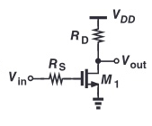

# 연습문제 11.16 — 폭과 바이어스 전류가 2배가 된 CS 단 (예제 11.16 변형)

## 원문
만약 폭과 바이어스 전류가 원래 값의 2배가 될 경우에는 어떻게 되겠는가?

## 조건
- 예제 11.16의 회로: Fig 11.31(a)의 CS 단
- 폭과 바이어스 전류가 원래 값의 2배 (예제는 절반)

## 구할 것
- 이 경우 (회로의 이득과 극점이) 어떻게 되겠는가?
  - 괄호 안은 예제 11.16의 요구를 이어받은 것 (원문에 없음)

## 상속·참조
- 예제 11.16 (E11.16) 풀이: 폭과 바이어스 전류가 모두 절반이면 $g_m$도 절반, 소신호 이득 $g_m R_L$도 절반, 모든 커패시턴스도 절반 → $|\omega_{p,in}| = \dfrac{1}{R_S\left[\dfrac{C_{in}}{2} + \left(1 + \dfrac{g_m R_L}{2}\right)\dfrac{C_{XY}}{2}\right]}$ (식 11.67), $|\omega_{p,out}| = \dfrac{1}{R_L\left[\dfrac{C_{out}}{2} + \left(1 + \dfrac{2}{g_m R_L}\right)\dfrac{C_{XY}}{2}\right]}$ (식 11.68). 이득은 절반, 대역폭은 대략 2배, 이득-대역폭 곱은 거의 일정
- CS 단 밀러 근사 (본문 Fig 11.32, 크롭 안 함): $R_{Thev} = R_S$, $C_{in} = C_{GS}$, $C_{XY} = C_{GD}$, $C_{out} = C_{DB}$, 부하 $R_L$ ($R_D$ 자리). $|\omega_{p,in}| = \dfrac{1}{R_S[C_{in} + (1 + g_m R_L) C_{XY}]}$ (식 11.61), $|\omega_{p,out}| = \dfrac{1}{R_L\left[C_{out} + \left(1 + \dfrac{1}{g_m R_L}\right) C_{XY}\right]}$ (식 11.62)

## 회로 — Fig 11.31(a)
```spice
RS  Vin   n1    {R_S}
M1  Vout  n1    0  nmos
RD  VDD   Vout  {R_D}
```
- 단자: VDD = 전원, 값 미지정 (T 전원 기호) / Vin = 입력 (개방 원) / Vout = 출력 (개방 원)
- 표시: 노드 라벨 V_DD (T 기호 오른쪽), V_in (입력 원 왼쪽), V_out (출력 원 오른쪽) / 소자 라벨 R_S (저항 위), R_D (저항 왼쪽), M1 (트랜지스터 오른쪽, 소스 옆) / 부호 없음 / 화살표 없음 / 수치·면적 라벨 없음
- 배치: 세로줄 위→아래 V_DD T 기호, R_D, 드레인 접속점, M1, 접지 / M1 NMOS 보통 방향(게이트 왼쪽, 드레인 위, 소스 아래) / V_in 원 → 가로 R_S → 게이트 / 드레인 접속점에서 가로선이 오른쪽 V_out 원에서 끝남 / 접지 기호는 M1 소스 아래 / 접속점 (세 갈래 이상, 1곳): 드레인 = 위 R_D + 아래 M1 드레인 + 오른쪽 V_out 선 (점) / 패널 글자 (a)는 크롭 이미지에 없음 (책에서는 CE·CS 두 회로 아래 가운데에 하나) / 교차: 없음


> 참고: 크롭은 (a)의 CS(오른쪽) 절반만 (crop: cs). 본문 그림 11.31의 (b) 트랜지스터 커패시턴스 포함, (c) 소신호 등가 회로, (d) 통합 모델은 크롭하지 않음 (상속·참조에 글로)

## 풀이
### 원래 소자 둘의 병렬로 보기
- 폭과 전류를 함께 2배로 하면 전류 밀도와 과구동 전압은 그대로이므로, 새 소자는 원래 소자 두 개를 병렬로 둔 것이다
- 따라서 원래 $M_1$의 트랜스컨덕턴스를 $g_m$이라 하면 새 값은 $2g_m$이고, $C_{GS}$, $C_{GD}$, $C_{DB}$도 모두 2배다
### 이득
- $|A_v'| = 2g_m R_D$ → 2배
### 입력 극점
- 밀러 근사, $R_{Thev} = R_S$: $|\omega_{p,in}'| = \dfrac{1}{R_S[2C_{GS} + (1 + 2g_m R_D) \cdot 2C_{GD}]}$
- 커패시턴스와 밀러 배수가 함께 커져 본래의 절반보다 작다
### 출력 극점
- $|\omega_{p,out}'| = \dfrac{1}{R_D\left[2C_{DB} + \left(1 + \dfrac{1}{2g_m R_D}\right) 2C_{GD}\right]}$
- $g_m R_D \gg 1$이면 본래의 약 절반이다
### 답
- 이득은 $2g_m R_D$로 2배가 된다.
- 극점은 $|\omega_{p,in}| = \dfrac{1}{R_S[2C_{GS} + (1 + 2g_m R_D) \cdot 2C_{GD}]}$ (절반보다 더 감소), $|\omega_{p,out}| = \dfrac{1}{R_D\left[2C_{DB} + \left(1 + \dfrac{1}{2g_m R_D}\right)2C_{GD}\right]}$ ($g_m R_D \gg 1$이면 약 절반). 대역폭이 약 절반이 되어 이득-대역폭 곱은 거의 그대로다.
