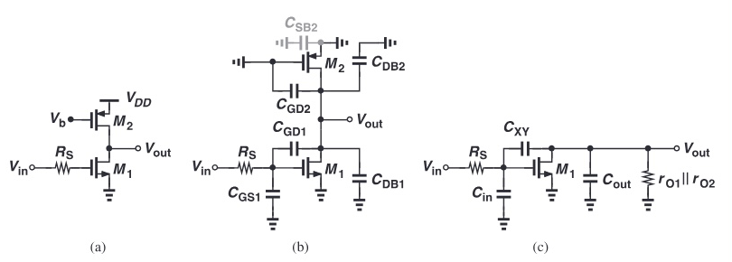

# 연습문제 11.17 — λ ≠ 0일 때 예제 11.17 반복

## 원문
$\lambda \neq 0$일 경우에 위 예제를 반복하라.

## 조건
- 예제 11.17의 회로: Fig 11.33(a) CS 단 ($R_S$, $M_1$, 게이트가 $V_b$에 걸린 PMOS 부하 $M_2$), 트랜지스터는 모두 포화 영역
- $\lambda \neq 0$ (인쇄된 대로)
- 예제 11.17도 이미 $\lambda \neq 0$을 가정하므로 문맥과 맞지 않음(오식으로 보임) (원문에 없음)

## 구할 것
- 예제 11.17 반복: 주극점 근사를 사용하여 회로의 극점들 계산

## 상속·참조
- 예제 11.17 (E11.17): $C_{SB1}$, $C_{GS2}$, $C_{SB2}$는 영향 없음. $C_{in} = C_{GS1}$, $C_{XY} = C_{GD1}$, $C_{out} = C_{DB1} + C_{GD2} + C_{DB2}$, 출력 노드의 저항 $r_{O1} \parallel r_{O2}$
- 주극점 근사 (식 11.80, 11.82): $|\omega_{p1}| = \dfrac{1}{(1 + g_m R_L)C_{XY}R_{Thev} + R_{Thev}C_{in} + R_L(C_{XY} + C_{out})}$, $|\omega_{p2}| = \dfrac{(1 + g_m R_L)C_{XY}R_{Thev} + R_{Thev}C_{in} + R_L(C_{XY} + C_{out})}{R_{Thev}R_L(C_{in}C_{XY} + C_{out}C_{XY} + C_{in}C_{out})}$
- 예제의 결과 (식 11.86–11.87): $R_{Thev} = R_S$, $R_L = r_{O1} \parallel r_{O2}$를 넣은 식

## 회로 — Fig 11.33(a)
```spice
M2  Vout  Vb   VDD  pmos
RS  Vin   n1   {R_S}
M1  Vout  n1   0    nmos
```
- 단자: VDD = 전원, 값 미지정 (T 전원 기호) / Vb = 이상적 DC 바이어스 (점 단자) / Vin = 입력 (개방 원) / Vout = 출력 (개방 원)
- 표시: 노드 라벨 V_DD (T 기호 오른쪽), V_b (점 단자 왼쪽), V_in (입력 원 왼쪽), V_out (출력 원 오른쪽) / 소자 라벨 M2 (트랜지스터 오른쪽), R_S (저항 위), M1 (트랜지스터 오른쪽, 소스 옆) / 부호 없음 / 화살표 없음 / 수치·면적 라벨 없음
- 배치: 한 세로줄 위→아래 V_DD T 기호, M2, 출력 접속점, M1, 접지 / M2 PMOS(게이트 왼쪽, 소스 위, 드레인 아래, 소스 화살표는 게이트 쪽을 향함) / V_b 점 단자 → 가로선 → M2 게이트 / M1 NMOS 보통 방향(게이트 왼쪽, 드레인 위, 소스 아래) / V_in 원 → 가로 R_S → M1 게이트 / 출력 접속점에서 가로선이 오른쪽 V_out 원에서 끝남 / 접속점 (세 갈래 이상, 1곳): ① 출력 = 위 M2 드레인 + 아래 M1 드레인 + 오른쪽 V_out 선 (점) / 교차: 없음


> 참고: 크롭 이미지 가운데 (b)와 오른쪽 (c)는 예제 11.17의 풀이 그림
