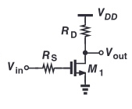

# 연습문제 11.18 — 폭(커패시턴스)과 바이어스 전류가 절반일 때 예제 11.18 반복

## 원문
소자의 폭(따라서 커패시턴스들)과 바이어스 전류가 절반일 경우 위의 예제를 반복하라.

## 조건
- 예제 11.18의 CS 단: Fig 11.31(a)의 CS 단, $R_S = 200\ \Omega$, $C_{GS} = 250\ \text{fF}$, $C_{GD} = 80\ \text{fF}$, $C_{DB} = 100\ \text{fF}$, $g_m = (150\ \Omega)^{-1}$, $\lambda = 0$, $R_L = 2\ \text{k}\Omega$
- 소자의 폭(따라서 커패시턴스들)과 바이어스 전류가 절반

## 구할 것
- 예제 11.18 반복: (a) 밀러 근사, (b) 정확한 전달 함수, (c) 주극점 근사를 이용하여 주파수 응답 그리기

## 상속·참조
- 예제 11.16 (E11.16) 풀이: 폭과 바이어스 전류가 모두 절반이면 $g_m$도 절반, 모든 커패시턴스도 절반
- 예제 11.18 (E11.18)의 결과: (a) $g_m R_L = 13.3$, $|\omega_{p,in}| = 2\pi \times (571\ \text{MHz})$, $|\omega_{p,out}| = 2\pi \times (428\ \text{MHz})$ / (b) 영점 $g_m/C_{GD} = 2\pi \times (13.3\ \text{GHz})$, $a = 2.12 \times 10^{-20}\ \text{s}^{-2}$, $b = 6.39 \times 10^{-10}$, $|\omega_{p1}| = 2\pi \times (264\ \text{MHz})$, $|\omega_{p2}| = 2\pi \times (4.53\ \text{GHz})$ / (c) $|\omega_{p1}| = 2\pi \times (249\ \text{MHz})$, $|\omega_{p2}| = 2\pi \times (4.79\ \text{GHz})$
- CS 단 밀러 근사 (본문 Fig 11.32, 크롭 안 함): $R_{Thev} = R_S$, $C_{in} = C_{GS}$, $C_{XY} = C_{GD}$, $C_{out} = C_{DB}$. $|\omega_{p,in}| = \dfrac{1}{R_S[C_{in} + (1 + g_m R_L) C_{XY}]}$ (식 11.61), $|\omega_{p,out}| = \dfrac{1}{R_L\left[C_{out} + \left(1 + \dfrac{1}{g_m R_L}\right) C_{XY}\right]}$ (식 11.62)
- 직접 해석 (11.4.4절, 통합 모델 Fig 11.31(d)의 두 노드 KCL): $\dfrac{V_{out}}{V_{Thev}}(s) = \dfrac{(C_{XY}s - g_m)R_L}{as^2 + bs + 1}$ (식 11.73), $a = R_{Thev}R_L(C_{in}C_{XY} + C_{out}C_{XY} + C_{in}C_{out})$ (식 11.74), $b = (1 + g_m R_L)C_{XY}R_{Thev} + R_{Thev}C_{in} + R_L(C_{XY} + C_{out})$ (식 11.75). 영점 $\omega_z = g_m/C_{XY}$ (식 11.76)
- 주극점 근사 ($\omega_{p2} \gg \omega_{p1}$): $|\omega_{p1}| = \dfrac{1}{(1 + g_m R_L)C_{XY}R_{Thev} + R_{Thev}C_{in} + R_L(C_{XY} + C_{out})}$ (식 11.80), $|\omega_{p2}| = \dfrac{b}{a}$ (식 11.81–11.82)

## 회로 — Fig 11.31(a)
```spice
RS  Vin   n1    {R_S}
M1  Vout  n1    0  nmos
RD  VDD   Vout  {R_D}
```
- 단자: VDD = 전원, 값 미지정 (T 전원 기호) / Vin = 입력 (개방 원) / Vout = 출력 (개방 원)
- 표시: 노드 라벨 V_DD (T 기호 오른쪽), V_in (입력 원 왼쪽), V_out (출력 원 오른쪽) / 소자 라벨 R_S (저항 위), R_D (저항 왼쪽), M1 (트랜지스터 오른쪽, 소스 옆) / 부호 없음 / 화살표 없음 / 수치·면적 라벨 없음
- 배치: 세로줄 위→아래 V_DD T 기호, R_D, 드레인 접속점, M1, 접지 / M1 NMOS 보통 방향(게이트 왼쪽, 드레인 위, 소스 아래) / V_in 원 → 가로 R_S → 게이트 / 드레인 접속점에서 가로선이 오른쪽 V_out 원에서 끝남 / 접지 기호는 M1 소스 아래 / 접속점 (세 갈래 이상, 1곳): 드레인 = 위 R_D + 아래 M1 드레인 + 오른쪽 V_out 선 (점) / 패널 글자 (a)는 크롭 이미지에 없음 (책에서는 CE·CS 두 회로 아래 가운데에 하나) / 교차: 없음


> 참고: 크롭은 (a)의 CS(오른쪽) 절반만 (crop: cs). 본문 그림 11.31의 (b) 트랜지스터 커패시턴스 포함, (c) 소신호 등가 회로, (d) 통합 모델은 크롭하지 않음 (상속·참조에 글로)
