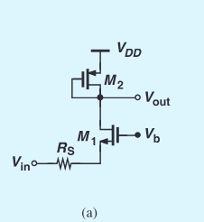

# 연습문제 11.19 — M2가 전류원으로 동작하는 CG 단의 극점 (예제 11.19 변형)

## 원문
$M_2$가 전류원으로 동작할 경우, 즉 $M_2$의 게이트에 정전압이 연결되어 있는 경우에 위의 예제를 반복하라.

## 조건
- 예제 11.19의 회로: Fig 11.38(a) CG 단 ($R_S$, $M_1$ 게이트 $V_b$), $\lambda = 0$
- 변경: $M_2$가 전류원으로 동작, 즉 $M_2$의 게이트에 정전압이 연결됨
- 그림 (a)의 다이오드 연결 대신 $M_2$ 게이트를 정전압에 연결한 회로로 봄 (원문에 없음)

## 구할 것
- 예제 11.19 반복: 회로의 극점 계산

## 상속·참조
- 예제 11.19 (E11.19): $C_{GD2}$와 $C_{SB2}$는 (다이오드 연결에서)(원문에 없음) 역할 없음. 입력 극점 $|\omega_{p,X}| = \dfrac{1}{\left(R_S \parallel \dfrac{1}{g_{m1}}\right)(C_{SB1} + C_{GD1})}$ (식 11.101, 인쇄된 대로. 풀이 그림 11.38(b)의 $X$ 노드 커패시터는 $C_{SB1} + C_{GS1}$), 출력 극점 $|\omega_{p,Y}| = \dfrac{1}{\dfrac{1}{g_{m2}}(C_{DB1} + C_{GD1} + C_{GS2} + C_{DB2})}$ (식 11.102, 출력 노드 저항 $1/g_{m2}$)
- 본문 Fig 11.37 (교재 608쪽, 크롭 안 함): 트랜지스터 커패시턴스를 포함한 (a) CB 단과 (b) CG 단. $r_O = \infty$. (b) CG 단: $V_{DD}$–$R_D$–$V_{out}$ = 드레인 노드 $Y$, $M_1$ 게이트는 $V_b$ (점 단자), 소스 노드 $X$, $R_S$는 $V_{in}$과 $X$ 사이. $C_{DB}$는 $Y$–접지, $C_{GD}$는 $Y$–$V_b$, $C_{GS}$는 $V_b$–$X$, $C_{SB}$는 $X$–접지. $V_b$가 교류 접지이므로 입력과 출력 사이에 커패시턴스가 없고 밀러 효과가 없음
- CB/CG 단의 극점: $|\omega_{p,X}| = \dfrac{1}{\left(R_S \parallel \dfrac{1}{g_m}\right)C_X}$ (식 11.99), $C_X = C_\pi$ 또는 $C_{GS} + C_{SB}$ / $|\omega_{p,Y}| = \dfrac{1}{R_L C_Y}$ (식 11.100), $C_Y = C_\mu + C_{CS}$ 또는 $C_{GD} + C_{DB}$

## 회로 — Fig 11.38(a)
```spice
* M2는 다이오드 연결: 게이트가 드레인(Vout)에 선으로 이어짐
M2  Vout  Vout  VDD  pmos
M1  Vout  Vb    n1   nmos
RS  Vin   n1    {R_S}
```
- 단자: VDD = 전원, 값 미지정 (T 전원 기호) / Vb = 이상적 DC 바이어스 (점 단자) / Vin = 입력 (개방 원) / Vout = 출력 (개방 원)
- 표시: 노드 라벨 V_DD (T 기호 오른쪽), V_b (점 단자 오른쪽), V_in (입력 원 왼쪽), V_out (출력 원 오른쪽) / 소자 라벨 M2 (트랜지스터 오른쪽), M1 (트랜지스터 왼쪽), R_S (저항 위) / 부호 없음 / 화살표 없음 / 수치·면적 라벨 없음
- 배치: 한 세로줄 위→아래 V_DD T 기호, M2, 출력 접속점, M1, M1 소스 모서리 / M2 PMOS(게이트 왼쪽, 소스 위, 드레인 아래, 소스 화살표는 게이트 쪽을 향함) / M2 게이트에서 선이 왼쪽으로 나가 아래로 꺾이고 다시 오른쪽으로 꺾여 출력 접속점 (다이오드 연결) / M1 NMOS 좌우 반전(게이트 오른쪽, 드레인 위, 소스 아래, 소스 화살표는 왼쪽 바깥을 향함) / M1 게이트 → 가로선 → 오른쪽 V_b 점 단자 / M1 소스에서 선이 아래로 내려가 모서리에서 왼쪽으로 꺾여 가로 R_S를 지나 V_in 원 / 출력 접속점에서 가로선이 오른쪽 V_out 원에서 끝남 / 접지 기호 없음 / 접속점 (세 갈래 이상, 1곳): ① 출력 = 위 M2 드레인 + 왼쪽 다이오드 선 + 아래 M1 드레인 + 오른쪽 V_out 선 (점) / 교차: 없음



## 힌트
### $M_2$는 이제 다이오드가 아니다
- 게이트가 정전압이면 $M_2$는 $1/g_{m2}$로 줄지 않는다. 출력 노드에서 접지로 가는 저항으로 무엇이 남는지 $M_1$, $M_2$ 양쪽을 들여다보고 따진다
- 게이트가 드레인에서 떨어졌으므로 $M_2$의 커패시턴스 중 출력 노드에 걸리는 것도 예제와 달라진다

## 풀이
### 영향 없는 커패시턴스
- $M_2$ 게이트가 정전압이면 게이트, 소스($V_{DD}$), $V_b$가 모두 AC 접지다
- $C_{GS2}$는 양 끝이 AC 접지, $C_{SB2}$는 양 끝이 $V_{DD}$라 빠진다. $C_{GD2}$는 이제 출력–AC 접지에 걸린다
### 입력 노드 $X$의 극점
- $M_1$ 소스 노드를 $X$라 하면 $X$–접지에 $C_{SB1}$, $X$–$V_b$(AC 접지)에 $C_{GS1}$ → $C_X = C_{GS1} + C_{SB1}$
- $\lambda = 0$이라 $M_1$ 소스로 들여다본 저항은 드레인 쪽 부하와 관계없이 $1/g_{m1}$이고 $R_S$와 병렬이다
- $|\omega_{p,X}| = \dfrac{1}{\left(R_S \parallel \dfrac{1}{g_{m1}}\right)(C_{GS1} + C_{SB1})}$ (예제와 같음)
- 교재 식의 $C_{GD1}$은 $C_{GS1}$의 오식으로 본다 (그림에서 $C_{GS1}$이 $X$에 걸림)
### 출력 노드의 극점
- 출력–AC 접지: $C_Y = C_{DB1} + C_{GD1} + C_{GD2} + C_{DB2}$ (예제의 $C_{GS2}$ 자리에 $C_{GD2}$)
- $M_2$는 이제 다이오드가 아니라 전류원이라 $1/g_{m2}$가 아닌 $r_{O2}$를, $M_1$ 드레인은 $r_{O1}$ 수준 이상을 보인다. $\lambda = 0$이면 둘 다 무한대라 출력 노드 저항 $R_Y \to \infty$
- $|\omega_{p,Y}| = \dfrac{1}{R_Y C_Y} \to 0$: 출력 극점이 원점으로 간다
### 답
- $|\omega_{p,X}| = \dfrac{1}{\left(R_S \parallel \dfrac{1}{g_{m1}}\right)(C_{GS1} + C_{SB1})}$ (예제와 같음)
- $|\omega_{p,Y}| = \dfrac{1}{R_Y(C_{DB1} + C_{GD1} + C_{GD2} + C_{DB2})}$에서 $\lambda = 0$이라 $R_Y \to \infty$, 따라서 $|\omega_{p,Y}| \to 0$ (원점의 극점)
