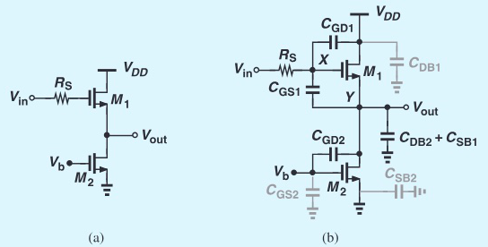

# 연습문제 11.22 — 예제 11.18 파라미터로 전류원 부하 소스 폴로어의 극점 계산 (예제 11.22 이어서)

## 원문
$M_1$과 $M_2$가 동일하다고 가정하고 예제 11.18에 주어진 트랜지스터 파라미터들을 사용하여 극점 주파수를 계산하라.

## 조건
- 예제 11.22의 소스 폴로어: Fig 11.43(a) ($R_S$, $M_1$, 전류원으로 동작하는 $M_2$)
- $M_1$과 $M_2$는 동일
- 트랜지스터 파라미터는 예제 11.18의 값: $C_{GS} = 250\ \text{fF}$, $C_{GD} = 80\ \text{fF}$, $C_{DB} = 100\ \text{fF}$, $g_m = (150\ \Omega)^{-1}$, $\lambda = 0$ (원문에 없음)
- 문제는 $R_S$와 $C_{SB}$ 값을 적지 않음 (원문에 없음)

## 구할 것
- 극점 주파수

## 상속·참조
- 예제 11.18 (E11.18)의 트랜지스터 파라미터: $C_{GS} = 250\ \text{fF}$, $C_{GD} = 80\ \text{fF}$, $C_{DB} = 100\ \text{fF}$, $g_m = (150\ \Omega)^{-1}$, $\lambda = 0$ (예제 11.18의 $R_S = 200\ \Omega$, $R_L = 2\ \text{k}\Omega$는 CS 단의 회로 값)
- 예제 11.22 (E11.22): $C_{GS2}$와 $C_{SB2}$는 역할 없음, $C_{SB1}$과 병렬로 $C_{GD2}$와 $C_{DB2}$가 나타남. $\dfrac{V_{out}}{V_{in}}(s) = \dfrac{1 + \dfrac{C_{GS1}}{g_{m1}}s}{as^2 + bs + 1}$ (식 11.119), $a = \dfrac{R_S}{g_{m1}}[C_{GD1}C_{GS1} + (C_{GD1} + C_{GS1})(C_{SB1} + C_{GD2} + C_{DB2})]$ (식 11.120), $b = R_S C_{GD1} + \dfrac{C_{GD1} + C_{SB1} + C_{GD2} + C_{DB2}}{g_{m1}}$ (식 11.121, 인쇄된 대로. 식 11.114와 비교하면 분자 첫 항은 $C_{GS1}$로 보임)

## 회로 — Fig 11.43(a)
```spice
RS  Vin   n1    {R_S}
M1  VDD   n1    Vout  nmos
M2  Vout  Vb    0     nmos
```
- 단자: VDD = 전원, 값 미지정 (T 전원 기호) / Vin = 입력 (개방 원) / Vb = 이상적 DC 바이어스 (점 단자) / Vout = 출력 (개방 원)
- 표시: 노드 라벨 V_DD (T 기호 오른쪽), V_in (입력 원 왼쪽), V_b (점 단자 왼쪽), V_out (출력 원 오른쪽) / 소자 라벨 R_S (저항 위), M1 (트랜지스터 오른쪽, 소스 옆), M2 (트랜지스터 왼쪽 아래, V_b 점 단자 아래) / 부호 없음 / 화살표 없음 / 수치·면적 라벨 없음
- 배치: 한 세로줄 위→아래 V_DD T 기호, M1, 출력 접속점, M2, 접지 / M1, M2 모두 NMOS 보통 방향(게이트 왼쪽, 드레인 위, 소스 아래) / V_in 원 → 가로 R_S → M1 게이트 / M2 게이트 → 가로선 → 왼쪽 V_b 점 단자 / 출력 접속점에서 가로선이 오른쪽 V_out 원에서 끝남 / 접속점 (세 갈래 이상, 1곳): ① 출력 = 위 M1 소스 + 아래 M2 드레인 + 오른쪽 V_out 선 (점) / 교차: 없음


> 참고: 크롭 이미지 오른쪽 (b)는 예제 11.22의 풀이 그림
